<div align="center">

# EKS Deep-Dive Reference: VPC Design to a Highly Available, Scalable Application

**The long-form companion to the beginner guide in [README.md](README.md).**

Custom VPC · Private worker nodes · Terraform · Managed node groups · ALB via AWS Load Balancer Controller · HPA and node autoscaling · EKS Pod Identity · Observability · Failure testing · Disaster recovery

</div>

> [!TIP]
> **New to Kubernetes or EKS? Start with [README.md](README.md).** It is the short, step-by-step path. This file is the reference you open *afterwards* when you want to know why a design choice was made, how something fails, or what a senior engineer would check before approving it. You do not need to read it top to bottom.

This guide takes you from an empty AWS account to a multi-AZ EKS cluster serving an HTTPS application through an Application Load Balancer, with worker nodes and pods kept private. Every major step explains the concept first, then the implementation, then how to verify it, how it fails, and what a senior engineer would check before approving it.

> [!IMPORTANT]
> **Verification status.** This document was written against official AWS, Kubernetes, and Terraform documentation as available on **16 October 2026**. The author has **not** deployed this exact stack end to end in a live AWS account while writing it. No command output in this guide is fabricated: where output matters, the guide tells you what to *look for* rather than pasting made-up results. Treat the first run as a learning exercise in a sandbox account, read every `terraform plan` before applying, and expect to adjust version pins (see [Version assumptions](#version-assumptions)).

> [!WARNING]
> **This lab creates billable resources** (EKS control plane, EC2 nodes, NAT gateways, an ALB, CloudWatch logs). Follow the [Teardown Procedure](#21-teardown-procedure) when you finish. See [Cost Optimization](#18-cost-optimization) before you start.

### How to read the callouts

| Callout | Meaning |
|---|---|
| `> [!NOTE]` 📘 **Learning note** | Background that explains *why* something works the way it does |
| `> [!TIP]` ✅ **Production insight** | What a senior engineer checks before approving the design |
| `> [!WARNING]` 🔐 / ⚠️ | Security risks, destructive commands, or common traps |
| `> [!IMPORTANT]` 💰 | Cost considerations and important constraints |

---

## Table of Contents

1. [Roadmap and Prerequisites](#1-roadmap-and-prerequisites)
2. [Reference Architecture](#2-reference-architecture)
3. [Architecture Components](#3-architecture-components)
4. [Custom VPC and Subnet Design](#4-custom-vpc-and-subnet-design)
5. [Public, Private and Isolated Subnets](#5-public-private-and-isolated-subnets)
6. [Terraform Infrastructure Provisioning](#6-terraform-infrastructure-provisioning)
7. [EKS Cluster Creation](#7-eks-cluster-creation)
8. [Managed Node Groups and Cluster Networking](#8-managed-node-groups-and-cluster-networking)
9. [Deploying the Sample Workload](#9-deploying-the-sample-workload)
10. [High Availability and Failure Handling](#10-high-availability-and-failure-handling)
11. [AWS Load Balancers and Kubernetes Networking](#11-aws-load-balancers-and-kubernetes-networking)
12. [Installing the AWS Load Balancer Controller](#12-installing-the-aws-load-balancer-controller)
13. [HTTPS, TLS, DNS and the End-to-End Request Flow](#13-https-tls-dns-and-the-end-to-end-request-flow)
14. [Application and Cluster Autoscaling](#14-application-and-cluster-autoscaling)
15. [Production Security](#15-production-security)
16. [Observability and Troubleshooting](#16-observability-and-troubleshooting)
17. [Failure Testing](#17-failure-testing)
18. [Cost Optimization](#18-cost-optimization)
19. [Multi-Cluster and Disaster Recovery](#19-multi-cluster-and-disaster-recovery)
20. [Production Readiness Checklist](#20-production-readiness-checklist)
21. [Teardown Procedure](#21-teardown-procedure)
22. [Official References and Further Learning](#22-official-references-and-further-learning)

---

## At a glance

**The architecture in one paragraph.** One VPC (`10.0.0.0/16`) spans three Availability Zones. Each AZ has a *public* subnet (ALB nodes and a NAT gateway), a *private* subnet (EKS worker nodes and pods), and an *isolated* database subnet reserved for later. AWS runs the Kubernetes control plane in its own managed infrastructure across multiple AZs and attaches network interfaces into your private subnets so nodes and the API can talk. The AWS Load Balancer Controller watches Kubernetes `Ingress` objects and builds an internet-facing ALB in the public subnets that forwards directly to pod IPs in the private subnets.

**Implementation roadmap**

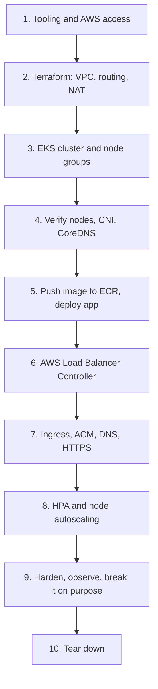

---

## 1. Roadmap and Prerequisites

### What you will learn

By the end you will be able to explain and operate: custom VPC and subnet design; routing, NAT, and VPC endpoints; EKS control-plane and worker-node responsibilities; ALB/NLB integration with Kubernetes Services and Ingress; pod, node, and load-balancer scaling; IAM, network, and workload security; and what really happens when pods, nodes, AZs, or the control plane fail.

### Assumed knowledge

Basic Linux shell, AWS networking vocabulary (VPC, subnet, security group), Docker, and Kubernetes fundamentals (Pods, Deployments, Services). Everything else is explained before it is used.

### Tool ownership: who creates what

Mixing provisioning tools is the most common source of confusing drift. This guide uses a strict split:

| Layer | Tool that owns it | Examples |
|---|---|---|
| AWS infrastructure and IAM | **Terraform** | VPC, subnets, NAT, endpoints, EKS cluster, managed node groups, EKS add-ons, ECR, IAM roles, Pod Identity associations, ACM certificate |
| In-cluster platform software | **Helm** (CLI) | AWS Load Balancer Controller, Metrics Server, Cluster Autoscaler |
| Applications and policies | **kubectl** + manifests | Namespaces, Deployments, Services, Ingress, HPA, PDB, NetworkPolicy |
| AWS resources created *by controllers* | **Kubernetes controllers** (do not manage by hand) | ALB, listeners, target groups, controller-managed security groups |

> [!WARNING]
> ⚠️ Never edit controller-created AWS resources (the ALB, its listeners, target groups) in the console. The controller will revert or fight your change. Change the Kubernetes `Ingress`/`Service` instead.

### Required tools

| Tool | Purpose | Version assumption |
|---|---|---|
| AWS CLI v2 | AWS API access, `aws eks update-kubeconfig` | v2 (current) |
| Terraform | Infrastructure provisioning | `>= 1.10` (needed for S3-native state locking) |
| `kubectl` | Cluster management | Within one minor version of the cluster |
| Helm | Install controllers | Helm 3.x or 4.x (the commands used here are the common subset) |
| Docker (or compatible) | Mirror/build the sample image | Any recent version |
| `jq`, `curl`, `python3` | Helper commands | Any recent version |

<a id="version-assumptions"></a>

### Version assumptions

| Component | Assumption in this guide | How to verify before you start |
|---|---|---|
| Amazon EKS / Kubernetes | **1.35** (standard support until 27 March 2027 per the EKS version calendar I could verify) | `aws eks describe-cluster-versions` and the [EKS version calendar](https://docs.aws.amazon.com/eks/latest/userguide/kubernetes-versions.html). AWS documentation lists **1.36 and 1.35** as the versions currently in standard support (checked 16 October 2026), so 1.36 is also a valid choice; EKS upgrades one minor version at a time. |
| Terraform AWS provider | `~> 6.0` | [Provider registry](https://registry.terraform.io/providers/hashicorp/aws/latest) |
| Terraform EKS module | `terraform-aws-modules/eks/aws` **`~> 21.0`** (uses `name`, `kubernetes_version`, `endpoint_public_access`, `enabled_log_types`; these differ from v20 and earlier) | [Module docs](https://registry.terraform.io/modules/terraform-aws-modules/eks/aws/latest) and [v20 to v21 upgrade guide](https://github.com/terraform-aws-modules/terraform-aws-eks/blob/master/docs/UPGRADE-21.0.md) |
| AWS Load Balancer Controller | **Not pinned blindly.** Chart and app versions move; the IAM policy must match the app version. | Section 12 shows how to read the chart's `APP VERSION` and fetch the matching IAM policy |
| Karpenter | v1.x APIs (`karpenter.sh/v1` `NodePool`, `karpenter.k8s.aws/v1` `EC2NodeClass`) | [Karpenter compatibility matrix](https://karpenter.sh/docs/upgrading/compatibility/) |
| Node AMI | Amazon Linux 2023 (`AL2023_x86_64_STANDARD`). EKS stopped publishing AL2 AMIs for Kubernetes versions after 1.32. | [EKS AMI docs](https://docs.aws.amazon.com/eks/latest/userguide/eks-optimized-ami.html) |

### Step 1: Configure and validate AWS access

**Purpose.** Prove which account and Region your CLI and Terraform will touch, *before* creating anything.

**Prerequisites.** An AWS account you can safely spend money in. Prefer a dedicated sandbox account.

Use IAM Identity Center (SSO) or an assumed role with short-lived credentials. Do not create long-lived access keys for this lab.

```bash
# One-time: configure an SSO profile (interactive)
aws configure sso --profile eks-lab

# Each session
aws sso login --profile eks-lab
export AWS_PROFILE=eks-lab
export AWS_REGION=ap-south-1
export AWS_DEFAULT_REGION=ap-south-1

# Validate account, principal, and Region
aws sts get-caller-identity
aws configure get region
aws ec2 describe-availability-zones \
  --query 'AvailabilityZones[].[ZoneName,ZoneId,State]' --output table
```

**Expected observation.** `get-caller-identity` returns the account ID and the role you expect. The AZ list should include `ap-south-1a`, `ap-south-1b`, `ap-south-1c`, all `available`.

> [!NOTE]
> 📘 **AZ names vs AZ IDs.** `ap-south-1a` in your account may map to a different physical AZ than `ap-south-1a` in someone else's account. For cross-account designs, use AZ IDs (`aps1-az1`, ...). For a single-account lab, names are fine.

**Common errors.** `ExpiredToken` (re-run `aws sso login`); wrong account (check `AWS_PROFILE`); `AccessDenied` (see the next step).

### Step 2: Least-privilege IAM for provisioning

**Concept.** Terraform acts with *your* permissions. Over-broad provisioning roles are a real risk because they can create IAM roles and attach policies (privilege escalation).

**Recommended approach**

1. Use a **dedicated provisioning role** assumed through SSO, separate from day-to-day roles.
2. Allow only the services this stack touches: `ec2` (VPC, subnets, NAT, endpoints, security groups), `eks`, `iam` (roles, policies, OIDC, instance profiles), `kms`, `logs`, `ecr`, `elasticloadbalancing` (read, plus delete during teardown), `acm`, `route53`, `autoscaling` (read), `s3` (the state bucket only).
3. Constrain IAM with a **permissions boundary** and restrict `iam:PassRole` to the EKS service principals.
4. After a successful run, generate a resource-scoped policy from CloudTrail using [IAM Access Analyzer policy generation](https://docs.aws.amazon.com/IAM/latest/UserGuide/access-analyzer-policy-generation.html) and replace the service-level wildcards.

The following is an **illustrative service-scoped starting point for a sandbox**, not a resource-minimal production policy. It is intentionally broad on actions to avoid mid-apply failures, and narrow on `iam:PassRole`:

```json
{
  "Version": "2012-10-17",
  "Statement": [
    {
      "Sid": "StackServices",
      "Effect": "Allow",
      "Action": [
        "ec2:*", "eks:*", "kms:*", "logs:*", "ecr:*",
        "acm:*", "route53:*", "elasticloadbalancing:*",
        "autoscaling:Describe*", "cloudwatch:*", "sts:GetCallerIdentity"
      ],
      "Resource": "*"
    },
    {
      "Sid": "IamRolesScopedByPrefix",
      "Effect": "Allow",
      "Action": [
        "iam:CreateRole", "iam:DeleteRole", "iam:GetRole", "iam:TagRole", "iam:UntagRole",
        "iam:UpdateAssumeRolePolicy", "iam:AttachRolePolicy", "iam:DetachRolePolicy",
        "iam:PutRolePolicy", "iam:DeleteRolePolicy", "iam:GetRolePolicy",
        "iam:ListRolePolicies", "iam:ListAttachedRolePolicies", "iam:ListInstanceProfilesForRole",
        "iam:CreatePolicy", "iam:DeletePolicy", "iam:GetPolicy", "iam:GetPolicyVersion",
        "iam:ListPolicyVersions", "iam:CreatePolicyVersion", "iam:DeletePolicyVersion", "iam:TagPolicy"
      ],
      "Resource": [
        "arn:aws:iam::<AWS_ACCOUNT_ID>:role/eks-ref-*",
        "arn:aws:iam::<AWS_ACCOUNT_ID>:policy/eks-ref-*"
      ]
    },
    {
      "Sid": "PassRoleToEksOnly",
      "Effect": "Allow",
      "Action": "iam:PassRole",
      "Resource": "arn:aws:iam::<AWS_ACCOUNT_ID>:role/eks-ref-*",
      "Condition": { "StringEquals": { "iam:PassedToService": ["eks.amazonaws.com", "ec2.amazonaws.com"] } }
    },
    {
      "Sid": "OidcAndServiceLinkedRoles",
      "Effect": "Allow",
      "Action": [
        "iam:CreateOpenIDConnectProvider", "iam:DeleteOpenIDConnectProvider",
        "iam:GetOpenIDConnectProvider", "iam:TagOpenIDConnectProvider",
        "iam:CreateServiceLinkedRole"
      ],
      "Resource": "*"
    },
    {
      "Sid": "StateBucket",
      "Effect": "Allow",
      "Action": ["s3:ListBucket", "s3:GetObject", "s3:PutObject", "s3:DeleteObject"],
      "Resource": ["arn:aws:s3:::<TF_STATE_BUCKET>", "arn:aws:s3:::<TF_STATE_BUCKET>/*"]
    }
  ]
}
```

> [!NOTE]
> The IAM role names in the Terraform code in this guide start with `eks-ref-` (because `cluster_name = "eks-ref"`), which is what the prefix-scoped statement above relies on. The EKS module also creates roles whose names it derives from the cluster name; if `terraform apply` reports `AccessDenied` on `iam:*`, read which role name it was creating and adjust the prefix rather than widening to `*`.

> [!TIP]
> ✅ **Production insight.** Run Terraform from CI with an OIDC-federated role, require plan review on pull requests, and apply only from the main branch. Humans should not hold standing `iam:*` in production accounts.

### Step 3: Shell variables used throughout this guide

```bash
export AWS_REGION=ap-south-1
export CLUSTER_NAME=eks-ref
export AWS_ACCOUNT_ID=$(aws sts get-caller-identity --query Account --output text)
export ECR_REGISTRY="${AWS_ACCOUNT_ID}.dkr.ecr.${AWS_REGION}.amazonaws.com"
```

---

## 2. Reference Architecture

Every later section follows this one design. Decisions are listed first so you can see what is deliberate.

| Decision | Choice | Why |
|---|---|---|
| Region | `ap-south-1` (Mumbai) | Baseline requirement; has three AZs |
| VPC | Custom `10.0.0.0/16`, DNS support and hostnames on | EKS and VPC endpoints depend on DNS; the default VPC is not designed for this |
| AZs | 3 (`ap-south-1a/b/c`) | Survive a single-AZ failure and keep quorum-like spread |
| Subnet tiers | Public, private (nodes and pods), isolated (database) | Least exposure per tier |
| Worker nodes | **Private subnets only**, no public IPs | Reduce attack surface; egress through NAT or endpoints |
| Compute | EKS **managed node groups**, one per AZ | Simple lifecycle management; per-AZ groups make autoscaling AZ-aware |
| Pod networking | Amazon VPC CNI (pods get VPC IPs) | Native VPC routing, security groups and ALB IP targets work directly |
| Ingress | AWS Load Balancer Controller + internet-facing ALB, **IP target mode** | Native L7 routing, TLS via ACM, health checks, WAF integration |
| Workload IAM | **EKS Pod Identity** (IRSA explained as the alternative) | Simpler trust policy, no per-cluster OIDC provider wiring for new roles |
| Node scaling | Cluster Autoscaler for the lab (Karpenter explained in depth) | Works naturally with per-AZ managed node groups; **never run both on the same capacity** |
| IaC | Terraform | Declarative, reviewable, repeatable |
| API endpoint | Public endpoint restricted to your CIDR **plus** private endpoint | See the callout below |

> [!NOTE]
> 📘 **Control-plane endpoint access and worker-node placement are separate decisions.** The EKS API endpoint (public, private, or both) controls *who can reach the Kubernetes API*. Worker-node subnets control *where EC2 instances live*. Having a public API endpoint does **not** mean nodes belong in public subnets. In this guide nodes are private, and the API endpoint is public-but-IP-restricted only so that you can run `kubectl`/`helm` from your laptop. In a stricter production design, disable the public endpoint and reach the API through a VPN, Direct Connect, or a CI runner inside the VPC.

### What each box in the diagram means

| Category | Style in diagram | Meaning |
|---|---|---|
| EKS control plane | purple | Runs in AWS-owned infrastructure, not on your EC2 instances |
| Resources in your VPC | blue | You provision (Terraform) and pay for them |
| AWS-managed services | grey | Regional services outside your VPC |
| Created by Kubernetes controllers | green | Reconciled by the AWS Load Balancer Controller from `Ingress`/`Service` objects |
| Optional | dashed border | Not required for the first working version |

### Reference architecture diagram

**Diagram A - the traffic path**

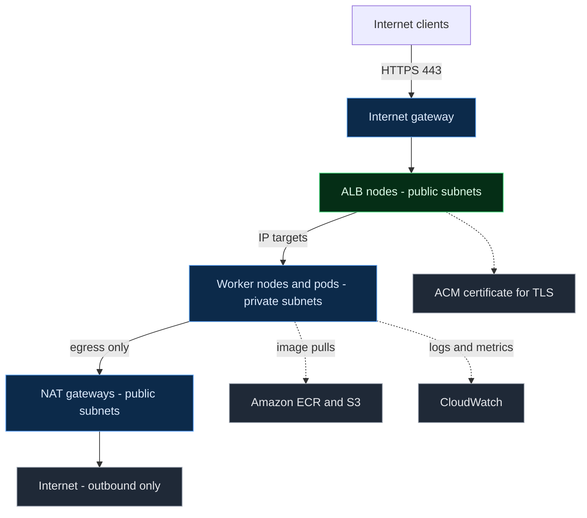

**Diagram B - the control path**

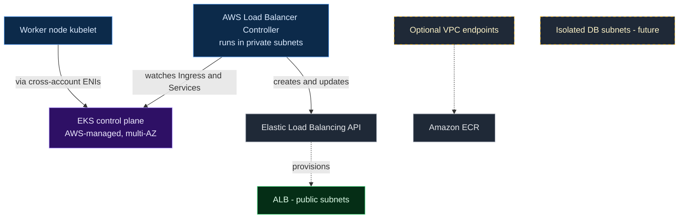

**How to read it**

- The pictures draw each tier **once**. In the real design every subnet tier exists in all three AZs (see the CIDR table in [Section 4.1](#41-cidr-allocation-plan) and the per-AZ node groups in Section 8).
- The **ALB nodes (green)** sit in public subnets but are *created and reconciled by the AWS Load Balancer Controller* (running in your cluster) calling the Elastic Load Balancing API. They are not Terraform resources in this guide.
- The **control plane (purple)** is not an EC2 instance in your subnets. EKS places **cross-account ENIs** in your subnets so the kubelet on each node can reach the API servers and the API servers can reach kubelets (for `exec`, `logs`, webhooks).
- **Dashed items** are optional: database tier (future) and VPC endpoints (reduce NAT dependence; see [Section 5](#5-public-private-and-isolated-subnets)).
- ALB nodes forward to pods in their own AZ in the picture for clarity; with ALB cross-zone load balancing (on by default) any ALB node can reach targets in any AZ.

---

## 3. Architecture Components

For each component: what it is, why it exists, where it lives, who manages it, who it talks to, what happens when it fails, and whether this reference architecture requires it.

### 3.1 AWS network foundation

| Component | What / why | Where it exists | Managed by | Talks to | If it fails | Required? |
|---|---|---|---|---|---|---|
| **Region** (`ap-south-1`) | Geographic area containing AZs; data-residency and latency boundary | AWS global infra | AWS | n/a | Regional outage takes all AZs; see [DR](#19-multi-cluster-and-disaster-recovery) | Yes |
| **Availability Zone** | Isolated failure domain (one or more data centers) | Inside a Region | AWS | Other AZs over low-latency links | Everything in that AZ is lost; design for it | Yes (3 AZs) |
| **VPC** (`10.0.0.0/16`) | Your isolated virtual network. Subnets, route tables, gateways live inside it | Regional | You | Subnets, gateways, endpoints | VPC itself is a regional construct, not a single point of failure in practice, but misconfiguration can break everything | Yes |
| **Subnet** | A CIDR slice of the VPC in exactly **one** AZ | One AZ | You | Route table, NACL | Loss of that AZ removes that subnet | Yes |
| **Route table** | Rules that decide where traffic from a subnet goes | VPC | You | Gateways, endpoints | A wrong route silently black-holes traffic | Yes |
| **Internet gateway (IGW)** | Horizontally scaled gateway enabling two-way internet routing for public subnets | Attached to VPC | AWS (you attach it) | Public subnets | Public subnets lose internet reachability; **not** AZ-specific | Yes |
| **NAT gateway** | Lets private resources initiate outbound IPv4 connections; blocks unsolicited inbound | **One AZ**, in a public subnet, with an Elastic IP | AWS | Private route table, IGW | Private subnets routed to it in that AZ lose internet egress | Yes (or replace with endpoints) |
| **Security group** | Stateful, instance/ENI-level allow-list firewall | VPC, attached to ENIs | You (and controllers) | ENIs, other SGs | Overly tight rules break connectivity; overly loose rules widen blast radius | Yes |
| **Network ACL** | Stateless, subnet-level allow/deny list | Subnet | You | Subnets | Stateless rules often break return traffic if ephemeral ports are blocked | Default allow-all is fine for the lab; add deliberately in production |
| **VPC endpoints** | Private connectivity to AWS services without NAT or IGW | Gateway (S3, DynamoDB) or Interface (ENIs in your subnets) | AWS (you create) | Private subnets | Pulls and API calls that depend on them fail or fall back to NAT | S3 gateway: strongly recommended. Interface endpoints: optional |

### 3.2 Kubernetes and EKS components

| Component | What / why | Where it runs | Managed by | Talks to | If it fails | Required? |
|---|---|---|---|---|---|---|
| **EKS control plane** | Kubernetes API servers, etcd, scheduler, controller managers | AWS-managed infrastructure across multiple AZs, **not in your subnets** | AWS | Nodes via cross-account ENIs; AWS services | Running pods usually keep serving; changes and recovery stop. See [Section 10](#10-high-availability-and-failure-handling) | Yes |
| **Managed node group** | EKS-managed Auto Scaling group of EC2 workers with lifecycle automation (AMI updates, graceful drain) | Your VPC, private subnets | AWS manages lifecycle; you choose config | Control plane, ECR, ALB | Nodes replaced by the ASG; capacity dips until replacement | Yes (one per AZ) |
| **EC2 worker node** | Runs kubelet, container runtime, `aws-node` (CNI), `kube-proxy` | Private subnet | You (patching via AMI rollout) | API server, pods, ECR | Pods on it are rescheduled elsewhere (not instantly) | Yes |
| **Pod** | Smallest scheduling unit; gets a VPC IP from the CNI | On a worker node | Kubernetes | Services, DNS, ALB | Recreated by its controller (ReplicaSet) | Yes |
| **Deployment / ReplicaSet** | Declares desired replicas and rolling-update strategy; ReplicaSet keeps N pods running | Objects in etcd; controllers in the control plane | Kubernetes | API server | If controllers are unavailable (control-plane outage) no replacement happens | Yes |
| **Service** | Stable virtual IP and DNS name for a set of pods (via EndpointSlices) | Rules programmed by `kube-proxy` on each node | Kubernetes | Pods | Stale rules if kube-proxy stops updating | Yes |
| **CoreDNS** | Cluster DNS (`svc.namespace.svc.cluster.local`) | Pods in `kube-system` (EKS managed add-on) | You operate the add-on; AWS publishes versions | API server (watch), upstream resolver (VPC DNS) | In-cluster name resolution fails for new lookups | Yes |
| **Amazon VPC CNI** (`aws-node`) | Assigns VPC IP addresses to pods by attaching ENIs/IPs to nodes | DaemonSet on every node | You operate the add-on | EC2 API, kubelet | New pods cannot get IPs; existing pods keep theirs | Yes |
| **kube-proxy** | Programs node-level rules to implement Services | DaemonSet | You operate the add-on | API server | Service routing stops updating | Yes |
| **EKS Pod Identity Agent** | Delivers temporary IAM credentials to pods per Service Account | DaemonSet on Linux EC2 nodes | You operate the add-on | EKS Auth API | Pods lose the ability to *refresh* AWS credentials | Yes (we use Pod Identity) |

### 3.3 Edge, delivery, identity, scaling, observability

| Component | What / why | Where | Managed by | Talks to | If it fails | Required? |
|---|---|---|---|---|---|---|
| **Amazon ECR** | Private image registry | Regional AWS service | AWS | Nodes (pull), CI (push); layers stored in S3 | New pods cannot pull images; running pods unaffected | Yes |
| **AWS Load Balancer Controller** | Kubernetes controller that creates/updates ALBs and NLBs from `Ingress`/`Service` | Pods in `kube-system` (2 replicas) | You (Helm) | API server, ELB API, EC2 API | **Existing load balancers keep working**; changes stop reconciling | Yes |
| **ALB** | Layer 7 HTTP/HTTPS load balancer (the *data plane*) | ENIs in the public subnets you select | AWS (scales itself) | Targets (pod IPs or node ports) | Multi-AZ by design; AZ loss removes that AZ's nodes only | Yes |
| **NLB** | Layer 4 TCP/UDP/TLS load balancer | Subnets you select | AWS | Targets | Same as above | Optional (TCP workloads) |
| **IAM role + policy** | AWS permissions | Account-global | You | AWS APIs | `AccessDenied` for whoever assumed it | Yes |
| **EKS Pod Identity** | Maps a Kubernetes Service Account to an IAM role via the agent | Association object on the cluster + node agent | AWS/You | EKS Auth API | See agent row | Yes (default) |
| **IRSA** | Maps a Service Account to an IAM role via the cluster's OIDC provider | OIDC provider in IAM + projected token | You | STS | Credentials fail if trust policy or OIDC is wrong | Optional alternative |
| **Metrics Server** | Resource metrics (CPU/memory) for HPA and `kubectl top` | Pod in `kube-system` | You (Helm) | Kubelets, API aggregation layer | HPA cannot compute CPU/memory utilization | Yes for HPA |
| **Cluster Autoscaler** | Scales managed node groups when pods are unschedulable | Pod in `kube-system` | You (Helm) | API server, ASG/EC2 APIs | No node scale up/down; existing nodes unaffected | Yes in the lab (alt: Karpenter) |
| **Karpenter** | Provisions right-sized EC2 capacity directly, no node group per shape | Pods on a small stable node group | You | API server, EC2 API | Same as CA | Optional alternative |
| **HPA** | Adjusts replica count from metrics | Controller in control plane; reads Metrics Server | Kubernetes | Metrics API | Replica count stays fixed | Yes |
| **VPA** | Recommends/sets resource requests | Add-on pods | You | API server | No automated right-sizing | Optional |
| **CloudWatch / Container Insights** | Logs and metrics in AWS | Regional service + agent add-on | AWS/You | Nodes, control plane | Loss of visibility, not of service | Strongly recommended |
| **Prometheus / Grafana** | Kubernetes-native metrics and dashboards | In-cluster or Amazon Managed Service for Prometheus/Grafana | You or AWS | Pods, nodes | Loss of visibility | Optional |

> [!TIP]
> ✅ **Production insight.** The most important column is "If it fails". Notice that most *controllers* (LBC, autoscalers, HPA) failing is **not** a data-plane outage: traffic keeps flowing, but *adaptation* stops. Senior engineers separate "serving" failures from "healing and scaling" failures, and alert on both.

---

## 4. Custom VPC and Subnet Design

**Concept.** A VPC is your private network; subnets carve it into per-AZ address ranges; route tables decide what each subnet can reach. EKS inherits all of its networking behavior from these choices, so we design the network first and the cluster second.

**Why not the default VPC?** The default VPC has public subnets only, a fixed CIDR you did not choose, and no tiering. You cannot cleanly separate load balancers, nodes, and databases, and you cannot plan IP space for pod networking.

### 4.1 CIDR allocation plan

| Subnet | CIDR | Usable IPs\* | Purpose |
|---|---|---|---|
| Public AZ-A | `10.0.0.0/24` | 251 | Internet-facing load balancer nodes, NAT gateway |
| Public AZ-B | `10.0.1.0/24` | 251 | Same |
| Public AZ-C | `10.0.2.0/24` | 251 | Same |
| Private AZ-A | `10.0.16.0/20` | 4,091 | EKS worker nodes **and pods** |
| Private AZ-B | `10.0.32.0/20` | 4,091 | EKS worker nodes and pods |
| Private AZ-C | `10.0.48.0/20` | 4,091 | EKS worker nodes and pods |
| Isolated DB AZ-A | `10.0.64.0/24` | 251 | Future database tier |
| Isolated DB AZ-B | `10.0.65.0/24` | 251 | Future database tier |
| Isolated DB AZ-C | `10.0.66.0/24` | 251 | Future database tier |

\*Usable = total minus the 5 addresses AWS reserves in every subnet.

**Validation.** All ranges lie inside `10.0.0.0/16` (`10.0.0.0`–`10.0.255.255`) and do not overlap:

| Range | Address span |
|---|---|
| Public | `10.0.0.0` – `10.0.2.255` |
| Private A | `10.0.16.0` – `10.0.31.255` |
| Private B | `10.0.32.0` – `10.0.47.255` |
| Private C | `10.0.48.0` – `10.0.63.255` |
| Database | `10.0.64.0` – `10.0.66.255` |

You can verify this mechanically instead of trusting a table:

```bash
python3 - <<'PY'
import ipaddress, itertools
vpc = ipaddress.ip_network("10.0.0.0/16")
subnets = {
  "public-a": "10.0.0.0/24",  "public-b": "10.0.1.0/24",  "public-c": "10.0.2.0/24",
  "private-a": "10.0.16.0/20","private-b": "10.0.32.0/20","private-c": "10.0.48.0/20",
  "db-a": "10.0.64.0/24",     "db-b": "10.0.65.0/24",     "db-c": "10.0.66.0/24",
}
nets = {k: ipaddress.ip_network(v) for k, v in subnets.items()}
assert all(n.subnet_of(vpc) for n in nets.values()), "subnet outside VPC"
for (a, na), (b, nb) in itertools.combinations(nets.items(), 2):
    assert not na.overlaps(nb), f"{a} overlaps {b}"
print("OK: all subnets inside", vpc, "and non-overlapping")
PY
```

### 4.2 AWS-reserved addresses

In every subnet AWS reserves five addresses. For `10.0.16.0/20`: `.0` network address, `.1` VPC router, `.2` Amazon DNS resolver, `.3` reserved for future use, and the last address (broadcast, unsupported but reserved). This is why a `/24` yields 251, not 254.

### 4.3 Why subnet sizing is a Kubernetes problem

With the **Amazon VPC CNI**, every pod gets a real VPC IP address. That has three consequences:

1. **Pod density consumes subnet IPs.** A node does not just use one IP; it holds the IPs for all its pods plus a warm pool.
2. **ENIs limit pods per node.** In the default mode, an instance type supports a fixed number of ENIs and IPs per ENI, which caps max pods. For example, a 3-ENI × 10-IP instance such as `m6i.large` supports 29 pods in default mode (`3 × (10 − 1) + 2`). Use the [EKS max-pods calculator](https://docs.aws.amazon.com/eks/latest/userguide/choose-instance-type.html) guidance for your instance type.
3. **Warm pools hold extra IPs.** By default the CNI keeps a spare ENI's worth of IPs attached for fast pod start. That is useful, but it inflates IP use in small subnets.

Other IP consumers in the same subnets: the EKS cross-account ENIs (EKS requires several free IPs per subnet, with 16 recommended; see the [cluster VPC requirements](https://docs.aws.amazon.com/eks/latest/userguide/network-reqs.html)), interface VPC endpoints, and, in public subnets, ALB nodes (an ALB needs at least 8 free IPs per subnet and uses more as it scales) and NAT gateways.

**Rough sizing check for one private subnet.** `/20` = 4,091 usable IPs. If your busiest AZ runs 40 nodes × up to ~30 pods plus warm pools, you may use roughly 1,500–2,000 IPs. That leaves headroom, but a `/24` private subnet (251 IPs) would be exhausted by ~8 busy nodes.

### 4.4 Prefix delegation and secondary CIDRs

| Technique | What it does | When to use it | Trade-offs |
|---|---|---|---|
| **Prefix delegation** | The CNI assigns `/28` IPv4 prefixes (16 IPs) to ENI slots instead of individual IPs, which raises max pods per node substantially | Dense nodes, many small pods | Needs contiguous `/28` blocks in the subnet (fragmentation risk; use [subnet CIDR reservations](https://docs.aws.amazon.com/vpc/latest/userguide/subnet-cidr-reservation.html)); node `maxPods` must be set consistently; see the [prefix delegation guide](https://docs.aws.amazon.com/eks/latest/userguide/cni-increase-ip-addresses.html) |
| **Secondary CIDR + custom networking** | Associate an extra VPC CIDR (commonly from `100.64.0.0/10`) and put *pods* in subnets from it via `ENIConfig`, leaving the primary range for nodes | The primary CIDR is too small or heavily shared/peered | More moving parts; the primary ENI is no longer used for pods, which reduces pods per node; see [custom networking](https://docs.aws.amazon.com/eks/latest/userguide/cni-custom-network.html) |
| **IPv6 cluster** | Pods get IPv6 addresses, removing IPv4 exhaustion | Greenfield clusters with IPv6-ready dependencies | Not covered here; irreversible choice at cluster creation |

> [!TIP]
> ✅ **Production insight.** This CIDR plan is a **starting point, not a universal recommendation.** Real sizing depends on node count at peak, pods per node, peering/VPN/Transit Gateway overlap with other networks (you cannot route between overlapping CIDRs), number of VPC endpoints, and growth headroom. Decide CIDRs with your network team *before* the first deploy: a VPC's primary CIDR is hard to change later.

### 4.5 Routing: what each subnet can reach

| Subnet type | Destination | Target |
|---|---|---|
| Public | VPC CIDR `10.0.0.0/16` | Local |
| Public | `0.0.0.0/0` | Internet gateway |
| Private | VPC CIDR `10.0.0.0/16` | Local |
| Private | `0.0.0.0/0` | NAT gateway **in the same AZ** (recommended design) |
| Private | S3 prefix list | S3 gateway endpoint (added when the endpoint is attached) |
| Isolated database | VPC CIDR `10.0.0.0/16` | Local |

Isolated database subnets have **no default route**: no internet gateway and no NAT gateway. They can reach other subnets in the VPC (local route) and nothing else. If a database tier ever needs AWS APIs (for example Secrets Manager or KMS), add [VPC endpoints](#53-vpc-endpoints) or explicit connectivity; do not add a NAT route "just to make it work".

### 4.6 One NAT gateway per AZ, or one shared?

| | One NAT per AZ (production recommendation) | Single NAT (learning) |
|---|---|---|
| Resilience | AZ-A failure does not cut egress for AZ-B/C | NAT's AZ failure cuts egress for **all** private subnets |
| Cross-AZ data charges | None for egress (each AZ uses its local NAT) | Nodes in other AZs pay cross-AZ data transfer to reach the NAT |
| Fixed cost | Three NAT gateways hourly | One NAT gateway hourly |
| Complexity | Three route tables | One route table pattern |

The Terraform in this guide uses a `single_nat_gateway` variable: `false` (default) builds three NATs; set `true` for a cheaper lab.

### 4.7 Public IP does not equal internet reachability

A resource needs **all** of these for two-way internet connectivity: a public IPv4/IPv6 address, a route to an internet gateway, security group and NACL rules that allow the traffic, and (for the instance OS) no local firewall blocking it. A public IP alone does nothing.

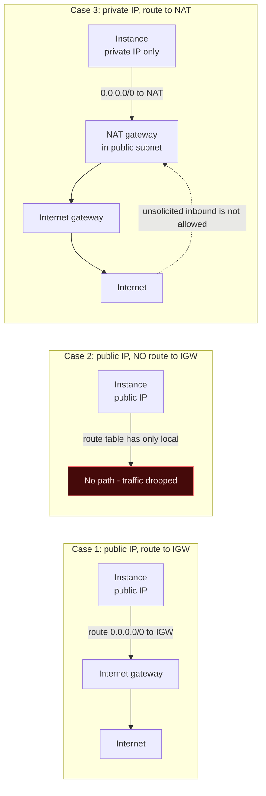

---

## 5. Public, Private and Isolated Subnets

### 5.1 The definitions (and the misconception to avoid)

- A subnet is **public** if its route table has a route to an **internet gateway** (`0.0.0.0/0 → igw-...`). That is the *only* definition. The "auto-assign public IP" setting on a subnet is *not* what makes it public; it only decides whether new instances receive a public address.
- A subnet is **private** if it has *no* route to an internet gateway. It may have a default route to a **NAT gateway** (egress-only to the internet) or no default route at all.
- An **isolated** subnet is private and has no default route of any kind. It can talk only to other VPC subnets and to explicitly attached endpoints.

### 5.2 Questions you should be able to answer

| Question | Answer |
|---|---|
| Why do private worker nodes not need public IPs? | They initiate all connections (image pulls, AWS APIs, control-plane traffic). Inbound user traffic arrives through the load balancer, which forwards to the node/pod **private** IP. |
| How do private nodes download container images? | From ECR (or any registry) over HTTPS. Path: NAT gateway to ECR, **or** interface endpoints for `ecr.api` and `ecr.dkr` plus the S3 gateway endpoint (ECR layers are stored in S3). |
| How do private nodes call AWS APIs (EC2, STS, CloudWatch)? | Through the NAT gateway to the public service endpoints, or through interface VPC endpoints (private IPs in your subnets). |
| Why does an internet-facing load balancer use public subnets? | An internet-facing ALB/NLB gets public-routable addresses in the subnets you choose; those subnets need an IGW route so internet clients can reach the load balancer nodes. |
| Can a load balancer forward to private IPs? | **Yes.** Targets are reached over VPC-local routing (`10.0.0.0/16 → local`). The load balancer and its targets do **not** need to share a subnet, only a routable path and permitting security groups. |
| Why should databases not be publicly reachable? | Public reachability widens the attack surface to the whole internet; databases should accept only from application security groups. |
| What if a private subnet has no NAT gateway (and no endpoints)? | Nodes cannot reach the internet or AWS public API endpoints: image pulls from ECR/registries fail (`ImagePullBackOff`), nodes may fail to join, and controllers cannot call AWS APIs. |
| Can a private EKS cluster run without NAT gateways? | **Yes**, if every required service is reachable through VPC endpoints and every image comes from ECR (or a pull-through cache). See [EKS private cluster requirements](https://docs.aws.amazon.com/eks/latest/userguide/private-clusters.html). |
| When should endpoints replace NAT? | When egress is limited to AWS services, you need strict egress control, NAT data-processing cost is high, or compliance forbids internet egress. Keep NAT if pods also need arbitrary internet destinations (public APIs, package registries). |

> [!NOTE]
> 📘 **Do not assume every image pull needs a NAT gateway.** Pulls from ECR can stay entirely inside AWS using endpoints. Pulls from Docker Hub, `registry.k8s.io`, or `public.ecr.aws` need internet egress (NAT) unless you mirror those images into your own ECR (pull-through cache or manual copy). This guide mirrors the sample app image into ECR so that app pulls are endpoint-compatible.

### 5.3 VPC endpoints

| Type | Services (examples) | How it works | Cost model | Notes |
|---|---|---|---|---|
| **Gateway endpoint** | S3, DynamoDB | A route-table entry (prefix list → endpoint). No ENIs, no security group. | **No hourly or data charge** | Always add the S3 gateway endpoint: ECR image layers come from S3, and this keeps that traffic off the NAT gateway. |
| **Interface endpoint** (AWS PrivateLink) | `ecr.api`, `ecr.dkr`, `sts`, `logs`, `ec2`, `ssm`, `ssmmessages`, `ec2messages`, `eks-auth`, `secretsmanager`, ... | ENIs with private IPs in your subnets; DNS name resolves to them | Hourly **per endpoint per AZ** plus per-GB processed | Deploy in all three AZs for resilience; each ENI consumes a subnet IP |

Requirements for interface endpoints:

- **Private DNS enabled** on the endpoint so the standard service hostname resolves to the endpoint IPs. This requires the VPC to have **DNS support and DNS hostnames enabled** (Terraform below does this).
- A **security group** on the endpoint allowing inbound **TCP 443** from the clients (the VPC CIDR or the node security group).
- Availability varies by service and AZ; confirm each service endpoint exists in `ap-south-1` and in your AZs (`aws ec2 describe-vpc-endpoint-services`).
- Pricing: see [AWS PrivateLink pricing](https://aws.amazon.com/privatelink/pricing/).

If you attach an endpoint policy to the S3 gateway endpoint, make sure it still allows the AWS-owned ECR layer bucket for your Region (see the [ECR S3 endpoint documentation](https://docs.aws.amazon.com/AmazonECR/latest/userguide/vpc-endpoints.html)).

### 5.4 Request flow: a private node pulls an image from ECR

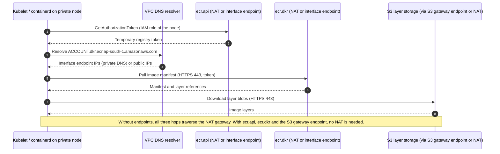

> [!TIP]
> ✅ **Production insight.** Before approving a "private cluster, no NAT" design, list every outbound dependency: ECR, S3, STS, EC2, CloudWatch Logs, EKS Auth (Pod Identity), SSM, Secrets Manager, plus any third-party SaaS/Helm repos. Missing one produces a failure that looks like a hung pod.

---

## 6. Terraform Infrastructure Provisioning

### 6.1 Concept: how this repository is organized

For learning, the code is a **flat root module** split into files by concern. In production you would extract `network` and `eks` into versioned modules and compose them per environment. To keep ownership clear: this section builds the network and ECR; [Section 7](#7-eks-cluster-creation) adds the cluster files to the same root module.

```text
eks-reference/            # a working directory you create; not part of this README's deliverable
├── versions.tf           # Terraform + providers + remote state backend
├── variables.tf          # inputs
├── terraform.tfvars      # your values (no secrets)
├── vpc.tf                # VPC, subnets, routes, IGW, NAT
├── endpoints.tf          # S3 gateway endpoint + optional interface endpoints
├── ecr.tf                # container repository
├── eks.tf                # (Section 7) EKS cluster, add-ons, node groups
├── iam.tf                # (Sections 7, 12, 14) Pod Identity roles
├── acm.tf                # (Section 13) certificate
└── outputs.tf
```

### 6.2 State management, locking, secrets, and safe destruction

Terraform state maps your code to real resources and can contain sensitive values (for example generated passwords, if you ever create any).

| Topic | Practice |
|---|---|
| **Remote state** | Store state in an S3 bucket with versioning, default encryption, and public access fully blocked. Never commit state to Git. |
| **Locking** | Terraform `>= 1.10` supports **S3-native locking** with `use_lockfile = true` (no DynamoDB table needed). Older guides use DynamoDB locking, which is now deprecated in favor of this. |
| **Blast radius** | One state per environment (and often per layer: network, cluster, apps). A single giant state makes every plan slow and every mistake dangerous. |
| **Secrets** | Do not put secrets in `.tfvars` or Terraform code. Reference AWS Secrets Manager/SSM at runtime. Mark outputs `sensitive = true`. Restrict who can read the state bucket: anyone who can read state can read its secrets. |
| **Safe destruction** | Always run `terraform plan -destroy` and read it. Enable EKS `deletion_protection` and S3 bucket versioning in production. Delete controller-created AWS resources (ALBs) *before* `terraform destroy` (see [Section 21](#21-teardown-procedure)). |

Create the state bucket **outside** Terraform (chicken-and-egg). Pick a globally unique name:

```bash
export TF_STATE_BUCKET="<TF_STATE_BUCKET>"   # e.g. eks-ref-tfstate-<AWS_ACCOUNT_ID>-ap-south-1

aws s3api create-bucket \
  --bucket "$TF_STATE_BUCKET" --region ap-south-1 \
  --create-bucket-configuration LocationConstraint=ap-south-1

aws s3api put-bucket-versioning \
  --bucket "$TF_STATE_BUCKET" --versioning-configuration Status=Enabled

aws s3api put-bucket-encryption --bucket "$TF_STATE_BUCKET" \
  --server-side-encryption-configuration \
  '{"Rules":[{"ApplyServerSideEncryptionByDefault":{"SSEAlgorithm":"AES256"}}]}'

aws s3api put-public-access-block --bucket "$TF_STATE_BUCKET" \
  --public-access-block-configuration \
  BlockPublicAcls=true,IgnorePublicAcls=true,BlockPublicPolicy=true,RestrictPublicBuckets=true
```

> [!IMPORTANT]
> Replace `<TF_STATE_BUCKET>` in `versions.tf` below (backend blocks cannot use variables).

### 6.3 `versions.tf`

```hcl
terraform {
  required_version = ">= 1.10"

  required_providers {
    aws = {
      source  = "hashicorp/aws"
      version = "~> 6.0"
    }
    http = {
      source  = "hashicorp/http"
      version = "~> 3.4"
    }
  }

  backend "s3" {
    bucket       = "<TF_STATE_BUCKET>" # replace: the bucket created above
    key          = "eks-reference/ap-south-1/terraform.tfstate"
    region       = "ap-south-1"
    encrypt      = true
    use_lockfile = true # S3-native state locking (Terraform >= 1.10)
  }
}

provider "aws" {
  region = var.region

  default_tags {
    tags = {
      Project     = "eks-reference"
      Environment = var.environment
      ManagedBy   = "terraform"
    }
  }
}
```

### 6.4 `variables.tf` and `terraform.tfvars`

```hcl
variable "region" {
  type    = string
  default = "ap-south-1"
}

variable "environment" {
  type    = string
  default = "lab"
}

variable "cluster_name" {
  type    = string
  default = "eks-ref"
}

variable "kubernetes_version" {
  description = "EKS Kubernetes version. Verify with: aws eks describe-cluster-versions"
  type        = string
  default     = "1.35"
}

variable "vpc_cidr" {
  type    = string
  default = "10.0.0.0/16"
}

variable "azs" {
  type    = list(string)
  default = ["ap-south-1a", "ap-south-1b", "ap-south-1c"]
}

variable "public_subnet_cidrs" {
  type    = list(string)
  default = ["10.0.0.0/24", "10.0.1.0/24", "10.0.2.0/24"]
}

variable "private_subnet_cidrs" {
  type    = list(string)
  default = ["10.0.16.0/20", "10.0.32.0/20", "10.0.48.0/20"]
}

variable "database_subnet_cidrs" {
  type    = list(string)
  default = ["10.0.64.0/24", "10.0.65.0/24", "10.0.66.0/24"]
}

variable "single_nat_gateway" {
  description = "true = one shared NAT (cheap lab, AZ dependency). false = one NAT per AZ (production)."
  type        = bool
  default     = false
}

variable "enable_vpc_endpoints" {
  description = "Create interface endpoints (hourly cost per endpoint per AZ). The S3 gateway endpoint is always created (free)."
  type        = bool
  default     = false
}

variable "api_allowed_cidrs" {
  description = "CIDRs allowed to reach the PUBLIC Kubernetes API endpoint. Never use 0.0.0.0/0."
  type        = list(string)

  validation {
    condition     = !contains(var.api_allowed_cidrs, "0.0.0.0/0") && length(var.api_allowed_cidrs) > 0
    error_message = "Provide specific CIDRs (for example your /32); 0.0.0.0/0 is not allowed."
  }
}

variable "node_instance_types" {
  type    = list(string)
  default = ["m6i.large"]
}

variable "node_min_size" {
  type    = number
  default = 1
}

variable "node_max_size" {
  type    = number
  default = 4
}

variable "node_desired_size" {
  description = "Initial desired nodes PER AZ node group. Autoscalers change this afterwards."
  type        = number
  default     = 1
}

variable "lbc_app_version" {
  description = "AWS Load Balancer Controller release tag (for example vX.Y.Z) whose IAM policy to fetch. Must match the Helm chart's APP VERSION (Section 12)."
  type        = string
}
```

```hcl
# terraform.tfvars  (no secrets here)
api_allowed_cidrs = ["<YOUR_PUBLIC_IP>/32"] # replace: output of  curl -s https://checkip.amazonaws.com
lbc_app_version   = "<LBC_RELEASE_TAG>"     # replace: see Section 12.1 for how to choose it

# Cheaper lab options (uncomment to use):
# single_nat_gateway = true
```

### 6.5 `vpc.tf`

```hcl
locals {
  # { "ap-south-1a" = 0, "ap-south-1b" = 1, "ap-south-1c" = 2 }
  az_index = { for i, az in var.azs : az => i }

  # Which AZs get a NAT gateway
  nat_azs = var.single_nat_gateway ? [var.azs[0]] : var.azs
}

resource "aws_vpc" "main" {
  cidr_block           = var.vpc_cidr
  enable_dns_support   = true # required for EKS and interface endpoints
  enable_dns_hostnames = true # required for EKS and endpoint private DNS

  tags = { Name = "${var.cluster_name}-vpc" }
}

resource "aws_internet_gateway" "main" {
  vpc_id = aws_vpc.main.id
  tags   = { Name = "${var.cluster_name}-igw" }
}

# ---------- Subnets ----------

resource "aws_subnet" "public" {
  for_each = local.az_index

  vpc_id                  = aws_vpc.main.id
  availability_zone       = each.key
  cidr_block              = var.public_subnet_cidrs[each.value]
  map_public_ip_on_launch = false # internet-facing ALB nodes and NAT EIPs get public addresses regardless

  tags = {
    Name                                        = "${var.cluster_name}-public-${each.key}"
    Tier                                        = "public"
    "kubernetes.io/role/elb"                    = "1"      # LBC discovers these for internet-facing LBs
    "kubernetes.io/cluster/${var.cluster_name}" = "shared" # optional with modern LBC; harmless and explicit
  }
}

resource "aws_subnet" "private" {
  for_each = local.az_index

  vpc_id                  = aws_vpc.main.id
  availability_zone       = each.key
  cidr_block              = var.private_subnet_cidrs[each.value]
  map_public_ip_on_launch = false

  tags = {
    Name                                        = "${var.cluster_name}-private-${each.key}"
    Tier                                        = "private"
    "kubernetes.io/role/internal-elb"           = "1" # LBC discovers these for internal LBs
    "kubernetes.io/cluster/${var.cluster_name}" = "shared"
    "karpenter.sh/discovery"                    = var.cluster_name # only used if you adopt Karpenter
  }
}

resource "aws_subnet" "database" {
  for_each = local.az_index

  vpc_id                  = aws_vpc.main.id
  availability_zone       = each.key
  cidr_block              = var.database_subnet_cidrs[each.value]
  map_public_ip_on_launch = false

  tags = {
    Name = "${var.cluster_name}-db-${each.key}"
    Tier = "isolated-database"
  }
}

# ---------- NAT gateways (EIP per NAT) ----------

resource "aws_eip" "nat" {
  for_each = toset(local.nat_azs)

  domain = "vpc"
  tags   = { Name = "${var.cluster_name}-nat-eip-${each.key}" }

  depends_on = [aws_internet_gateway.main]
}

resource "aws_nat_gateway" "main" {
  for_each = toset(local.nat_azs)

  allocation_id = aws_eip.nat[each.key].id
  subnet_id     = aws_subnet.public[each.key].id # NAT lives in a PUBLIC subnet
  tags          = { Name = "${var.cluster_name}-nat-${each.key}" }

  depends_on = [aws_internet_gateway.main]
}

# ---------- Route tables ----------

# Public: one shared table. Local route is implicit; add the default route to the IGW.
resource "aws_route_table" "public" {
  vpc_id = aws_vpc.main.id
  tags   = { Name = "${var.cluster_name}-rt-public" }
}

resource "aws_route" "public_internet" {
  route_table_id         = aws_route_table.public.id
  destination_cidr_block = "0.0.0.0/0"
  gateway_id             = aws_internet_gateway.main.id
}

resource "aws_route_table_association" "public" {
  for_each       = aws_subnet.public
  subnet_id      = each.value.id
  route_table_id = aws_route_table.public.id
}

# Private: one table PER AZ so each AZ routes to the NAT in the SAME AZ
resource "aws_route_table" "private" {
  for_each = local.az_index

  vpc_id = aws_vpc.main.id
  tags   = { Name = "${var.cluster_name}-rt-private-${each.key}" }
}

resource "aws_route" "private_nat" {
  for_each = local.az_index

  route_table_id         = aws_route_table.private[each.key].id
  destination_cidr_block = "0.0.0.0/0"
  nat_gateway_id         = aws_nat_gateway.main[var.single_nat_gateway ? var.azs[0] : each.key].id
}

resource "aws_route_table_association" "private" {
  for_each       = aws_subnet.private
  subnet_id      = each.value.id
  route_table_id = aws_route_table.private[each.key].id
}

# Database: local route only. NO default route, NO NAT, NO IGW.
resource "aws_route_table" "database" {
  vpc_id = aws_vpc.main.id
  tags   = { Name = "${var.cluster_name}-rt-database" }
}

resource "aws_route_table_association" "database" {
  for_each       = aws_subnet.database
  subnet_id      = each.value.id
  route_table_id = aws_route_table.database.id
}
```

> [!NOTE]
> 📘 **Security groups in this stack.** Rather than hand-write node and control-plane security groups, we let the EKS module create the cluster and node security groups with the rules EKS needs (control plane ↔ nodes, node ↔ node, CoreDNS). The AWS Load Balancer Controller then manages ALB security groups and adds the required inbound rule to the node security group. Interface endpoints get their own security group below.

### 6.6 `endpoints.tf`

```hcl
locals {
  interface_endpoint_services = [
    "ecr.api",   # ECR control API (auth token, metadata)
    "ecr.dkr",   # Docker registry API (manifests)
    "sts",       # STS (IRSA/clients that call STS)
    "logs",      # CloudWatch Logs
    "ec2",       # EC2 API (VPC CNI, autoscalers)
    "eks-auth",  # EKS Pod Identity credential retrieval
  ]
}

# Gateway endpoint for S3: free, and keeps ECR layer downloads off the NAT gateway.
resource "aws_vpc_endpoint" "s3" {
  vpc_id            = aws_vpc.main.id
  service_name      = "com.amazonaws.${var.region}.s3"
  vpc_endpoint_type = "Gateway"
  route_table_ids   = [for rt in aws_route_table.private : rt.id]

  tags = { Name = "${var.cluster_name}-vpce-s3" }
}

resource "aws_security_group" "vpce" {
  count = var.enable_vpc_endpoints ? 1 : 0

  name_prefix = "${var.cluster_name}-vpce-"
  description = "Allow HTTPS from the VPC to interface endpoints"
  vpc_id      = aws_vpc.main.id

  ingress {
    description = "HTTPS from VPC"
    from_port   = 443
    to_port     = 443
    protocol    = "tcp"
    cidr_blocks = [var.vpc_cidr]
  }

  tags = { Name = "${var.cluster_name}-vpce-sg" }

  lifecycle {
    create_before_destroy = true
  }
}

resource "aws_vpc_endpoint" "interface" {
  for_each = var.enable_vpc_endpoints ? toset(local.interface_endpoint_services) : toset([])

  vpc_id              = aws_vpc.main.id
  service_name        = "com.amazonaws.${var.region}.${each.key}"
  vpc_endpoint_type   = "Interface"
  subnet_ids          = [for s in aws_subnet.private : s.id] # one ENI per AZ
  security_group_ids  = [aws_security_group.vpce[0].id]
  private_dns_enabled = true

  tags = { Name = "${var.cluster_name}-vpce-${each.key}" }
}
```

> [!IMPORTANT]
> 💰 Each interface endpoint is billed **per endpoint per AZ per hour** plus data processed. Six endpoints × three AZs is eighteen hourly charges. Leave `enable_vpc_endpoints = false` for the lab unless you are specifically exploring private connectivity.

### 6.7 `ecr.tf` and `outputs.tf`

```hcl
resource "aws_ecr_repository" "http_echo" {
  name                 = "demo/http-echo"
  image_tag_mutability = "IMMUTABLE" # tags cannot be overwritten: safer rollouts and provenance
  force_delete         = true        # LAB ONLY: lets terraform destroy remove a non-empty repo

  image_scanning_configuration {
    scan_on_push = true # basic scanning; consider enhanced scanning (Amazon Inspector) in production
  }

  encryption_configuration {
    encryption_type = "AES256" # use KMS with a customer-managed key if your policy requires it
  }
}

resource "aws_ecr_lifecycle_policy" "http_echo" {
  repository = aws_ecr_repository.http_echo.name
  policy = jsonencode({
    rules = [{
      rulePriority = 1
      description  = "Keep the last 20 images"
      selection    = { tagStatus = "any", countType = "imageCountMoreThan", countNumber = 20 }
      action       = { type = "expire" }
    }]
  })
}
```

```hcl
output "vpc_id" {
  value = aws_vpc.main.id
}

output "public_subnet_ids" {
  value = { for az, s in aws_subnet.public : az => s.id }
}

output "private_subnet_ids" {
  value = { for az, s in aws_subnet.private : az => s.id }
}

output "database_subnet_ids" {
  value = { for az, s in aws_subnet.database : az => s.id }
}

output "ecr_repository_url" {
  value = aws_ecr_repository.http_echo.repository_url
}
```

### 6.8 Apply the network layer

```bash
cd eks-reference
terraform init
terraform fmt -recursive
terraform validate
terraform plan -out=network.tfplan     # READ the plan: expect VPC, 9 subnets, route tables, IGW, EIPs, NATs, S3 endpoint, ECR
terraform apply network.tfplan
```

**Verification**

```bash
VPC_ID=$(terraform output -raw vpc_id)

# 1. DNS attributes
aws ec2 describe-vpc-attribute --vpc-id "$VPC_ID" --attribute enableDnsSupport
aws ec2 describe-vpc-attribute --vpc-id "$VPC_ID" --attribute enableDnsHostnames

# 2. Subnets, AZs, CIDRs and tags
aws ec2 describe-subnets --filters Name=vpc-id,Values="$VPC_ID" \
  --query 'Subnets[].{Name:Tags[?Key==`Name`]|[0].Value,AZ:AvailabilityZone,CIDR:CidrBlock}' \
  --output table

# 3. Routes: every private table should point 0.0.0.0/0 at a nat-..., public at igw-..., database at neither
aws ec2 describe-route-tables --filters Name=vpc-id,Values="$VPC_ID" \
  --query 'RouteTables[].{Name:Tags[?Key==`Name`]|[0].Value,Routes:Routes[].[DestinationCidrBlock,GatewayId,NatGatewayId]}' \
  --output json

# 4. NAT gateways should be 'available' and in PUBLIC subnets
aws ec2 describe-nat-gateways --filter Name=vpc-id,Values="$VPC_ID" \
  --query 'NatGateways[].[NatGatewayId,State,SubnetId,AvailabilityZone]' --output table
```

**What to look for.** Private route tables in each AZ target a *different* NAT gateway (unless `single_nat_gateway = true`); the database route table contains only the local route; the S3 gateway endpoint appears in private route tables as a `vpce-...` route.

**Common errors**

| Error | Likely cause | Fix |
|---|---|---|
| `Error acquiring the state lock` | A previous run crashed or a teammate is applying | Confirm nobody is running; remove the stale lock object (`<key>.tflock`) only after verifying |
| `AddressLimitExceeded` | Not enough Elastic IP quota for three NATs | Request an increase or set `single_nat_gateway = true` |
| `InvalidSubnet.Conflict` | CIDR overlaps | Re-run the Python validation in [4.1](#41-cidr-allocation-plan) |
| `AccessDenied` on `ec2:*` | Provisioning role too narrow | Review [Step 2](#step-2-least-privilege-iam-for-provisioning) |

> [!TIP]
> ✅ **Production insight.** Before approving a network change, a senior engineer checks: Are subnets sized for peak pod density? Does every private subnet's default route target a NAT in its own AZ? Do the database subnets truly lack a default route? Are subnet tags present *before* the load balancer controller runs? Is the CIDR non-overlapping with every network you will ever peer with?

---

## 7. EKS Cluster Creation

### 7.1 Concept and dependency sequence

**What we are building.** An EKS cluster whose control plane is run by AWS, attached to your private subnets, with three managed node groups (one per AZ), the core add-ons, and IAM wired for Pod Identity.

**Why it matters.** The order matters: nodes cannot join without the CNI and a working route to the control plane, the controllers cannot work without subnet tags and IAM, and the ALB cannot appear until the controller runs.

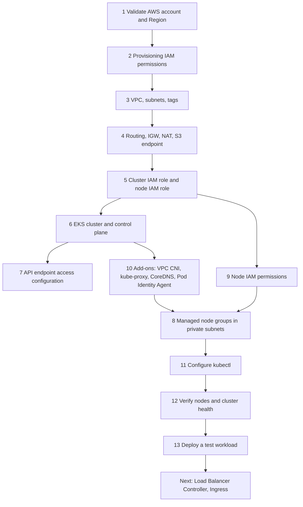

> [!NOTE]
> 📘 In the EKS Terraform module, the VPC CNI and Pod Identity Agent add-ons are marked `before_compute = true` so they exist before nodes start. Without a working CNI, nodes appear but stay `NotReady`.

### 7.2 Who creates what

| Resource | Created by |
|---|---|
| VPC, subnets, routes, NAT, endpoints, ECR repository | **Terraform** (Section 6) |
| EKS cluster resource, cluster IAM role, node IAM role, cluster/node security groups, KMS key, log group, managed node groups, EKS add-ons, access entries | **Terraform** (EKS module in this section) |
| Control plane compute (API servers, etcd), cross-account ENIs placed in your subnets, Auto Scaling groups and launch templates behind node groups, node EC2 instances | **AWS** (driven by the resources above) |
| ALBs, listeners, target groups, controller-managed security groups | **Kubernetes controller** (AWS Load Balancer Controller, [Section 12](#12-installing-the-aws-load-balancer-controller)) |
| Pod IPs (secondary IPs/prefixes on node ENIs) | **VPC CNI** (`aws-node`) |

### 7.3 `eks.tf`

```hcl
locals {
  # One managed node group per AZ: ng-a, ng-b, ng-c
  node_groups = {
    for az, i in local.az_index :
    "ng-${substr(az, -1, 1)}" => { subnet_id = aws_subnet.private[az].id, az = az }
  }
}

module "eks" {
  source  = "terraform-aws-modules/eks/aws"
  version = "~> 21.0"

  name               = var.cluster_name
  kubernetes_version = var.kubernetes_version

  # --- Networking: control-plane ENIs and nodes live in the PRIVATE subnets ---
  vpc_id                   = aws_vpc.main.id
  subnet_ids               = [for s in aws_subnet.private : s.id]
  control_plane_subnet_ids = [for s in aws_subnet.private : s.id]

  # --- API endpoint access (separate decision from node placement) ---
  endpoint_private_access      = true                     # nodes and in-VPC clients reach the API privately
  endpoint_public_access       = true                     # lab convenience: kubectl/helm from your laptop
  endpoint_public_access_cidrs = var.api_allowed_cidrs    # never 0.0.0.0/0

  # --- Access: EKS access entries (no aws-auth ConfigMap) ---
  authentication_mode                      = "API"
  enable_cluster_creator_admin_permissions = true # grants the identity running Terraform cluster-admin via an access entry

  # --- Control-plane logging to CloudWatch (additional cost) ---
  enabled_log_types                      = ["api", "audit", "authenticator", "controllerManager", "scheduler"]
  cloudwatch_log_group_retention_in_days = 30

  deletion_protection = false # LAB: set to true in production

  # --- Core add-ons (managed by EKS) ---
  addons = {
    eks-pod-identity-agent = {
      before_compute = true
    }
    vpc-cni = {
      before_compute = true
      configuration_values = jsonencode({
        enableNetworkPolicy = "true" # native NetworkPolicy support (Section 15)
      })
    }
    kube-proxy = {}
    coredns = {
      configuration_values = jsonencode({
        replicaCount = 3 # one per AZ at minimum for DNS availability
      })
    }
  }

  # --- Managed node groups: private subnets, one per AZ ---
  eks_managed_node_groups = {
    for name, ng in local.node_groups : name => {
      ami_type       = "AL2023_x86_64_STANDARD"
      instance_types = var.node_instance_types
      capacity_type  = "ON_DEMAND"

      min_size     = var.node_min_size
      max_size     = var.node_max_size
      desired_size = var.node_desired_size

      subnet_ids = [ng.subnet_id] # nodes in exactly one AZ per group

      labels = { workload = "general" }

      update_config = { max_unavailable = 1 }

      block_device_mappings = {
        xvda = {
          device_name = "/dev/xvda"
          ebs = {
            volume_size           = 50
            volume_type           = "gp3"
            encrypted             = true
            delete_on_termination = true
          }
        }
      }
    }
  }

  tags = { Cluster = var.cluster_name }
}
```

Append these outputs to `outputs.tf`:

```hcl
output "cluster_name" {
  value = module.eks.cluster_name
}

output "cluster_endpoint" {
  value = module.eks.cluster_endpoint
}

output "node_security_group_id" {
  value = module.eks.node_security_group_id
}
```

**What each important argument does**

| Argument | Why |
|---|---|
| `subnet_ids` / `control_plane_subnet_ids` | Subnets where EKS places cross-account ENIs; also the default node subnets. We pass private subnets so control-plane ENIs are private. |
| `endpoint_private_access = true` | Nodes reach the API through the VPC. If this were `false` while public access is on, nodes would reach the API over the internet path via NAT. Keep it `true`. |
| `endpoint_public_access_cidrs` | Restricts who can reach the public endpoint. Authentication still applies, but never rely on network exposure alone. |
| `authentication_mode = "API"` | Use [EKS access entries](https://docs.aws.amazon.com/eks/latest/userguide/access-entries.html) only. Simpler to audit than the legacy `aws-auth` ConfigMap. |
| one node group per AZ | Lets autoscalers add capacity in a *specific* AZ, which topology spread constraints need. See [Section 8](#8-managed-node-groups-and-cluster-networking). |
| `before_compute = true` | Create CNI and Pod Identity Agent before nodes, avoiding a boot-time deadlock. |

> [!WARNING]
> ⚠️ **Public API endpoint.** It is restricted to your IP in this lab. For production, prefer **private-only** access reached via VPN/Direct Connect or CI runners in the VPC, or at minimum a tightly maintained CIDR allow-list. Note that Terraform itself, and any `helm`/`kubectl` from your laptop, then need a network path to the private endpoint.

### 7.4 Create the cluster

```bash
terraform init -upgrade
terraform validate
terraform plan -out=cluster.tfplan   # review: IAM roles, KMS key, log group, 3 node groups, add-ons
terraform apply cluster.tfplan       # typically takes on the order of 15-25 minutes; read errors as they appear
```

> [!NOTE]
> 📘 The module creates a KMS key for Kubernetes **Secrets envelope encryption** by default and enables key rotation. EKS also encrypts Kubernetes API data at rest by default using AWS-owned keys on current versions; the customer-managed KMS key adds control and auditability. Verify behavior for your version in the [EKS encryption documentation](https://docs.aws.amazon.com/eks/latest/userguide/envelope-encryption.html).

### 7.5 Step-by-step checklist with verification

| # | Step | Prerequisite | Verification | Expected observation | Common errors and troubleshooting |
|---|---|---|---|---|---|
| 1 | Validate account/Region | AWS credentials | `aws sts get-caller-identity` | Expected account and role | Wrong profile: `export AWS_PROFILE=...` |
| 2 | Provisioning IAM | Step 1 | `terraform plan` succeeds | No `AccessDenied` | Read the denied action; add that action narrowly |
| 3 | Create VPC and subnets | Steps 1-2 | [6.8 verification](#68-apply-the-network-layer) | Correct CIDRs/tags | Overlap or quota errors |
| 4 | Routing and NAT | Step 3 | `aws ec2 describe-route-tables ...` | Private default routes target NATs | Missing route means nodes cannot reach ECR/API |
| 5 | Cluster and node IAM roles | Step 2 | `aws iam list-roles --query "Roles[?starts_with(RoleName, 'eks-ref')].RoleName"` | Cluster role and node roles exist | `iam:PassRole` denied: fix the condition/prefix |
| 6 | Create the EKS cluster | Steps 3-5 | `aws eks describe-cluster --name $CLUSTER_NAME --query 'cluster.status'` | `ACTIVE` | `UnsupportedAvailabilityZoneException`: use supported AZs; `InvalidParameterException` on subnets: check subnets belong to the right VPC and have free IPs |
| 7 | API endpoint access | Step 6 | `aws eks describe-cluster --name $CLUSTER_NAME --query 'cluster.resourcesVpcConfig.[endpointPublicAccess,endpointPrivateAccess,publicAccessCidrs]'` | Private `true`; public `true` with your `/32` | `Unable to connect` from laptop: your IP changed; update `api_allowed_cidrs` |
| 8 | Managed node groups | Steps 5-6, add-ons | `aws eks list-nodegroups --cluster-name $CLUSTER_NAME` | `ng-a`, `ng-b`, `ng-c` | `NodeCreationFailure`: see [Section 16](#16-observability-and-troubleshooting) (nodes failing to join) |
| 9 | Node IAM permissions | Step 5 | `aws iam list-attached-role-policies --role-name <NODE_ROLE_NAME>` | Worker-node and ECR pull policies attached (the module's defaults; confirm in your plan) | Nodes `NotReady` or `ImagePullBackOff` often trace to missing policies |
| 10 | VPC CNI and CoreDNS | Step 6 | `aws eks list-addons --cluster-name $CLUSTER_NAME` | `vpc-cni`, `coredns`, `kube-proxy`, `eks-pod-identity-agent` | Add-on `DEGRADED`: `aws eks describe-addon ... --query 'addon.health'` |
| 11 | Configure `kubectl` | Steps 6-7 | see below | Context set | `Unauthorized`: your IAM principal has no access entry |
| 12 | Verify nodes and health | Step 11 | see below | 3 nodes `Ready`, one per AZ | See troubleshooting |
| 13 | Deploy test workload | Step 12 | [Section 9](#9-deploying-the-sample-workload) | Pods `Running` | n/a |

### 7.6 Configure `kubectl` and verify cluster health

```bash
aws eks update-kubeconfig --name "$CLUSTER_NAME" --region "$AWS_REGION"
kubectl config current-context

# Who am I to the cluster? (confirms the access entry works)
kubectl auth whoami            # available on current Kubernetes versions
kubectl auth can-i '*' '*'     # expect "yes" for the cluster creator in this lab

# Nodes: expect three, STATUS Ready, one in each AZ, with private INTERNAL-IPs and no EXTERNAL-IP
kubectl get nodes -o wide -L topology.kubernetes.io/zone,workload

# System pods: aws-node, kube-proxy, coredns (3), eks-pod-identity-agent on every node
kubectl get pods -n kube-system -o wide

# Add-on health from the AWS side
aws eks describe-addon --cluster-name "$CLUSTER_NAME" --addon-name vpc-cni  --query 'addon.[addonVersion,status,health]'
aws eks describe-addon --cluster-name "$CLUSTER_NAME" --addon-name coredns --query 'addon.[addonVersion,status,health]'

# Kubernetes-side API health checks
kubectl get --raw='/readyz?verbose' | tail -n 5
kubectl get events -A --sort-by=.lastTimestamp | tail -n 20
```

**What to look for.** `EXTERNAL-IP` is `<none>` for every node (proof they are private). The `topology.kubernetes.io/zone` column shows `ap-south-1a`, `1b`, `1c`. CoreDNS replicas are spread across nodes.

> [!TIP]
> ✅ **Production insight.** Before approving a cluster, check: nodes are private, the API public CIDR list is minimal (or public access is off), control-plane logs are enabled with a retention policy, access is via access entries mapped to IAM roles (not shared users), add-ons are managed and pinned deliberately, and there is an upgrade plan (see the version calendar in [Section 1](#version-assumptions)).

---

## 8. Managed Node Groups and Cluster Networking

### 8.1 Concept: why one node group per AZ?

A **managed node group** is an EKS-managed Auto Scaling group with automation for node lifecycle: it can roll AMI updates and drains nodes gracefully before termination.

| Layout | Pros | Cons |
|---|---|---|
| **One node group spanning 3 AZs** | Simple; ASG rebalances across AZs | The autoscaler cannot choose *which* AZ gets a new node; AZ rebalancing can terminate nodes; AZ-specific EBS volumes and topology constraints are harder to satisfy |
| **One node group per AZ** (this guide) | Autoscalers add capacity in the right AZ; failure and upgrades are isolated per AZ; works with `balance-similar-node-groups` | More objects to manage; each group needs its own min/max |
| **Multiple groups by workload type** (for example `general`, `memory-optimized`, `spot`) | Isolation, taints, different instance families | More fragmentation, lower bin-packing efficiency, more overhead; use taints/tolerations and labels deliberately |

### 8.2 Networking pieces on the node

- **VPC CNI (`aws-node`)** attaches ENIs to the node and assigns VPC IPs to pods. Pod-to-pod, pod-to-node, and pod-to-ALB traffic is native VPC routing, no overlay.
- **kube-proxy** programs Service rules (ClusterIP/NodePort).
- **CoreDNS** answers cluster DNS; upstream lookups go to the VPC resolver (`.2` address).
- **Pod Identity Agent** serves credentials to pods (see [Section 15](#15-production-security)).

### 8.3 Verify the networking layer

```bash
# Pod IPs should come from the PRIVATE subnet CIDRs (10.0.16.0/20, 10.0.32.0/20, 10.0.48.0/20)
kubectl get pods -A -o wide | head -n 20

# CNI settings currently in effect
kubectl -n kube-system get ds aws-node -o jsonpath='{.spec.template.spec.containers[0].env}' | jq .

# DNS works from inside a pod (creates a short-lived pod; deleted on exit)
kubectl run dnstest --rm -it --restart=Never --image=busybox:1.36 -- nslookup kubernetes.default.svc.cluster.local

# Egress through NAT works from a private node (also exercises DNS)
kubectl run nettest --rm -it --restart=Never --image=busybox:1.36 -- wget -qO- -T 5 https://checkip.amazonaws.com
```

**Expected observation.** `nslookup` resolves the `kubernetes` Service IP. `checkip.amazonaws.com` returns one of your **NAT gateway Elastic IPs**, which proves egress is flowing through NAT and not from a public address on the node. Compare with `aws ec2 describe-nat-gateways`.

> [!NOTE]
> 📘 Pod Security Admission can block `kubectl run` in namespaces that enforce `restricted`. These commands run in `default`, which has no enforcement in this lab. For the `demo` namespace we use stricter settings.

### 8.4 IP exhaustion guardrails

Watch for pods stuck in `ContainerCreating` with `failed to assign an IP address to container` in events: the node or subnet is out of IPs. See the troubleshooting entry in [Section 16](#16-observability-and-troubleshooting). Mitigations: larger subnets, prefix delegation, secondary CIDR, or fewer pods per node. These were introduced in [4.4](#44-prefix-delegation-and-secondary-cidrs).

To check free IPs per subnet:

```bash
aws ec2 describe-subnets --filters Name=vpc-id,Values="$(terraform output -raw vpc_id)" Name=tag:Tier,Values=private \
  --query 'Subnets[].[AvailabilityZone,CidrBlock,AvailableIpAddressCount]' --output table
```

> [!TIP]
> ✅ **Production insight.** Alert when any private subnet drops below roughly 20-25% free IPs, and keep node `maxPods`, CNI warm-pool settings, and subnet size in the same design review.

---

## 9. Deploying the Sample Workload

### 9.1 What we deploy

Two tiny HTTP services from the same image: **`frontend`** (will serve `/app`) and **`api`** (will serve `/api`). Using `hashicorp/http-echo` keeps the image small and lets us focus on platform behavior. Each Deployment gets three replicas, resource requests/limits, probes, topology spread, rolling-update safety, and a PodDisruptionBudget.

> [!NOTE]
> 📘 `http-echo` responds on **any path** with its configured text, which is convenient here: ALB path rules forward `/api/...` to the service **without stripping the prefix** (ALB cannot rewrite paths), and this app does not care. A real app must serve under its prefix or you need a rewrite at another layer.

### 9.2 Mirror the image into ECR

We pull from Docker Hub once (from your machine) and push to ECR, so cluster nodes pull from ECR only (works with NAT *or* endpoints).

```bash
ECR_REPO_URL=$(terraform output -raw ecr_repository_url)   # <AWS_ACCOUNT_ID>.dkr.ecr.ap-south-1.amazonaws.com/demo/http-echo
IMAGE_TAG=1.0.0

aws ecr get-login-password --region "$AWS_REGION" \
  | docker login --username AWS --password-stdin "$ECR_REGISTRY"

# Nodes are linux/amd64 (m6i). Pull that platform explicitly even if your laptop is ARM.
docker pull --platform linux/amd64 hashicorp/http-echo:${IMAGE_TAG}
docker tag  hashicorp/http-echo:${IMAGE_TAG} "${ECR_REPO_URL}:${IMAGE_TAG}"
docker push "${ECR_REPO_URL}:${IMAGE_TAG}"

aws ecr describe-images --repository-name demo/http-echo \
  --query 'imageDetails[].[imageTags,imagePushedAt,imageScanStatus.status]' --output table
```

**Expected observation.** The image appears with tag `1.0.0`; the scan status eventually becomes `COMPLETE`.

> [!WARNING]
> ⚠️ **Supply chain.** In production, build images in CI from source you control, scan them, sign them, and pin by **digest**, not just by tag. Mirroring a public image is a lab shortcut. Replace `${IMAGE_TAG}`-only references with `@sha256:...` once you trust a build.

### 9.3 Namespace

```yaml
# 00-namespace.yaml
apiVersion: v1
kind: Namespace
metadata:
  name: demo
  labels:
    # Pod Security Standards: reject pods that violate the "restricted" profile
    pod-security.kubernetes.io/enforce: restricted
    pod-security.kubernetes.io/enforce-version: latest
    pod-security.kubernetes.io/warn: restricted
    # Make the AWS Load Balancer Controller inject a readiness gate so pods
    # are not considered Ready until their ALB targets are healthy (IP target mode)
    elbv2.k8s.aws/pod-readiness-gate-inject: enabled
```

### 9.4 Deployments, Services, and PodDisruptionBudgets

Replace `<AWS_ACCOUNT_ID>` below with your account ID (or run the `sed` command after the manifest).

```yaml
# 10-app.yaml
apiVersion: apps/v1
kind: Deployment
metadata:
  name: frontend
  namespace: demo
  labels: { app: frontend }
spec:
  replicas: 3
  revisionHistoryLimit: 5
  selector:
    matchLabels: { app: frontend }
  strategy:
    type: RollingUpdate
    rollingUpdate:
      maxSurge: 1
      maxUnavailable: 0           # never drop below desired capacity during a rollout
  template:
    metadata:
      labels: { app: frontend }
    spec:
      terminationGracePeriodSeconds: 45
      automountServiceAccountToken: false   # this app never calls the Kubernetes API
      securityContext:
        runAsNonRoot: true
        runAsUser: 65532
        runAsGroup: 65532
        fsGroup: 65532
        seccompProfile: { type: RuntimeDefault }
      topologySpreadConstraints:
        - maxSkew: 1                           # spread evenly across AZs
          topologyKey: topology.kubernetes.io/zone
          whenUnsatisfiable: DoNotSchedule
          nodeTaintsPolicy: Honor              # ignore tainted/unavailable nodes when computing skew (see Section 10)
          labelSelector:
            matchLabels: { app: frontend }
        - maxSkew: 1                           # and across nodes, as a softer preference
          topologyKey: kubernetes.io/hostname
          whenUnsatisfiable: ScheduleAnyway
          labelSelector:
            matchLabels: { app: frontend }
      tolerations:                             # react to a dead node faster than the 300s default
        - key: node.kubernetes.io/unreachable
          operator: Exists
          effect: NoExecute
          tolerationSeconds: 60
        - key: node.kubernetes.io/not-ready
          operator: Exists
          effect: NoExecute
          tolerationSeconds: 60
      containers:
        - name: app
          image: <AWS_ACCOUNT_ID>.dkr.ecr.ap-south-1.amazonaws.com/demo/http-echo:1.0.0
          args: ["-listen=:5678", "-text=frontend ok"]
          ports:
            - name: http
              containerPort: 5678
          securityContext:
            allowPrivilegeEscalation: false
            readOnlyRootFilesystem: true
            capabilities: { drop: ["ALL"] }
          resources:
            requests: { cpu: 50m, memory: 32Mi }
            limits: { memory: 64Mi }           # memory limit protects the node; no CPU limit to avoid throttling
          startupProbe:                        # gives slow starters time before liveness applies
            httpGet: { path: /, port: http }
            periodSeconds: 2
            failureThreshold: 15
          readinessProbe:                      # controls whether the pod receives traffic
            httpGet: { path: /, port: http }
            periodSeconds: 5
            failureThreshold: 2
          livenessProbe:                       # restarts a wedged container
            httpGet: { path: /, port: http }
            periodSeconds: 10
            failureThreshold: 3
          lifecycle:
            preStop:
              sleep: { seconds: 15 }           # keep serving while the ALB deregisters this target
---
apiVersion: v1
kind: Service
metadata:
  name: frontend
  namespace: demo
spec:
  type: ClusterIP                              # enough for ALB IP target mode (see Section 11)
  selector: { app: frontend }
  ports:
    - name: http
      port: 80
      targetPort: http
---
apiVersion: policy/v1
kind: PodDisruptionBudget
metadata:
  name: frontend
  namespace: demo
spec:
  maxUnavailable: 1                            # voluntary disruptions (drains) may take at most one pod
  selector:
    matchLabels: { app: frontend }
---
apiVersion: apps/v1
kind: Deployment
metadata:
  name: api
  namespace: demo
  labels: { app: api }
spec:
  replicas: 3
  revisionHistoryLimit: 5
  selector:
    matchLabels: { app: api }
  strategy:
    type: RollingUpdate
    rollingUpdate:
      maxSurge: 1
      maxUnavailable: 0
  template:
    metadata:
      labels: { app: api }
    spec:
      terminationGracePeriodSeconds: 45
      automountServiceAccountToken: false
      securityContext:
        runAsNonRoot: true
        runAsUser: 65532
        runAsGroup: 65532
        fsGroup: 65532
        seccompProfile: { type: RuntimeDefault }
      topologySpreadConstraints:
        - maxSkew: 1
          topologyKey: topology.kubernetes.io/zone
          whenUnsatisfiable: DoNotSchedule
          nodeTaintsPolicy: Honor
          labelSelector:
            matchLabels: { app: api }
        - maxSkew: 1
          topologyKey: kubernetes.io/hostname
          whenUnsatisfiable: ScheduleAnyway
          labelSelector:
            matchLabels: { app: api }
      tolerations:
        - key: node.kubernetes.io/unreachable
          operator: Exists
          effect: NoExecute
          tolerationSeconds: 60
        - key: node.kubernetes.io/not-ready
          operator: Exists
          effect: NoExecute
          tolerationSeconds: 60
      containers:
        - name: app
          image: <AWS_ACCOUNT_ID>.dkr.ecr.ap-south-1.amazonaws.com/demo/http-echo:1.0.0
          args: ["-listen=:5678", "-text=api ok"]
          ports:
            - name: http
              containerPort: 5678
          securityContext:
            allowPrivilegeEscalation: false
            readOnlyRootFilesystem: true
            capabilities: { drop: ["ALL"] }
          resources:
            requests: { cpu: 50m, memory: 32Mi }
            limits: { memory: 64Mi }
          startupProbe:
            httpGet: { path: /, port: http }
            periodSeconds: 2
            failureThreshold: 15
          readinessProbe:
            httpGet: { path: /, port: http }
            periodSeconds: 5
            failureThreshold: 2
          livenessProbe:
            httpGet: { path: /, port: http }
            periodSeconds: 10
            failureThreshold: 3
          lifecycle:
            preStop:
              sleep: { seconds: 15 }
---
apiVersion: v1
kind: Service
metadata:
  name: api
  namespace: demo
spec:
  type: ClusterIP
  selector: { app: api }
  ports:
    - name: http
      port: 80
      targetPort: http
---
apiVersion: policy/v1
kind: PodDisruptionBudget
metadata:
  name: api
  namespace: demo
spec:
  maxUnavailable: 1
  selector:
    matchLabels: { app: api }
```

```bash
# Substitute your account ID into the manifest, then apply
sed -i.bak "s/<AWS_ACCOUNT_ID>/${AWS_ACCOUNT_ID}/g" 10-app.yaml

kubectl apply -f 00-namespace.yaml
kubectl apply -f 10-app.yaml

kubectl -n demo rollout status deploy/frontend
kubectl -n demo rollout status deploy/api
```

### 9.5 Verification

```bash
kubectl -n demo get deploy,rs,pods,svc,pdb -o wide

# Replicas should be spread across zones: join pod -> node -> zone
kubectl -n demo get pods -l app=frontend -o custom-columns=POD:.metadata.name,NODE:.spec.nodeName
kubectl get nodes -L topology.kubernetes.io/zone

# EndpointSlices show the pod IPs behind each Service
kubectl -n demo get endpointslices

# In-cluster reachability via the ClusterIP Service
kubectl -n demo run curl --rm -it --restart=Never --image=busybox:1.36 \
  --overrides='{"spec":{"securityContext":{"runAsNonRoot":true,"runAsUser":65532,"seccompProfile":{"type":"RuntimeDefault"}},"containers":[{"name":"curl","image":"busybox:1.36","command":["wget","-qO-","http://frontend"],"securityContext":{"allowPrivilegeEscalation":false,"capabilities":{"drop":["ALL"]}}}]}}'
```

**What to look for.** Three `Running` pods per Deployment, **one per node/zone**, and `frontend ok` returned by the in-cluster request.

**Common errors**

| Symptom | Cause | Where to look |
|---|---|---|
| `ImagePullBackOff` | Wrong account ID/tag, ECR permissions, no NAT/endpoints | `kubectl -n demo describe pod <POD_NAME>` events |
| `forbidden: violates PodSecurity "restricted"` | Missing a required `securityContext` field | The admission error text lists exactly which field |
| Pod `Pending` with a topology message | Not enough nodes in a zone to satisfy `DoNotSchedule` | `kubectl -n demo describe pod <POD_NAME>` (`FailedScheduling`) |

> [!TIP]
> ✅ **Production insight.** A senior engineer reading this manifest checks: requests are realistic (they drive scheduling and HPA), there is a memory limit but deliberate thought about CPU limits, probes check the right thing (not just "process is up"), the rollout cannot reduce capacity (`maxUnavailable: 0`), the PDB and replica count are compatible with node drains (3 replicas with `maxUnavailable: 1` allows exactly one eviction at a time), and the image is pinned and comes from a trusted registry.

---

## 10. High Availability and Failure Handling

### 10.1 Four words that are not synonyms

| Term | Question it answers | Example mechanism here |
|---|---|---|
| **High availability (HA)** | Does the service keep working through *expected* component failures with minimal interruption? | 3 AZs, multiple replicas, health-checked load balancing |
| **Fault tolerance** | Can it continue with *zero* visible impact when a component fails? | Stricter than HA; usually needs redundancy and over-provisioning beyond what most apps pay for |
| **Disaster recovery (DR)** | Can you *restore* service after a large failure (AZ-wide, Region-wide, bad deployment, data corruption)? | Second cluster, replicated data, tested runbooks ([Section 19](#19-multi-cluster-and-disaster-recovery)) |
| **Scalability** | Can it handle *more load* by adding capacity? | HPA, node autoscaling ([Section 14](#14-application-and-cluster-autoscaling)) |

HA protects against failures *inside* a design. DR protects against the loss of the design's assumptions. Scalability is about load, not failure, though capacity headroom is what makes failure survivable.

### 10.2 Part A: control-plane availability

**What AWS provides.** AWS runs the EKS control plane (API servers, etcd, controllers) across multiple Availability Zones in an AWS-managed account, and replaces unhealthy control-plane components for you. See the [EKS service-level agreement](https://aws.amazon.com/eks/sla/) for the commitment. **You do not attach a second independent control plane to a normal EKS cluster to get HA.** There is nothing to add: it is already redundant. What you control is which subnets the control-plane ENIs use, who may reach the endpoint, and everything on the data plane.

**API endpoint access.** Where your clients reach the API (public, private, or both) is an access decision, independent of control-plane redundancy. If your only route to a private-only endpoint is a VPN or bastion, *that* path is your availability risk for administration, not the control plane.

**API availability is not application availability.** The distinction that matters in an incident:

| Situation | What keeps working | What stops or degrades |
|---|---|---|
| **Control-plane / API unavailable** (rare, temporary) | Already-running pods and the kubelet's management of them; node-level Service rules already programmed by `kube-proxy`; the ALB and its already-registered healthy targets; CoreDNS answering for names it already knows; pod traffic between running pods | `kubectl` and all API clients; creating or scaling Deployments; the **scheduler** and **controllers** (a crashed pod is not replaced by a new ReplicaSet pod, a dead node's pods are not evicted and rescheduled); HPA decisions; the AWS Load Balancer Controller reconciling changes; new nodes **joining**; admission webhooks; anything that needs fresh Service/endpoint changes |
| **Worker node failure** | Pods on other nodes; the control plane and the rest of the cluster | Pods on that node become unreachable until the node controller marks them and ReplicaSets create replacements elsewhere |

> [!WARNING]
> ⚠️ **Do not promise "workloads are unaffected during an API outage."** Running workloads often continue to serve, **provided** their dependencies remain healthy: for example, the kubelet can still restart a failed *container* on its own node, but a *node* failure during a control-plane outage will not be healed, and a prolonged outage prevents scaling, rollout, and recovery. Applications that call the Kubernetes API directly (operators, leader election, service discovery) will fail sooner. Credential refresh for AWS access (Pod Identity) and webhooks can also be affected depending on timing and design.

### 10.3 Part B: worker-node and workload availability

Layers, from the outside in:

| Layer | Mechanism | What it buys you |
|---|---|---|
| Multiple AZs | Nodes in three AZs (one managed node group per AZ) | Survive an AZ loss |
| Multiple nodes per AZ | `min_size >= 1` per group, more for headroom | Survive a node loss without waiting for a replacement |
| Pod replicas | `replicas: 3` | Survive a pod/node loss |
| **Spread** | Topology spread constraints (and optionally pod anti-affinity) | Make replicas *land* in different failure domains |
| Disruption control | PodDisruptionBudget | Voluntary disruptions (drains, upgrades) cannot remove too many pods at once |
| Health signals | Startup, readiness, liveness probes | Only ready pods get traffic; wedged containers restart |
| Safe change | Rolling update, `maxUnavailable: 0`, graceful termination | Deployments do not reduce capacity |
| Elasticity | HPA plus node autoscaler | Absorb load and replace lost capacity |

> [!NOTE]
> 📘 **Why three replicas are not automatically highly available.** Replicas are just a count. Without constraints, the scheduler is free to place all three on the same node, or all in one AZ. One node or AZ failure then removes 100% of capacity despite "three replicas." Spread constraints (zone and host) turn a count into an *availability property*. In this guide's manifests the zone constraint is a hard rule (`DoNotSchedule`) and the host constraint is a soft preference.

**Anti-affinity vs topology spread.** `podAntiAffinity` says "do not co-locate with matching pods" (all-or-nothing per domain, awkward when replicas exceed domains). Topology spread constraints say "keep the count per domain within `maxSkew`" and scale naturally with replica count; prefer them for spreading, and use anti-affinity only for hard separation requirements.

**Liveness, readiness, startup.** Readiness decides whether the pod is in the Service endpoints (and, with the readiness gate, whether its ALB target is healthy). Liveness restarts the container. Startup suspends liveness and readiness checks until the app has started. A liveness probe that depends on a downstream service can restart-storm your fleet during a dependency outage; keep liveness checks local and cheap.

**Graceful termination.** On pod deletion, Kubernetes removes the pod from endpoints and sends `SIGTERM`, but ALB deregistration and endpoint propagation are not instantaneous. The manifests use a `preStop` sleep (keep serving while the ALB drains the target) inside a `terminationGracePeriodSeconds` longer than the sleep plus your app's drain time, and the target group deregistration delay is set shorter than that (Section 13).

### 10.4 Tuning the zone spread for real AZ failure

A subtle trap: with `whenUnsatisfiable: DoNotSchedule`, the scheduler enforces `maxSkew` against **all eligible zones**. If AZ-b's nodes are merely `NotReady`, that zone still counts as a domain with 0 pods, so any replacement pod placed in AZ-a or AZ-c would violate the skew and stay `Pending`. That can silently defeat your recovery.

The manifests set **`nodeTaintsPolicy: Honor`** on the zone constraint. With it, nodes carrying taints the pod does not tolerate (including `node.kubernetes.io/unreachable`, `not-ready`, and `unschedulable` from cordoning) are *excluded* from the skew calculation, so a failed or cordoned AZ stops counting as a domain and replacements fill the surviving zones. This field relies on the Kubernetes node-inclusion-policy feature (generally available on current versions; check the [topology spread docs](https://kubernetes.io/docs/concepts/scheduling-eviction/topology-spread-constraints/) for your version). Trade-off: when the AZ returns, pods stay where they are; rebalance with a rollout restart or a tool such as the Descheduler.

> [!NOTE]
> The pod tolerations with `tolerationSeconds: 60` matter too. By default, pods on an unreachable node tolerate the taint for 300 seconds before eviction. Lowering it speeds up replacement for stateless apps; do not lower it blindly for stateful workloads.

### 10.5 Capacity planning for an AZ loss

To survive losing one of three AZs **without degraded capacity**, size so that the *remaining two* AZs can carry peak load:

- If peak load needs **N** pods, run at least **ceil(N × 3 / 2)** pods across three AZs (for example peak needs 6 pods, run 9: 3 per AZ; after losing an AZ, 6 remain).
- Surviving nodes must have **spare CPU/memory/IPs** for *rescheduled* pods, or the node autoscaler must add nodes quickly. Autoscaling takes minutes; headroom is immediate.
- Use PDBs and `maxUnavailable: 0` so upgrades do not eat into this headroom.

### 10.6 Required failure scenario: one AZ fails

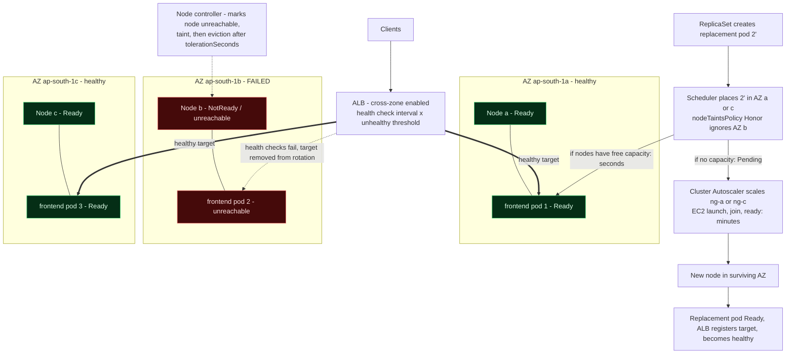

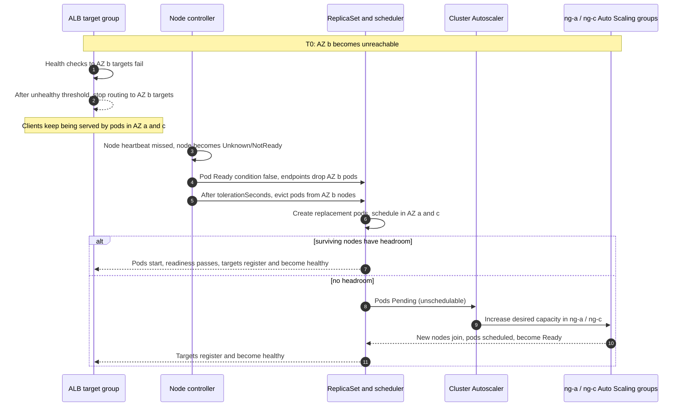

**Key points to be able to explain**

1. **Which nodes become unavailable:** all nodes in AZ-b; the managed node group `ng-b` cannot launch replacements in a failed AZ.
2. **Which pods are affected:** only the replicas on AZ-b nodes; the others are untouched.
3. **How traffic survives:** ALB target health removes the dead targets from rotation; ALB nodes in the surviving AZs keep serving (with cross-zone load balancing, they also still reach targets in any AZ).
4. **How rescheduling works:** the control plane (node lifecycle controller, ReplicaSet controller, scheduler) must be reachable; it evicts, recreates, and places pods.
5. **Replacement capacity:** if surviving nodes have room, pods start in seconds to a couple of minutes. Otherwise the node autoscaler launches EC2 in AZ-a/AZ-c, which takes minutes.
6. **Why spare capacity matters:** until new nodes exist, the remaining two AZs must carry 100% of the traffic on 2/3 of the pods. If that is above their capacity, users see latency and errors during the gap.

### 10.7 Replacing a pod vs replacing a node

| | Replace a failed **pod** on an existing node | Provision a replacement **EC2 node** |
|---|---|---|
| Trigger | Container crash, failed liveness probe, eviction, rollout | Node failure, drain/upgrade, unschedulable pods, scale up |
| Who acts | kubelet (restart) or ReplicaSet + scheduler | ASG/EC2 (managed node group) or Karpenter, plus the autoscaler's decision |
| Speed | Seconds to about a minute (image already cached) | Typically minutes: EC2 launch, bootstrap, join, CNI, image pull |
| Dependencies | Free CPU/memory/IPs on a node; control plane for new pods | EC2 capacity in that AZ, quotas, subnet IPs, IAM, control plane |
| Failure mode | `Pending` for resources or constraints | `InsufficientInstanceCapacity`, quota, subnet exhaustion, join failures |

> [!TIP]
> ✅ **Production insight.** Ask in design review: "If an entire AZ disappears at peak, how many pods are left, where do replacements go, and how long until we are back to full strength?" If the answer relies entirely on autoscaling, you have a minutes-long window of reduced capacity. Consider multiple instance families per node group, Karpenter's flexibility, or modest standing headroom for critical services.

---

## 11. AWS Load Balancers and Kubernetes Networking

This is where most confusion happens, so we build it from first principles.

### 11.1 Eight things that get mixed up

| # | Thing | What it actually is | Kind of object |
|---|---|---|---|
| 1 | **ALB** | A Layer 7 (HTTP/HTTPS/gRPC) load balancer: terminates TLS, evaluates host/path rules, forwards to targets | **AWS resource** (data plane) |
| 2 | **NLB** | A Layer 4 (TCP/UDP/TLS) load balancer: very high throughput, static IPs per AZ, preserves client IP in IP mode | **AWS resource** (data plane) |
| 3 | `Service` type **ClusterIP** | A stable virtual IP and DNS name that load-balances to pod endpoints *inside* the cluster | Kubernetes resource |
| 4 | `Service` type **NodePort** | ClusterIP **plus** a port (30000-32767 by default) opened on *every node* that forwards to the Service | Kubernetes resource |
| 5 | `Service` type **LoadBalancer** | NodePort/ClusterIP **plus** a request to the cloud provider/controller for an external L4 load balancer. With the AWS Load Balancer Controller and `loadBalancerClass: service.k8s.aws/nlb`, that is an **NLB** | Kubernetes resource (asks for an AWS resource) |
| 6 | **Ingress** | A Kubernetes *API object* that declares HTTP routing rules (host, path → Service). **It is not a load balancer.** Nothing happens without a controller. | Kubernetes resource (desired state only) |
| 7 | **AWS Load Balancer Controller** | A controller running **in your cluster** that watches Ingresses/Services and *creates and reconciles* ALBs/NLBs, listeners, target groups, and rules via AWS APIs | Software in your cluster (control plane of the LB) |
| 8 | **The load balancer itself** | The ALB/NLB infrastructure that actually carries user traffic | AWS-managed data plane |

> [!NOTE]
> 📘 **Declarative split.** `Ingress` = *what you want* (desired state). The controller = *the actor that makes AWS match it*. The ALB = *the thing that moves packets*. If the controller is stopped, the existing ALB keeps forwarding traffic; it just stops following your changes. If the ALB is deleted behind the controller's back, the controller recreates it on its next reconcile.

### 11.2 Which components create AWS resources, and which only declare state

| Component | Creates AWS resources? |
|---|---|
| `Ingress`, `Service`, `Deployment` YAML | **No.** Declares desired state in Kubernetes. |
| AWS Load Balancer Controller | **Yes.** ALB/NLB, listeners, rules, target groups, target registrations, managed security groups. |
| ALB/NLB | It *is* the created resource; it forwards traffic. |
| Terraform (this guide) | The VPC, cluster, IAM, certificate, DNS. **Not** the ALB. |

### 11.3 Where load balancers and nodes live

| Load balancer | Subnets | Reachable from | Typical use |
|---|---|---|---|
| **Internet-facing ALB** | **Public** subnets (tag `kubernetes.io/role/elb=1`), at least two AZs | Internet | Public web apps and APIs |
| **Internal ALB** | **Private** subnets (tag `kubernetes.io/role/internal-elb=1`) | VPC, VPN, peered networks | Internal services, private APIs |
| **Internet-facing NLB** | Public subnets (optionally with Elastic IPs for static addresses) | Internet | TCP/UDP services, static IP requirements |
| **Internal NLB** | Private subnets | VPC and connected networks | Internal TCP services, PrivateLink backends |
| **Worker nodes** | **Private** subnets | Only from the load balancer's security group (and internal sources) | Always private in this guide |
| **EKS API endpoint** | Not a load balancer you manage. Public/private endpoint access per cluster config | Per endpoint access config | `kubectl`, CI/CD, controllers |

**Why the load balancer and nodes need not share a subnet.** Everything in the VPC reaches everything else through the implicit `VPC CIDR → local` route. An ALB node in `10.0.0.0/24` talks to a pod at `10.0.16.x` simply because both are inside `10.0.0.0/16`. What *does* need to be right is **security group** permission from the ALB to the target port, and the load balancer must have **at least one subnet per enabled AZ** where targets live (with cross-zone load balancing, it can also reach targets in other AZs).

### 11.4 The two target modes

**Instance target mode** (`alb.ingress.kubernetes.io/target-type: instance`)

- The ALB registers **nodes** (instance IDs) and sends traffic to **node private IP : NodePort**.
- `kube-proxy` on that node then forwards (DNAT) to a pod of the Service, which may be on a **different node**, adding a hop and SNAT.
- The Service **must be `NodePort` or `LoadBalancer` type**; a plain `ClusterIP` Service has no node port to target.
- Health checks hit the **NodePort** on each node, so they validate the node/`kube-proxy`/Service path, not each pod directly.
- Security: node security group must allow the ALB's security group on the **NodePort range** (the controller manages this rule by default).
- Works with any CNI and any compute type that has instances; not available for Fargate.

**IP target mode** (`alb.ingress.kubernetes.io/target-type: ip`) — **used in this guide**

- The ALB registers **pod IPs** directly and sends traffic to **pod IP : containerPort**.
- This requires pod IPs to be routable inside the VPC, which the **VPC CNI** provides (pods get real VPC IPs). It does not work with overlay CNIs whose pod IPs are not VPC-routable.
- The controller keeps targets in sync as pods start, stop, and become ready (it watches EndpointSlices). Health checks go straight to the pod.
- No NodePort hop; fewer hops; client-IP visibility via `X-Forwarded-For`; scales per pod; the **only** mode for Fargate pods.
- The Service can be `ClusterIP` (it is only used to find the pod endpoints).
- Security: pods must accept traffic from the ALB's security group on the container port. By default the controller attaches a shared *backend* security group to the ALB and adds an inbound rule for it on the *node/pod* security group.
- **Pod readiness gates** (the namespace label in Section 9) make Kubernetes wait for ALB target health during rollouts, preventing "pod Ready but target not yet healthy" gaps.

| Consideration | Instance mode | IP mode |
|---|---|---|
| Target | Node IP + NodePort | Pod IP + container port |
| Service type needed | `NodePort`/`LoadBalancer` | `ClusterIP` is enough |
| Extra network hop | Yes (kube-proxy, possibly cross-node) | No |
| Health check validates | Node and NodePort path | The pod itself |
| Target churn | Low (nodes) | Higher (pods come and go) |
| Fargate | No | Yes |
| Requires VPC-routable pod IPs | No | **Yes** |

### 11.5 Required comparison table

| | **ALB** | **NLB** | **ClusterIP** | **NodePort** | **LoadBalancer Service** | **Ingress** |
|---|---|---|---|---|---|---|
| OSI layer / traffic | L7 HTTP, HTTPS, gRPC, WebSocket | L4 TCP, UDP, TLS | L4 (in-cluster virtual IP) | L4 (port on each node) | L4 (external LB) | L7 *rules* (HTTP) |
| Primary purpose | Content-based routing, TLS termination, WAF | Raw TCP/UDP at high throughput, static IPs | Internal service discovery and load balancing | Expose a port on all nodes (building block) | Provision an external L4 load balancer | Declare host/path routing |
| AWS or Kubernetes | **AWS** resource | **AWS** resource | **Kubernetes** | **Kubernetes** | **Kubernetes** (requests an AWS NLB) | **Kubernetes** (requires a controller) |
| Typical exposure | Internet or internal | Internet or internal | Cluster-internal only | Node IPs (private in our design) | Internet or internal via the created NLB | Whatever the controller builds (ALB here) |
| Target behavior | Instances (NodePort) or **pod IPs**, health-checked | Instances or **pod IPs**, health-checked | kube-proxy balances across ready endpoints | kube-proxy to Service endpoints | NLB targets nodes or pod IPs | Routes to Services; controller turns them into target groups |
| Production use | Public/internal web and API traffic | Databases, MQTT, gaming, TLS passthrough, static-IP needs | Service-to-service traffic | Rarely directly; as the backing for instance-mode LBs | TCP-based apps exposed via NLB | The standard way to publish HTTP apps through an ALB |

### 11.6 Required diagrams (one scenario each)

**1. Internet-facing ALB with instance targets**

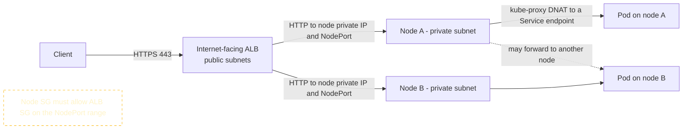

**2. Internet-facing ALB with IP targets (this guide)**

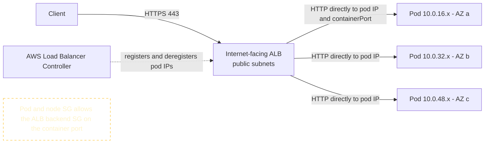

**3. Internal ALB for a private application**

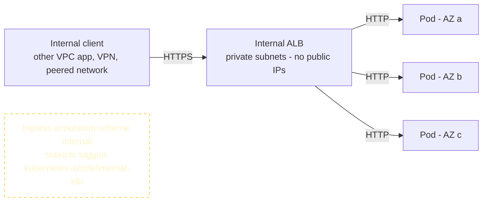

**4. NLB for a TCP-based application**

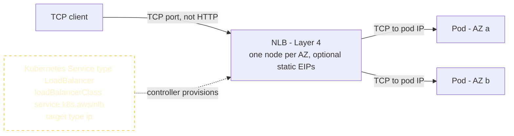

**5. Application accessed internally through a ClusterIP Service**

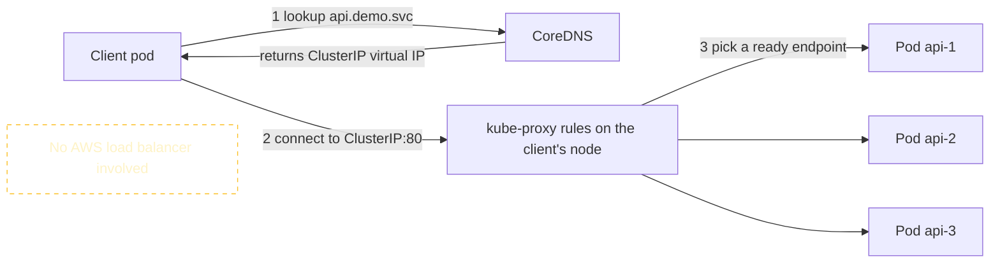

> [!TIP]
> ✅ **Production insight.** Default to **ALB + IP target mode** for HTTP apps on EKS with the VPC CNI, because health checks and rollouts reflect real pod state. Choose **instance mode** when you need a node-level path (for example some network appliance integrations) or cannot make pod IPs routable. Choose **NLB** only when you genuinely need L4 behavior. Both ALB and NLB scale themselves, but their health-check and cross-zone behavior differ: ALB cross-zone is on by default; NLB cross-zone is off by default and billed for cross-AZ transfer if enabled.

---

## 12. Installing the AWS Load Balancer Controller

**Concept.** The controller runs as a Deployment in `kube-system`, uses AWS credentials from **EKS Pod Identity**, and watches `Ingress`, `Service`, and `TargetGroupBinding` objects.

**Official sources of truth** (read these alongside the steps; they change over time):

- [Route internet traffic with the AWS Load Balancer Controller (EKS User Guide)](https://docs.aws.amazon.com/eks/latest/userguide/aws-load-balancer-controller.html)
- [Controller documentation and annotations](https://kubernetes-sigs.github.io/aws-load-balancer-controller/latest/)
- [Controller releases and IAM policy file location](https://github.com/kubernetes-sigs/aws-load-balancer-controller/releases)

### 12.1 Prerequisites

| Prerequisite | Provided by |
|---|---|
| Cluster with the `eks-pod-identity-agent` add-on | [Section 7](#73-ekstf) |
| Subnets tagged for load balancers | [Section 6](#65-vpctf) |
| IAM role + policy for the controller, associated to its Service Account | This section (Terraform) |
| Helm chart repo | This section |
| VPC ID and Region passed to the controller | This section (see the callout) |

> [!NOTE]
> 📘 The EKS module sets the node instance-metadata hop limit to 1, so **pods cannot reach IMDS** (a good security default). The controller normally auto-discovers its Region and VPC via IMDS, so we pass `region` and `vpcId` explicitly to Helm.

### 12.2 Choose a matching controller version and fetch its IAM policy

The controller's IAM policy gains permissions across releases. **Use the policy file from the same release tag as the controller you install**, and do not hand-edit it into something shorter. This is why the guide fetches the official policy instead of reproducing a copy that could go stale.

```bash
helm repo add eks https://aws.github.io/eks-charts
helm repo update eks

# The APP VERSION column is the controller release (for example vX.Y.Z); CHART VERSION is the Helm chart
helm search repo eks/aws-load-balancer-controller --versions | head -n 5
```

Pick a row (normally the newest that your cluster version supports; confirm in the release notes) and note both values:

- Controller release tag → put in `terraform.tfvars` as `lbc_app_version` (for example `"vX.Y.Z"`, including the `v`).
- Chart version → use as `<LBC_CHART_VERSION>` below.

### 12.3 `iam.tf`: Pod Identity roles for the controller (and the Cluster Autoscaler)

```hcl
data "aws_iam_policy_document" "pod_identity_trust" {
  statement {
    effect  = "Allow"
    actions = ["sts:AssumeRole", "sts:TagSession"]

    principals {
      type        = "Service"
      identifiers = ["pods.eks.amazonaws.com"]
    }
  }
}

# ---------- AWS Load Balancer Controller ----------

# Official AWS-maintained policy for exactly the controller release you install
data "http" "lbc_policy" {
  url = "https://raw.githubusercontent.com/kubernetes-sigs/aws-load-balancer-controller/${var.lbc_app_version}/docs/install/iam_policy.json"

  lifecycle {
    postcondition {
      condition     = self.status_code == 200
      error_message = "Could not download the controller IAM policy for ${var.lbc_app_version}. Check the tag exists."
    }
  }
}

resource "aws_iam_policy" "lbc" {
  name   = "${var.cluster_name}-aws-load-balancer-controller"
  policy = data.http.lbc_policy.response_body
}

resource "aws_iam_role" "lbc" {
  name               = "${var.cluster_name}-aws-load-balancer-controller"
  assume_role_policy = data.aws_iam_policy_document.pod_identity_trust.json
}

resource "aws_iam_role_policy_attachment" "lbc" {
  role       = aws_iam_role.lbc.name
  policy_arn = aws_iam_policy.lbc.arn
}

resource "aws_eks_pod_identity_association" "lbc" {
  cluster_name    = module.eks.cluster_name
  namespace       = "kube-system"
  service_account = "aws-load-balancer-controller"
  role_arn        = aws_iam_role.lbc.arn
}

# ---------- Cluster Autoscaler (used in Section 14) ----------

data "aws_iam_policy_document" "cluster_autoscaler" {
  statement {
    sid    = "Read"
    effect = "Allow"
    actions = [
      "autoscaling:DescribeAutoScalingGroups",
      "autoscaling:DescribeAutoScalingInstances",
      "autoscaling:DescribeLaunchConfigurations",
      "autoscaling:DescribeScalingActivities",
      "autoscaling:DescribeTags",
      "ec2:DescribeImages",
      "ec2:DescribeInstanceTypes",
      "ec2:DescribeLaunchTemplateVersions",
      "ec2:GetInstanceTypesFromInstanceRequirements",
      "eks:DescribeNodegroup",
    ]
    resources = ["*"]
  }

  statement {
    sid       = "ScaleOnlyThisClustersGroups"
    effect    = "Allow"
    actions   = ["autoscaling:SetDesiredCapacity", "autoscaling:TerminateInstanceInAutoScalingGroup"]
    resources = ["*"]

    condition {
      test     = "StringEquals"
      variable = "aws:ResourceTag/k8s.io/cluster-autoscaler/${module.eks.cluster_name}"
      values   = ["owned"]
    }
  }
}

resource "aws_iam_policy" "cluster_autoscaler" {
  name   = "${var.cluster_name}-cluster-autoscaler"
  policy = data.aws_iam_policy_document.cluster_autoscaler.json
}

resource "aws_iam_role" "cluster_autoscaler" {
  name               = "${var.cluster_name}-cluster-autoscaler"
  assume_role_policy = data.aws_iam_policy_document.pod_identity_trust.json
}

resource "aws_iam_role_policy_attachment" "cluster_autoscaler" {
  role       = aws_iam_role.cluster_autoscaler.name
  policy_arn = aws_iam_policy.cluster_autoscaler.arn
}

resource "aws_eks_pod_identity_association" "cluster_autoscaler" {
  cluster_name    = module.eks.cluster_name
  namespace       = "kube-system"
  service_account = "cluster-autoscaler"
  role_arn        = aws_iam_role.cluster_autoscaler.arn
}
```

```bash
terraform plan -out=iam.tfplan   # expect: 2 policies, 2 roles, 2 attachments, 2 Pod Identity associations
terraform apply iam.tfplan

# Verify the associations exist
aws eks list-pod-identity-associations --cluster-name "$CLUSTER_NAME" \
  --query 'associations[].[namespace,serviceAccount,associationId]' --output table
```

> [!NOTE]
> 📘 **IRSA instead of Pod Identity.** IRSA uses the cluster's OIDC provider and a role trust policy that references `system:serviceaccount:<namespace>:<name>`, plus an `eks.amazonaws.com/role-arn` annotation on the Service Account. Choose IRSA when you need Fargate or Windows nodes (Pod Identity targets Linux EC2 nodes), or when an existing tool/SDK flow requires it. Pod Identity is simpler: the trust policy is cluster-independent, and role reuse across clusters is easier. Credentials are injected when a pod **starts**, so restart pods that existed before you created an association.

### 12.4 Install with Helm

```bash
VPC_ID=$(terraform output -raw vpc_id)

helm upgrade --install aws-load-balancer-controller eks/aws-load-balancer-controller \
  --namespace kube-system \
  --version "<LBC_CHART_VERSION>" \
  --set clusterName="$CLUSTER_NAME" \
  --set region="$AWS_REGION" \
  --set vpcId="$VPC_ID" \
  --set serviceAccount.create=true \
  --set serviceAccount.name=aws-load-balancer-controller \
  --set replicaCount=2
```

> [!WARNING]
> ⚠️ Helm installs the chart's CRDs only on first install. When you **upgrade** the chart later, apply updated CRDs manually as described in the [chart README](https://github.com/kubernetes-sigs/aws-load-balancer-controller/tree/main/helm/aws-load-balancer-controller), or new fields will be silently missing.

### 12.5 Verify the controller

```bash
kubectl -n kube-system rollout status deploy/aws-load-balancer-controller
kubectl -n kube-system get deploy,pods -l app.kubernetes.io/name=aws-load-balancer-controller -o wide

kubectl get ingressclass                # expect an IngressClass named "alb"
kubectl get crd | grep -i elbv2         # expect ingressclassparams and targetgroupbindings CRDs

# Logs: look for startup without credential or VPC discovery errors
kubectl -n kube-system logs deploy/aws-load-balancer-controller --tail=50

# Confirm Pod Identity credentials are actually injected into the pods
kubectl -n kube-system get pod -l app.kubernetes.io/name=aws-load-balancer-controller \
  -o jsonpath='{.items[0].spec.containers[0].env[?(@.name=="AWS_CONTAINER_CREDENTIALS_FULL_URI")].value}'; echo
```

**What to look for.** Two replicas `Running` on different nodes; the Pod Identity environment variable is present (a non-empty URI); no `AccessDenied` or "failed to get VPC ID" in the logs.

### 12.6 Behavior you must understand

- **Subnet discovery.** For an internet-facing ALB the controller picks subnets tagged `kubernetes.io/role/elb=1`; for internal, `kubernetes.io/role/internal-elb=1`. If more than one qualifying subnet exists in an AZ, it chooses one deterministically (lexicographic by subnet ID), so keep exactly one tagged subnet per AZ per role. The cluster tag `kubernetes.io/cluster/<name>` is optional on current controller versions but is still a good isolation tool when several clusters share a VPC. Override with `alb.ingress.kubernetes.io/subnets` if needed. Each subnet needs free IPs (an ALB wants at least 8).
- **Security groups.** By default the controller creates a *frontend* security group for the ALB (inbound from `alb.ingress.kubernetes.io/inbound-cidrs`, default open to the world for internet-facing) and a shared *backend* security group attached to the ALB, then adds an inbound rule to the **node/pod security group** allowing the backend group to reach the target ports. To supply your own, use `alb.ingress.kubernetes.io/security-groups`. The controller needs exactly one cluster-tagged security group on the target ENIs to edit; the EKS module's node security group is tagged for this, so do **not** also attach the EKS-created *cluster* security group to nodes (see troubleshooting).
- **Target registration.** For IP mode the controller creates a `TargetGroupBinding` per Service port and registers each ready pod IP; it deregisters on pod termination.
- **Health checks.** The ALB performs its own HTTP health checks per target group (configured by Ingress annotations); this is **independent of** Kubernetes readiness/liveness probes. The readiness gate bridges the two during rollouts.
- **Where to look when it fails:** the controller logs and `kubectl describe ingress`. The table below lists the usual culprits.

| Reconciliation failure | Typical log or event text | Cause | Fix |
|---|---|---|---|
| Missing permission | `AccessDenied` / `UnauthorizedOperation` | Policy version older than the controller, or Pod Identity not applied | Re-fetch the matching policy; restart controller pods |
| No subnets | `couldn't auto-discover subnets` | Missing or duplicated role tags; wrong cluster tags | Fix tags ([6.5](#65-vpctf)) |
| Multiple security groups | `expected exactly one securityGroup tagged with kubernetes.io/cluster/<name>` | ENIs have more than one cluster-tagged group | Use only the module's node SG on nodes; remove the extra tag/attachment |
| Certificate not found | `CertificateNotFound` | ACM ARN in the wrong Region or account | Use an ACM certificate in `ap-south-1` |
| Webhook failures when applying Services/Ingress | `failed calling webhook "mservice.elbv2.k8s.aws"` | Control plane cannot reach the controller webhook (port 9443) because the node security group blocks it | Allow the cluster security group to node SG on TCP 9443 (`node_security_group_additional_rules` in the module if your module version does not already include it) |
| `IngressClass` missing | Ingress ignored with no events | Controller not installed or `ingressClassName` mismatch | Install controller; use `ingressClassName: alb` |

> [!TIP]
> ✅ **Production insight.** Run at least two controller replicas spread across zones with a PDB, pin the chart version, upgrade the controller and its IAM policy together, and alert on controller restarts and on `TargetGroupBinding` errors. Remember: a controller outage does not drop traffic but it blocks every change, including *removal* of a bad target.

---

## 13. HTTPS, TLS, DNS and the End-to-End Request Flow

**What we are building.** A public HTTPS endpoint, `https://<DOMAIN_NAME>`, backed by an internet-facing ALB that the controller creates from an `Ingress`. Traffic is routed by path (`/api` → `api`, `/app` → `frontend`) and forwarded straight to pod IPs.

### 13.1 Prerequisites and placeholders

You need a public domain with a Route 53 **public hosted zone** in your account. If you do not have a domain, you can still complete the lab over HTTP by removing the HTTPS-related annotations (listed in the manifest comments) and testing against the ALB's DNS name.

| Placeholder | Meaning | Where to replace it |
|---|---|---|
| `<DOMAIN_NAME>` | The hostname users visit, for example `app.example.com` | `terraform.tfvars` (`domain_name`), `20-ingress.yaml` (`host:`), `curl` examples |
| `<ROUTE53_ZONE_NAME>` | Your hosted zone, for example `example.com` | `terraform.tfvars` (`route53_zone_name`), DNS CLI command |
| `<ACM_CERTIFICATE_ARN>` | ARN of the validated ACM certificate (Terraform output below) | `20-ingress.yaml` annotation `alb.ingress.kubernetes.io/certificate-arn` |
| `<AWS_ACCOUNT_ID>` | Your 12-digit account ID | Image references in `10-app.yaml` (already shown in Section 9) |

> [!WARNING]
> 🔐 Never put real secrets, private keys, or credentials into manifests or Terraform variables. ACM keeps the certificate private key; you never handle it.

### 13.2 ACM certificate with DNS validation (`acm.tf`)

ACM public certificates are free, auto-renew when DNS validation records remain in place, and must be in the **same Region as the ALB** (`ap-south-1`).

```hcl
variable "domain_name" {
  description = "Public hostname for the application, e.g. app.example.com"
  type        = string
}

variable "route53_zone_name" {
  description = "Existing public Route 53 hosted zone, e.g. example.com"
  type        = string
}

data "aws_route53_zone" "this" {
  name         = var.route53_zone_name
  private_zone = false
}

resource "aws_acm_certificate" "app" {
  domain_name       = var.domain_name
  validation_method = "DNS"

  lifecycle {
    create_before_destroy = true
  }
}

resource "aws_route53_record" "acm_validation" {
  for_each = {
    for dvo in aws_acm_certificate.app.domain_validation_options : dvo.domain_name => {
      name   = dvo.resource_record_name
      record = dvo.resource_record_value
      type   = dvo.resource_record_type
    }
  }

  allow_overwrite = true
  zone_id         = data.aws_route53_zone.this.zone_id
  name            = each.value.name
  type            = each.value.type
  ttl             = 60
  records         = [each.value.record]
}

resource "aws_acm_certificate_validation" "app" {
  certificate_arn         = aws_acm_certificate.app.arn
  validation_record_fqdns = [for r in aws_route53_record.acm_validation : r.fqdn]
}

output "acm_certificate_arn" {
  value = aws_acm_certificate_validation.app.certificate_arn
}
```

```hcl
# add to terraform.tfvars
domain_name       = "<DOMAIN_NAME>"
route53_zone_name = "<ROUTE53_ZONE_NAME>"
```

```bash
terraform plan -out=acm.tfplan && terraform apply acm.tfplan
export ACM_CERTIFICATE_ARN=$(terraform output -raw acm_certificate_arn)
aws acm describe-certificate --certificate-arn "$ACM_CERTIFICATE_ARN" --query 'Certificate.Status'   # expect ISSUED
```

### 13.3 The Ingress (`20-ingress.yaml`)

```yaml
apiVersion: networking.k8s.io/v1
kind: Ingress
metadata:
  name: web
  namespace: demo
  annotations:
    # --- Placement and target mode ---
    alb.ingress.kubernetes.io/scheme: internet-facing       # public subnets (role/elb tag)
    alb.ingress.kubernetes.io/target-type: ip               # register pod IPs directly
    alb.ingress.kubernetes.io/ip-address-type: ipv4

    # --- HTTPS listener (remove these 4 lines for an HTTP-only lab) ---
    alb.ingress.kubernetes.io/listen-ports: '[{"HTTP":80},{"HTTPS":443}]'
    alb.ingress.kubernetes.io/ssl-redirect: "443"           # 80 redirects to 443
    alb.ingress.kubernetes.io/certificate-arn: <ACM_CERTIFICATE_ARN>   # REPLACE
    alb.ingress.kubernetes.io/ssl-policy: ELBSecurityPolicy-TLS13-1-2-2021-06

    # --- Target group health checks (ALB health checks, NOT Kubernetes probes) ---
    alb.ingress.kubernetes.io/healthcheck-protocol: HTTP
    alb.ingress.kubernetes.io/healthcheck-path: /
    alb.ingress.kubernetes.io/healthcheck-interval-seconds: "15"
    alb.ingress.kubernetes.io/healthcheck-timeout-seconds: "5"
    alb.ingress.kubernetes.io/healthy-threshold-count: "2"
    alb.ingress.kubernetes.io/unhealthy-threshold-count: "2"
    alb.ingress.kubernetes.io/success-codes: "200"

    # --- Draining and hygiene ---
    alb.ingress.kubernetes.io/target-group-attributes: deregistration_delay.timeout_seconds=30
    alb.ingress.kubernetes.io/load-balancer-attributes: routing.http.drop_invalid_header_fields.enabled=true,idle_timeout.timeout_seconds=60
    alb.ingress.kubernetes.io/tags: Environment=lab,Project=eks-reference

    # --- Source restriction (explicit; tighten for non-public apps) ---
    alb.ingress.kubernetes.io/inbound-cidrs: 0.0.0.0/0

    # --- Optional: AWS WAF (additional cost) ---
    # alb.ingress.kubernetes.io/wafv2-acl-arn: <WAF_WEB_ACL_ARN>
spec:
  ingressClassName: alb
  rules:
    - host: <DOMAIN_NAME>                                   # REPLACE (host-based routing)
      http:
        paths:
          - path: /api                                      # path-based routing
            pathType: Prefix
            backend:
              service:
                name: api
                port: { number: 80 }
          - path: /app
            pathType: Prefix
            backend:
              service:
                name: frontend
                port: { number: 80 }
```

```bash
sed -i.bak "s|<ACM_CERTIFICATE_ARN>|${ACM_CERTIFICATE_ARN}|; s|<DOMAIN_NAME>|app.example.com|" 20-ingress.yaml   # set YOUR hostname
kubectl apply -f 20-ingress.yaml
```

> [!NOTE]
> 📘 **What happens to unmatched requests.** With only host+path rules and no default backend, the controller configures the ALB listener's default action to return **HTTP 404**. A request to `https://<DOMAIN_NAME>/` therefore returns the ALB's 404, not your app. Add a `/` rule or a `defaultBackend` if you want one.

**Security-group requirements (IP target mode)**

| Direction | From → To | Port | Managed by |
|---|---|---|---|
| Inbound | Internet (`inbound-cidrs`) → ALB frontend SG | 80, 443 | Controller (from annotations) |
| Inbound | ALB backend SG → pod/node SG (the cluster-tagged node SG) | Container port `5678` | Controller adds the rule automatically |
| Outbound | Pod → NAT/endpoints | 443 | Node SG default egress |

### 13.4 Verify the ALB, listeners, rules, and targets

```bash
kubectl -n demo get ingress web
kubectl -n demo describe ingress web          # look at Events: "SuccessfullyReconciled" vs errors

ALB_DNS=$(kubectl -n demo get ingress web -o jsonpath='{.status.loadBalancer.ingress[0].hostname}')
echo "$ALB_DNS"

LB_ARN=$(aws elbv2 describe-load-balancers \
  --query "LoadBalancers[?DNSName=='${ALB_DNS}'].LoadBalancerArn" --output text)

# Scheme, state, and which AZs/subnets the ALB lives in (should be the three PUBLIC subnets)
aws elbv2 describe-load-balancers --load-balancer-arns "$LB_ARN" \
  --query 'LoadBalancers[0].[Scheme,State.Code,AvailabilityZones[].[ZoneName,SubnetId]]'

# Listeners and rules
aws elbv2 describe-listeners --load-balancer-arn "$LB_ARN" \
  --query 'Listeners[].[ListenerArn,Port,Protocol]' --output table
HTTPS_LISTENER=$(aws elbv2 describe-listeners --load-balancer-arn "$LB_ARN" \
  --query "Listeners[?Port==\`443\`].ListenerArn" --output text)
aws elbv2 describe-rules --listener-arn "$HTTPS_LISTENER" \
  --query 'Rules[].[Priority,Conditions[].Values[],Actions[].Type]' --output json

# Target groups and the health of each target (pod IPs)
aws elbv2 describe-target-groups --load-balancer-arn "$LB_ARN" \
  --query 'TargetGroups[].[TargetGroupName,TargetType,Port,TargetGroupArn]' --output table
for TG in $(aws elbv2 describe-target-groups --load-balancer-arn "$LB_ARN" --query 'TargetGroups[].TargetGroupArn' --output text); do
  aws elbv2 describe-target-health --target-group-arn "$TG" \
    --query 'TargetHealthDescriptions[].[Target.Id,Target.Port,TargetHealth.State,TargetHealth.Reason]' --output table
done

# Compare target IPs with pod IPs
kubectl -n demo get pods -o wide
```

**What to look for.** The ALB `Scheme` is `internet-facing` and it spans three public subnets. There are two target groups of type `ip`; each lists three targets whose IPs match the pod IPs, in state `healthy`. (State `initial` for a minute after creation is normal.)

### 13.5 DNS: point the hostname at the ALB

The ALB was created by the controller, so Terraform does not know its DNS name. Create an alias record (free for alias to ALB) manually, or automate it with the optional [ExternalDNS](https://github.com/kubernetes-sigs/external-dns) controller (additional component, needs its own IAM).

```bash
ZONE_ID=$(aws route53 list-hosted-zones-by-name --dns-name "<ROUTE53_ZONE_NAME>" \
  --query 'HostedZones[0].Id' --output text | sed 's|/hostedzone/||')
ALB_ZONE_ID=$(aws elbv2 describe-load-balancers --load-balancer-arns "$LB_ARN" \
  --query 'LoadBalancers[0].CanonicalHostedZoneId' --output text)

cat > dns-change.json <<JSON
{
  "Changes": [{
    "Action": "UPSERT",
    "ResourceRecordSet": {
      "Name": "<DOMAIN_NAME>",
      "Type": "A",
      "AliasTarget": {
        "HostedZoneId": "${ALB_ZONE_ID}",
        "DNSName": "dualstack.${ALB_DNS}",
        "EvaluateTargetHealth": true
      }
    }
  }]
}
JSON

aws route53 change-resource-record-sets --hosted-zone-id "$ZONE_ID" --change-batch file://dns-change.json
```

Test, first bypassing DNS propagation, then via DNS:

```bash
# Bypass DNS: force the hostname to one ALB IP (keeps correct SNI and Host header)
curl -sS -i --resolve "<DOMAIN_NAME>:443:$(dig +short "$ALB_DNS" | head -n1)" https://<DOMAIN_NAME>/app
curl -sS -i --resolve "<DOMAIN_NAME>:443:$(dig +short "$ALB_DNS" | head -n1)" https://<DOMAIN_NAME>/api

# After DNS propagates
curl -sS -i https://<DOMAIN_NAME>/app    # expect: HTTP/2 200 and body "frontend ok"
curl -sS -i https://<DOMAIN_NAME>/api    # expect: HTTP/2 200 and body "api ok"
curl -sS -i http://<DOMAIN_NAME>/app     # expect: 301 redirect to https
```

**Host-based routing.** Add a second `rules` entry with another `host:` (for example `api.<DOMAIN_NAME>`), pointing at the `api` Service. The ALB evaluates **host** conditions, then **path** conditions, by rule priority. Your ACM certificate must cover every hostname (use `subject_alternative_names` or a wildcard), and each hostname needs a DNS record. With one shared ALB for many apps, use `alb.ingress.kubernetes.io/group.name` so several Ingress objects merge into a single ALB (and explicit `group.order` when rule precedence matters).

### 13.6 The request, hop by hop

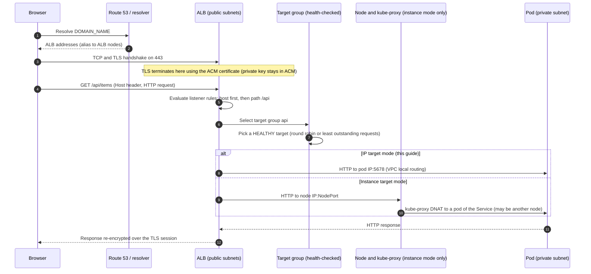

1. **DNS resolution.** The client resolves `<DOMAIN_NAME>`; the Route 53 alias returns the ALB's addresses (one set per enabled AZ).
2. **HTTPS connection.** The client connects to the ALB on 443 through the internet gateway, to an ALB node in a public subnet.
3. **TLS termination.** The ALB presents the ACM certificate matching the SNI hostname and decrypts. The certificate's private key never leaves ACM; ALB uses it through the ACM integration.
4. **Listener rules.** The HTTPS listener evaluates rules by priority: host header conditions, path conditions, then the default action.
5. **Target-group selection.** The matched rule forwards to a target group (`api` or `frontend`).
6. **Health validation.** Only targets that pass the **ALB health check** receive traffic. (If *all* targets in a target group are unhealthy, ALB fails open and sends to all of them, so unhealthy fleets can still receive traffic.)
7. **Forwarding.** *IP mode:* ALB → pod IP and container port. *Instance mode:* ALB → node IP and NodePort → kube-proxy → pod.
8. **Kubernetes Service routing.** In IP mode the Service is used only for endpoint discovery; kube-proxy is not in the path. In instance mode kube-proxy implements the Service.
9. **Application processing.** The pod handles the request. Source address seen by the pod is the ALB node address; the client IP is in `X-Forwarded-For`.
10. **Response.** The response returns over the same connection to the ALB, which sends it to the client over TLS.

**TLS and encryption to the backend.** By default ALB→pod is plain HTTP inside your VPC. For encryption in transit to the pod, set `alb.ingress.kubernetes.io/backend-protocol: HTTPS` and run TLS on the pod (certificates for the pod are your responsibility; ALB does not validate the backend certificate chain). For service-to-service encryption and identity beyond that, consider a service mesh. Whether intra-VPC plaintext is acceptable is a compliance decision, not a technical default.

**Do not confuse health checks.** They answer different questions and run from different places:

| | ALB target-group health check | Kubernetes readiness probe | Kubernetes liveness probe |
|---|---|---|---|
| Who runs it | The load balancer | kubelet on the pod's node | kubelet |
| Question | "Should the ALB send requests to this target?" | "Should this pod receive Service traffic?" | "Should this container be restarted?" |
| Failure effect | Target marked unhealthy and removed from rotation | Pod removed from Service endpoints (and, with IP mode, deregistered from the ALB) | Container restart |
| Configured by | Ingress annotations | Pod spec | Pod spec |

### 13.7 Troubleshooting 502, 503, and 504

| Code | What it means at the ALB | Common causes | How to troubleshoot |
|---|---|---|---|
| **502 Bad Gateway** | ALB reached the target but got an invalid or no response | App crashed or resets connections; app **keep-alive timeout shorter than the ALB idle timeout (60 s default)**; protocol mismatch (HTTPS to a plain-HTTP pod or the reverse); malformed response headers | `kubectl -n demo logs <POD_NAME>`; compare app keep-alive vs `idle_timeout`; check `backend-protocol`; enable ALB access logs and read `target_status_code` and `elb_status_code` |
| **503 Service Unavailable** | ALB has **no registered targets** to send to (for a matched rule) | Service selector matches no pods; Service/endpoints empty; controller not reconciling (IAM, webhook); all pods unready so none are registered; wrong Service port | `kubectl -n demo get endpointslices`; `kubectl -n demo get pods`; `kubectl -n kube-system logs deploy/aws-load-balancer-controller`; `aws elbv2 describe-target-health` |
| **504 Gateway Timeout** | ALB timed out connecting to or waiting for the target | **Security group or NACL blocks the ALB→pod port**; target slow or overloaded; wrong container port; app idle longer than ALB idle timeout | Check target `Reason` (for example `Target.Timeout`); verify the node SG has the ALB backend SG rule; `kubectl exec` and `curl localhost:<port>`; check CPU throttling/limits |

```bash
# Why is a target unhealthy? Read the Reason and Description fields.
aws elbv2 describe-target-health --target-group-arn "<TARGET_GROUP_ARN>" \
  --query 'TargetHealthDescriptions[].[Target.Id,TargetHealth.State,TargetHealth.Reason,TargetHealth.Description]' --output table
```

Common `Reason` values: `Target.Timeout` (blocked by SG/NACL or app too slow), `Target.ResponseCodeMismatch` (health path returns something other than `success-codes`), `Target.FailedHealthChecks` (generic), `Elb.RegistrationInProgress` or `Elb.InitialHealthChecking` (transient, wait).

> [!TIP]
> ✅ **Production insight.** Enable **ALB access logs** to S3 and alarm on `HTTPCode_ELB_5XX_Count`, `HTTPCode_Target_5XX_Count`, `UnHealthyHostCount`, and `TargetResponseTime`. Rehearse a 5xx runbook that starts with "is it the ALB (`ELB_5XX`) or the app (`Target_5XX`)?" That single question halves diagnosis time.

---

## 14. Application and Cluster Autoscaling

### 14.1 Four different things people call "scaling"

| What scales | Mechanism | Trigger | Reaction time |
|---|---|---|---|
| **Pods** (replica count) | HPA (also VPA for sizing, KEDA for event-driven) | Metrics vs a target (CPU, memory, custom) | Tens of seconds to minutes |
| **Nodes** (capacity) | Cluster Autoscaler or Karpenter | Unschedulable pods or underused nodes | Minutes |
| **Cluster** (control plane) | Managed by AWS | n/a | n/a |
| **Load-balancing capacity** | ALB/NLB internal scaling | Traffic | Automatic, minutes for large step increases |

Load balancers distribute traffic across **existing** targets. They do not create pods. Only Kubernetes controllers create replicas, and only node autoscalers create nodes.

### 14.2 Horizontal Pod Autoscaler

**How it works.** HPA reads **resource metrics from the Metrics Server**, computes `desiredReplicas = ceil(currentReplicas × currentMetric / targetMetric)`, and updates the Deployment's replica count within `minReplicas`/`maxReplicas`. For CPU/memory *utilization* targets, HPA measures usage as a percentage of the pod's **resource request**, so **requests are mandatory** and must be realistic.

**Install Metrics Server**

```bash
helm repo add metrics-server https://kubernetes-sigs.github.io/metrics-server/
helm repo update metrics-server
helm upgrade --install metrics-server metrics-server/metrics-server --namespace kube-system

kubectl -n kube-system rollout status deploy/metrics-server
kubectl top nodes        # may take a minute to populate
kubectl top pods -A
kubectl get apiservice v1beta1.metrics.k8s.io   # AVAILABLE should be True
```

**A CPU-hungry lab workload and an HPA.** We use the Kubernetes documentation's `hpa-example` image (it burns CPU per request) in its own namespace. Requests are deliberately large (`500m`) so scaling out forces *node* scaling later. This namespace uses the `baseline` Pod Security level because the image runs as root.

```yaml
# 30-hpa-lab.yaml
apiVersion: v1
kind: Namespace
metadata:
  name: scaling-lab
  labels:
    pod-security.kubernetes.io/enforce: baseline
---
apiVersion: apps/v1
kind: Deployment
metadata:
  name: php-apache
  namespace: scaling-lab
spec:
  replicas: 3
  selector:
    matchLabels: { app: php-apache }
  template:
    metadata:
      labels: { app: php-apache }
    spec:
      topologySpreadConstraints:
        - maxSkew: 1
          topologyKey: topology.kubernetes.io/zone
          whenUnsatisfiable: ScheduleAnyway
          labelSelector:
            matchLabels: { app: php-apache }
      containers:
        - name: php-apache
          image: registry.k8s.io/hpa-example
          ports:
            - containerPort: 80
          resources:
            requests: { cpu: 500m, memory: 64Mi }
            limits: { memory: 128Mi }
---
apiVersion: v1
kind: Service
metadata:
  name: php-apache
  namespace: scaling-lab
spec:
  selector: { app: php-apache }
  ports:
    - port: 80
      targetPort: 80
---
apiVersion: autoscaling/v2
kind: HorizontalPodAutoscaler
metadata:
  name: php-apache
  namespace: scaling-lab
spec:
  scaleTargetRef:
    apiVersion: apps/v1
    kind: Deployment
    name: php-apache
  minReplicas: 3
  maxReplicas: 20
  metrics:
    - type: Resource
      resource:
        name: cpu
        target:
          type: Utilization
          averageUtilization: 50           # 50% of the 500m request = 250m per pod
  behavior:
    scaleUp:
      stabilizationWindowSeconds: 0
      policies:
        - { type: Percent, value: 100, periodSeconds: 30 }
        - { type: Pods, value: 4, periodSeconds: 30 }
      selectPolicy: Max
    scaleDown:
      stabilizationWindowSeconds: 300      # avoid flapping
      policies:
        - { type: Percent, value: 50, periodSeconds: 60 }
```

```bash
kubectl apply -f 30-hpa-lab.yaml
kubectl -n scaling-lab get hpa php-apache      # TARGETS should show a percentage, not <unknown>
```

**Common reasons HPA does not scale**

| Symptom | Cause | Check |
|---|---|---|
| `TARGETS: <unknown>/50%` | Metrics Server missing/unhealthy, or pods lack CPU **requests** | `kubectl get apiservice v1beta1.metrics.k8s.io`; `kubectl -n scaling-lab describe hpa php-apache` |
| Stuck at `maxReplicas` | Limit reached | Raise `maxReplicas` deliberately |
| Replicas increase but pods are `Pending` | No node capacity (HPA scaled pods; nodes did not follow) | `kubectl -n scaling-lab get pods`; Cluster Autoscaler logs |
| No scale-up despite load | Load is not CPU-bound, or utilization measured against a huge request | `kubectl top pods`; revisit requests |
| Slow scale-down | Stabilization window working as designed | Adjust `behavior.scaleDown` |
| Fights with a fixed `replicas:` | GitOps tool or CI keeps resetting replicas | Omit `spec.replicas` from manifests that an HPA owns |

### 14.3 Cluster Autoscaler

**How it works.** Cluster Autoscaler (CA) watches for pods that are `Pending` because **no node can fit them** (`Unschedulable`). It simulates scheduling against each node group's template, picks a group where the pod would fit, and raises that Auto Scaling group's desired capacity. For scale-down, it removes nodes that have been underutilized (below a threshold for a period) *and* whose pods can all be moved elsewhere.

- **Node-group limits.** CA only scales between each group's `min_size` and `max_size`. It cannot exceed EC2 quotas or find capacity that AWS does not have in that AZ.
- **Per-AZ groups pay off here.** Because each managed node group is one AZ, CA can add capacity in the AZ a pod's topology constraint requires. `--balance-similar-node-groups` keeps the three groups roughly equal.
- **IAM.** Provided in [12.3](#123-iamtf-pod-identity-roles-for-the-controller-and-the-cluster-autoscaler): read ASG/EC2 metadata, and change only ASGs tagged for this cluster.
- **Scale-down blockers.** Pods without a controller, pods using local storage, restrictive PDBs, and `cluster-autoscaler.kubernetes.io/safe-to-evict: "false"` all stop node removal. That is correct behavior but a frequent source of "why is my cluster not shrinking".
- **Not instant.** Typical scale-up is node launch + join + CNI + image pull: minutes. Plan headroom ([10.5](#105-capacity-planning-for-an-az-loss)).

```bash
# Managed node groups tag their ASGs for CA discovery. Verify before installing:
aws autoscaling describe-auto-scaling-groups \
  --query "AutoScalingGroups[?Tags[?Key=='k8s.io/cluster-autoscaler/${CLUSTER_NAME}']].[AutoScalingGroupName,MinSize,MaxSize,DesiredCapacity]" \
  --output table

helm repo add autoscaler https://kubernetes.github.io/autoscaler
helm repo update autoscaler

# Pick a Cluster Autoscaler image tag whose MINOR version matches your Kubernetes minor version
# (see https://github.com/kubernetes/autoscaler/releases). Example form: v1.35.x
helm upgrade --install cluster-autoscaler autoscaler/cluster-autoscaler \
  --namespace kube-system \
  --set autoDiscovery.clusterName="$CLUSTER_NAME" \
  --set awsRegion="$AWS_REGION" \
  --set rbac.serviceAccount.create=true \
  --set rbac.serviceAccount.name=cluster-autoscaler \
  --set image.tag="<CA_IMAGE_TAG>" \
  --set extraArgs.balance-similar-node-groups=true \
  --set extraArgs.skip-nodes-with-system-pods=false \
  --set extraArgs.expander=least-waste

kubectl -n kube-system rollout status deploy/cluster-autoscaler-aws-cluster-autoscaler
kubectl -n kube-system logs deploy/cluster-autoscaler-aws-cluster-autoscaler --tail=30
```

> [!NOTE]
> The Deployment name above is the Helm chart's default for release `cluster-autoscaler` (`<release>-aws-cluster-autoscaler`). If `kubectl get deploy -n kube-system` shows a different name, use that. The Service Account name must stay `cluster-autoscaler` to match the Pod Identity association.

**Watch the full chain** (after you start the load in 14.6): HPA adds pods, some go `Pending`, CA logs "scale-up", ASG desired capacity rises, new nodes appear in `kubectl get nodes`, pods schedule.

### 14.4 Karpenter

**What it is.** Karpenter provisions EC2 capacity **directly** (no per-shape node group): it reads pending pods, chooses an instance type and AZ that fit them (and their topology constraints), launches it, and later consolidates or replaces it. It runs as a controller on a small stable set of nodes (for example a dedicated managed node group), and manages its own nodes separately.

**Core concepts (Karpenter v1 APIs)**

| Concept | Role |
|---|---|
| `NodePool` (`karpenter.sh/v1`) | *What* nodes may be created: requirements (instance categories, generation, architecture, capacity type, AZs), limits, taints/labels, expiry, **disruption** settings |
| `EC2NodeClass` (`karpenter.k8s.aws/v1`) | *How* nodes are built on AWS: node IAM role, AMI selection, subnets and security groups (usually by discovery tag), block devices |
| Disruption and **consolidation** | Karpenter removes empty nodes and replaces/merges underutilized ones (`consolidationPolicy`, `consolidateAfter`) honoring **disruption budgets** and PDBs |

Illustrative configuration (reference only; **not** part of the guide's main path):

```yaml
apiVersion: karpenter.k8s.aws/v1
kind: EC2NodeClass
metadata:
  name: default
spec:
  role: "<KARPENTER_NODE_ROLE_NAME>"              # node IAM role (created by the Karpenter Terraform submodule)
  amiSelectorTerms:
    - alias: "al2023@<PINNED_AMI_RELEASE>"        # pin in production; "latest" auto-rolls nodes
  subnetSelectorTerms:
    - tags:
        karpenter.sh/discovery: eks-ref           # we tagged the private subnets in vpc.tf
  securityGroupSelectorTerms:
    - tags:
        karpenter.sh/discovery: eks-ref           # tag the node security group too
  blockDeviceMappings:
    - deviceName: /dev/xvda
      ebs: { volumeSize: 50Gi, volumeType: gp3, encrypted: true }
---
apiVersion: karpenter.sh/v1
kind: NodePool
metadata:
  name: general
spec:
  template:
    spec:
      nodeClassRef:
        group: karpenter.k8s.aws
        kind: EC2NodeClass
        name: default
      requirements:
        - { key: karpenter.sh/capacity-type, operator: In, values: ["on-demand"] }   # add "spot" deliberately
        - { key: karpenter.k8s.aws/instance-category, operator: In, values: ["c", "m", "r"] }
        - { key: karpenter.k8s.aws/instance-generation, operator: Gt, values: ["4"] }
        - { key: kubernetes.io/arch, operator: In, values: ["amd64"] }
        - { key: topology.kubernetes.io/zone, operator: In, values: ["ap-south-1a", "ap-south-1b", "ap-south-1c"] }
      expireAfter: 720h                           # recycle nodes monthly for patching
  limits:
    cpu: "200"                                    # hard ceiling on total provisioned CPU
  disruption:
    consolidationPolicy: WhenEmptyOrUnderutilized
    consolidateAfter: 5m
    budgets:
      - nodes: "10%"                              # never disrupt more than 10% of nodes at once
```

**Requirements:** an IAM role for the controller (Pod Identity), a node IAM role and EKS access entry for nodes, discovery tags on subnets and the node security group, and for Spot an **interruption queue** (SQS) fed by EventBridge. The [Karpenter submodule of the EKS Terraform module](https://registry.terraform.io/modules/terraform-aws-modules/eks/aws/latest/submodules/karpenter) provisions these; check the [Karpenter getting-started guide](https://karpenter.sh/docs/getting-started/) and compatibility matrix for the exact versions that match your EKS version.

**Spot vs On-Demand.** Spot can be much cheaper but is reclaimed with a short warning. Use it for stateless, retry-tolerant, multi-AZ, well-spread workloads, diversify across many instance types, keep the baseline capacity of critical services On-Demand, and handle interruptions gracefully.

**Cluster Autoscaler vs Karpenter**

| | Cluster Autoscaler | Karpenter |
|---|---|---|
| Model | Scales pre-defined node groups (ASGs) | Launches individual right-sized instances from requirements |
| Instance flexibility | One shape set per group | Chooses from many types per decision |
| Consolidation | Basic scale-down | Active consolidation and replacement |
| Setup | Simple with managed node groups | More configuration (IAM, queue, discovery) |
| Choose it when | Few stable workloads, you want simplicity | Diverse/bursty workloads, cost efficiency, faster, finer-grained scaling |

> [!WARNING]
> ⚠️ **Never let Cluster Autoscaler and Karpenter manage the same capacity.** Pick one per set of nodes. If you adopt Karpenter: run its controller on a small, fixed managed node group that CA does *not* manage (or disable CA entirely), keep Karpenter-launched nodes out of the managed node groups, and migrate workloads by scaling the managed groups down gradually once Karpenter nodes are healthy. Two autoscalers acting on the same pending pods lead to duplicate launches and unpredictable scale-down.

### 14.5 Load balancer scaling

ALB and NLB scale their own capacity automatically in response to traffic (ALB capacity is measured and billed in LCUs). They are not tuned through Kubernetes. Facts that matter:

- **Target registration and health** decide which pods receive traffic. New pods get traffic only after they register and pass ALB health checks (the readiness gate coordinates this).
- Very sudden, very large step increases can outpace automatic LB scaling; for known events, AWS supports requests to pre-provision (contact AWS Support).
- Load balancing spreads load across *existing* pods. It does not create pods. A flood of requests to three pods makes three busy pods until HPA and node autoscaling react.

### 14.6 The required scaling flow

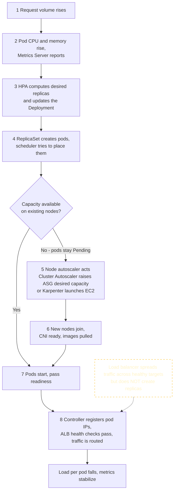

**Run the experiment**

```bash
# Terminal 1: watch HPA and pods
kubectl -n scaling-lab get hpa php-apache -w

# Terminal 2: watch nodes
kubectl get nodes -L topology.kubernetes.io/zone -w

# Terminal 3: generate load from inside the cluster
kubectl -n scaling-lab create deployment load --image=busybox:1.36 --replicas=5 -- \
  /bin/sh -c 'while true; do wget -q -O- http://php-apache > /dev/null; done'

# Also watch the autoscaler's reasoning
kubectl -n kube-system logs deploy/cluster-autoscaler-aws-cluster-autoscaler -f
```

**Expected observation.** HPA `TARGETS` rise above 50%, replicas increase toward `maxReplicas`, some pods are `Pending`, CA logs a scale-up, new nodes appear (the ASG for the AZ chosen), pods schedule. If scaling is too gentle, add load replicas. After you delete the load deployment, the scale-down happens over the next several minutes.

```bash
# Cleanup for the experiment
kubectl -n scaling-lab delete deployment load
# Optional: remove the whole lab afterwards
# kubectl delete -f 30-hpa-lab.yaml
```

> [!IMPORTANT]
> 💰 The experiment can launch additional EC2 nodes. Delete the load generator and the lab namespace afterwards, and confirm nodes scale back (it can take 10+ minutes by default).

### 14.7 Compute models compared (the later comparison)

| Model | You manage | Strengths | Limits | Choose when |
|---|---|---|---|---|
| **Managed node groups** (this guide) | Instance types, sizing, scaling policy | Full Kubernetes features, simple lifecycle automation | You own capacity planning and bin-packing | Default for most clusters |
| **Self-managed nodes** | AMI, ASG, bootstrap, upgrades | Maximum control | Most operational work | Special AMIs or unsupported configurations |
| **Karpenter-managed nodes** | NodePool/EC2NodeClass | Flexible, cost-efficient, fast | More setup; careful disruption config | Diverse, bursty workloads |
| **AWS Fargate** | Pod specs only; no nodes | No node management, per-pod isolation | No DaemonSets, no privileged pods, no GPUs, IRSA not Pod Identity; only IP target mode for ALB; per-pod pricing | Isolated, spiky or low-ops workloads |
| **EKS Auto Mode** | Pod specs and policies; AWS manages nodes and several core components | Least operations; built-in compute, storage, load-balancing integrations | Less control; extra management charge; check current feature and cost details | Teams that want AWS to run the data-plane plumbing |

> [!TIP]
> ✅ **Production insight.** Autoscaling is a chain of dependencies, and the slowest link sets your recovery speed. Before approving: requests/limits are justified by measurements, HPA targets leave headroom, `maxReplicas` fits within node-group `max_size`, quotas and subnet IPs allow growth, and a load test has *actually* walked through pods → nodes → traffic.

---

## 15. Production Security

### 15.1 Four questions, four different controls

Security failures often come from confusing these. Keep them separate:

| Concept | Question | Mechanism in this architecture |
|---|---|---|
| **Authentication** | *Who are you?* | IAM identity → EKS access entry (humans, CI); projected service-account tokens (pods to the Kubernetes API) |
| **Authorization** | *What may you do in Kubernetes?* | Kubernetes RBAC and EKS access policies |
| **Network access** | *Can packet X reach Y?* | Security groups, NACLs, NetworkPolicy, private subnets, endpoint policies |
| **Workload identity** | *What may this pod do in AWS?* | EKS Pod Identity (or IRSA) → IAM role |

An IAM role that can call `eks:DescribeCluster` can *find* the cluster, but it can only *do* things inside it if an access entry maps it to Kubernetes permissions. A pod with network access to an S3 endpoint still needs IAM permission. Each layer is independent, which is the point.

### 15.2 Cluster access: access entries and least-privilege RBAC

Humans and CI authenticate with IAM and are authorized through **EKS access entries**, which associate an IAM principal with an AWS-managed access policy (cluster- or namespace-scoped) and/or Kubernetes groups. Separate **cluster administration** from **workload identities**: no application pod should ever hold cluster-admin or reuse an admin role.

Add to the `module "eks"` block for a namespace-scoped, read-only role:

```hcl
  access_entries = {
    demo_viewers = {
      principal_arn = "arn:aws:iam::<AWS_ACCOUNT_ID>:role/<READONLY_ROLE_NAME>" # replace
      policy_associations = {
        view = {
          policy_arn   = "arn:aws:eks::aws:cluster-access-policy/AmazonEKSViewPolicy"
          access_scope = { type = "namespace", namespaces = ["demo"] }
        }
      }
    }
  }
```

For finer-grained Kubernetes permissions, bind an IAM role to a Kubernetes group through the access entry and grant that group a custom `Role`:

```yaml
apiVersion: rbac.authorization.k8s.io/v1
kind: Role
metadata:
  name: deployment-restarter
  namespace: demo
rules:
  - apiGroups: ["apps"]
    resources: ["deployments"]
    verbs: ["get", "list", "patch"]       # patch allows `kubectl rollout restart`
---
apiVersion: rbac.authorization.k8s.io/v1
kind: RoleBinding
metadata:
  name: deployment-restarter
  namespace: demo
subjects:
  - kind: Group
    name: demo-deployers                  # map this group to an IAM role via an access entry's kubernetes_groups
    apiGroup: rbac.authorization.k8s.io
roleRef:
  kind: Role
  name: deployment-restarter
  apiGroup: rbac.authorization.k8s.io
```

Test with `kubectl auth can-i patch deployments -n demo --as-group demo-deployers --as dummy-user`.

> [!WARNING]
> 🔐 `enable_cluster_creator_admin_permissions = true` is convenient for the lab but gives whoever ran Terraform permanent admin. In production, manage admin access explicitly through access entries for a break-glass role and a small admin group, and remove the creator's implicit admin.

### 15.3 Workload identity with EKS Pod Identity (least privilege)

Give each workload its own Service Account and role. Example: a hypothetical pod `app-reader` in `demo` that may read only secrets under one prefix:

```hcl
data "aws_iam_policy_document" "app_secrets" {
  statement {
    actions   = ["secretsmanager:GetSecretValue"]
    resources = ["arn:aws:secretsmanager:${var.region}:${data.aws_caller_identity.current.account_id}:secret:demo/app/*"]
  }
}

data "aws_caller_identity" "current" {}

resource "aws_iam_policy" "app_secrets" {
  name   = "${var.cluster_name}-app-secrets-read"
  policy = data.aws_iam_policy_document.app_secrets.json
}

resource "aws_iam_role" "app_reader" {
  name               = "${var.cluster_name}-app-reader"
  assume_role_policy = data.aws_iam_policy_document.pod_identity_trust.json
}

resource "aws_iam_role_policy_attachment" "app_reader" {
  role       = aws_iam_role.app_reader.name
  policy_arn = aws_iam_policy.app_secrets.arn
}

resource "aws_eks_pod_identity_association" "app_reader" {
  cluster_name    = module.eks.cluster_name
  namespace       = "demo"
  service_account = "app-reader"
  role_arn        = aws_iam_role.app_reader.arn
}
```

```yaml
apiVersion: v1
kind: ServiceAccount
metadata:
  name: app-reader
  namespace: demo
automountServiceAccountToken: false     # the app does not talk to the Kubernetes API; Pod Identity uses its own credential channel
```

Pods that set `serviceAccountName: app-reader` receive temporary credentials for that role only. Compare with the pre-Pod-Identity anti-pattern of attaching broad permissions to the **node role**, which every pod on the node could use. (IMDS hop limit 1 in this guide blocks that path for pods, but the role would still be over-privileged.)

### 15.4 Network controls

| Control | In this guide | Note |
|---|---|---|
| Private worker nodes | Yes | No public IPs; reachable only through the ALB path |
| Security groups | Module-managed node/cluster SGs; controller-managed ALB SGs | Prefer SG-to-SG rules over CIDRs |
| NACLs | Default allow | Stateless; add only with a clear need and test ephemeral ports (1024-65535) |
| API endpoint | Public restricted to your CIDR plus private | Prefer private-only in production |
| NetworkPolicy | Enabled in the VPC CNI (`enableNetworkPolicy`) | Default deny plus explicit allows |
| Endpoint policies | Optional | Restrict what the S3/ECR endpoints can reach |

Default-deny with the minimum needed for the sample app (ALB ingress in IP mode, DNS egress):

```yaml
apiVersion: networking.k8s.io/v1
kind: NetworkPolicy
metadata:
  name: default-deny-all
  namespace: demo
spec:
  podSelector: {}
  policyTypes: ["Ingress", "Egress"]
---
apiVersion: networking.k8s.io/v1
kind: NetworkPolicy
metadata:
  name: allow-dns-egress
  namespace: demo
spec:
  podSelector: {}
  policyTypes: ["Egress"]
  egress:
    - to:
        - namespaceSelector:
            matchLabels: { kubernetes.io/metadata.name: kube-system }
          podSelector:
            matchLabels: { k8s-app: kube-dns }
      ports:
        - { protocol: UDP, port: 53 }
        - { protocol: TCP, port: 53 }
---
apiVersion: networking.k8s.io/v1
kind: NetworkPolicy
metadata:
  name: allow-alb-to-app
  namespace: demo
spec:
  podSelector: {}
  policyTypes: ["Ingress"]
  ingress:
    - from:                                  # in IP mode the source is the ALB's addresses in the PUBLIC subnets
        - ipBlock: { cidr: 10.0.0.0/24 }
        - ipBlock: { cidr: 10.0.1.0/24 }
        - ipBlock: { cidr: 10.0.2.0/24 }
      ports:
        - { protocol: TCP, port: 5678 }
```

> [!NOTE]
> 📘 NetworkPolicy decides pod-level traffic; security groups decide ENI/instance-level traffic. Both must allow a flow. Apply policies in a test namespace first and watch probes and traffic: the VPC CNI's network-policy implementation is designed not to block kubelet probes that originate from the node, but verify this on your CNI version before relying on it. For richer policy (L7, FQDN, cluster-wide), evaluate Cilium or Calico options; those change your CNI story, so decide deliberately.

### 15.5 Secrets

- A Kubernetes **Secret is base64-encoded, not encrypted**. Anyone with `get` on Secrets (or access to etcd backups) can read it. Base64 is an encoding.
- **At rest:** EKS encrypts Kubernetes API data at rest; the module also enables **envelope encryption of Secrets with a customer-managed KMS key** (additional KMS cost) for control and audit.
- **Access control:** restrict `get/list/watch` on Secrets with RBAC. `list` and `watch` on Secrets reveal values. Avoid mounting Service Account tokens when unneeded.
- **Prefer an external secret store:** keep secrets in **AWS Secrets Manager** or **SSM Parameter Store**, grant access through Pod Identity, and deliver them with the [Secrets Store CSI Driver + AWS provider](https://docs.aws.amazon.com/secretsmanager/latest/userguide/integrating_csi_driver.html) or [External Secrets Operator](https://external-secrets.io/). Both are additional components.
- Never bake secrets into images, ConfigMaps, Terraform variables, or Git.

### 15.6 Pod hardening and admission control

The Deployments in Section 9 already show the baseline: `runAsNonRoot`, a numeric `runAsUser`, `allowPrivilegeEscalation: false`, `readOnlyRootFilesystem: true`, `capabilities.drop: ["ALL"]`, `seccompProfile: RuntimeDefault`, no mounted API token, and resource requests/limits. The `demo` namespace **enforces the Pod Security Standards `restricted` profile**, so a pod that violates it is rejected at admission.

Pod Security Admission covers the *profile*. For organization-specific rules, use **ValidatingAdmissionPolicy** (CEL, built into the API server on current versions, no webhook to operate). Example: only allow images from your ECR registry in `demo`:

```yaml
apiVersion: admissionregistration.k8s.io/v1
kind: ValidatingAdmissionPolicy
metadata:
  name: require-account-ecr-images
spec:
  failurePolicy: Fail
  matchConstraints:
    resourceRules:
      - apiGroups: [""]
        apiVersions: ["v1"]
        operations: ["CREATE", "UPDATE"]
        resources: ["pods"]
  validations:
    - expression: "object.spec.containers.all(c, c.image.startsWith('<AWS_ACCOUNT_ID>.dkr.ecr.ap-south-1.amazonaws.com/'))"
      message: "Container images must come from this account's ECR registry in ap-south-1."
---
apiVersion: admissionregistration.k8s.io/v1
kind: ValidatingAdmissionPolicyBinding
metadata:
  name: require-account-ecr-images-demo
spec:
  policyName: require-account-ecr-images
  validationActions: ["Deny"]
  matchResources:
    namespaceSelector:
      matchLabels:
        kubernetes.io/metadata.name: demo
```

This example inspects only `containers`; extend it for `initContainers`. For policy engines with more features (mutation, reporting, image-signature verification), consider [Kyverno](https://kyverno.io/) or OPA Gatekeeper (additional components).

### 15.7 Supply chain, patching, logging, encryption, and edge protection

| Area | Practice | Cost/optional/version note |
|---|---|---|
| **Trusted registry and scanning** | Private ECR, immutable tags, scan on push (enabled), pin by digest | Basic scanning included; **enhanced scanning (Amazon Inspector) is additional cost** |
| **Image provenance** | Build in CI from reviewed source; generate an SBOM; sign images and verify at admission | Signing tools and policy engines are optional extras (for example AWS Signer or cosign with Kyverno) |
| **Patch management** | Roll node groups to new EKS-optimized AMIs regularly (managed node group update); keep add-ons current; upgrade Kubernetes one minor at a time before support ends | Extended support is billed at a premium: see [Section 18](#18-cost-optimization) |
| **Audit logging** | EKS control-plane logs (`audit`, `authenticator`, `api`) to CloudWatch, with retention; also CloudTrail for AWS API calls | CloudWatch ingestion and storage cost |
| **Encryption at rest** | EBS (nodes encrypted in our config), ECR, S3 state, Secrets via KMS envelope encryption | KMS key costs |
| **Encryption in transit** | TLS at the ALB; optional HTTPS to pods; encrypted control-plane traffic; consider a service mesh for pod-to-pod mTLS | Mesh is optional and operationally heavy |
| **Resource limits** | Memory limits everywhere, requests everywhere, `ResourceQuota` and `LimitRange` per namespace | Prevents noisy neighbors and runaway usage |
| **AWS WAF** | Attach a web ACL to the internet-facing ALB via the Ingress annotation | **Additional cost**; managed rule groups need tuning to avoid false positives |
| **Threat detection** | Amazon GuardDuty EKS protection | **Additional cost**, optional |

> [!TIP]
> ✅ **Production insight.** For each control a senior engineer asks: is it *preventive* (stops the bad thing: PSS, NetworkPolicy, IAM), *detective* (audit logs, GuardDuty), or *corrective* (patching, incident runbooks)? A design with only one of the three is incomplete. Also verify the *defaults you rely on*: the node IMDS hop limit, the API endpoint CIDRs, and who is `cluster-admin`.

---

## 16. Observability and Troubleshooting

### 16.1 Observability layers

| Layer | Tooling | Notes |
|---|---|---|
| **Control-plane logs** | CloudWatch log group `/aws/eks/<cluster>/cluster` (enabled in Terraform) | Audit and authenticator logs answer "who did what" |
| **Cluster and pod metrics/logs** | **CloudWatch Container Insights** via the `amazon-cloudwatch-observability` add-on | Additional cost: metrics and log ingestion |
| **Kubernetes-native metrics** | Metrics Server (HPA, `kubectl top`) | Short-term, not a monitoring system |
| **Metrics, dashboards, alerting** | Optional **Prometheus + Grafana** (self-hosted `kube-prometheus-stack`, or Amazon Managed Service for Prometheus and Managed Grafana) | Additional components/cost; you own retention and upgrades |
| **Load balancer** | CloudWatch ALB metrics, optional access logs to S3 | The 5xx split between ELB and target is the first diagnostic fork |
| **Network** | VPC Flow Logs, Reachability Analyzer | Flow logs cost grows with traffic |

Enable Container Insights by adding the add-on and a Pod Identity role in Terraform (inside `module "eks"` `addons`, plus the role):

```hcl
resource "aws_iam_role" "cloudwatch_agent" {
  name               = "${var.cluster_name}-cloudwatch-agent"
  assume_role_policy = data.aws_iam_policy_document.pod_identity_trust.json
}

resource "aws_iam_role_policy_attachment" "cloudwatch_agent" {
  role       = aws_iam_role.cloudwatch_agent.name
  policy_arn = "arn:aws:iam::aws:policy/CloudWatchAgentServerPolicy"
}

# inside module "eks" -> addons = { ... }
#   amazon-cloudwatch-observability = {
#     pod_identity_association = [{
#       role_arn        = aws_iam_role.cloudwatch_agent.arn
#       service_account = "cloudwatch-agent"
#     }]
#   }
```

Useful queries and alarms:

```bash
# Who deleted or read Secrets recently? (CloudWatch Logs Insights, run against /aws/eks/eks-ref/cluster)
cat <<'QUERY'
fields @timestamp, user.username, verb, objectRef.resource, objectRef.name, responseStatus.code
| filter objectRef.resource = "secrets" and verb in ["get", "list", "delete", "update", "patch"]
| sort @timestamp desc
| limit 50
QUERY

# Alarm: any unhealthy ALB target for 3 consecutive minutes.
# LB_ARN and a TG_ARN come from Section 13.4. SNS_TOPIC_ARN is your notification topic.
aws cloudwatch put-metric-alarm \
  --alarm-name "${CLUSTER_NAME}-alb-unhealthy-targets" \
  --namespace AWS/ApplicationELB --metric-name UnHealthyHostCount \
  --dimensions Name=LoadBalancer,Value="${LB_ARN#*:loadbalancer/}" Name=TargetGroup,Value="targetgroup/${TG_ARN#*:targetgroup/}" \
  --statistic Maximum --period 60 --evaluation-periods 3 --threshold 1 \
  --comparison-operator GreaterThanOrEqualToThreshold --treat-missing-data notBreaching \
  --alarm-actions "<SNS_TOPIC_ARN>"
```

> [!WARNING]
> ⚠️ **Monitoring tools are not an incident-response plan.** Dashboards show you data; they do not decide who gets paged, what "healthy" means, or what to do next. Define **service-level objectives** (for example availability and latency percentiles from the user's perspective), alert on SLO burn rather than raw resource graphs, write runbooks, assign on-call ownership, and run game days ([Section 17](#17-failure-testing)). The alarm above is an example of one signal, not a complete alerting strategy. Remember to delete CLI-created alarms at teardown.

### 16.2 The troubleshooting method

1. **Scope:** is it one pod, one node, one AZ, one namespace, or everything?
2. **Layer:** AWS network → node → Kubernetes object → controller → load balancer → application.
3. **Evidence first:** events, logs, and AWS API state, before changing anything.
4. **Change one thing**, observe, and write down what you learned.

Core commands used in nearly every investigation:

```bash
kubectl get nodes -o wide
kubectl get pods -A
kubectl get events -A --sort-by=.lastTimestamp | tail -n 40
kubectl describe pod <POD_NAME> -n <NAMESPACE>
kubectl logs <POD_NAME> -n <NAMESPACE> [--previous] [-c <CONTAINER>]
kubectl get ingress,svc -A
aws eks describe-cluster --name "$CLUSTER_NAME"
aws elbv2 describe-target-health --target-group-arn <TARGET_GROUP_ARN>
```

### 16.3 Troubleshooting handbook

Each entry follows the same shape: **symptoms → likely causes → diagnose → interpret → fix → prevent**. Expand the one you need.

<details>
<summary><strong>1. EKS cluster access failures (<code>kubectl</code> cannot connect or is unauthorized)</strong></summary>

- **Symptoms:** `Unable to connect to the server: dial tcp ... i/o timeout`; `error: You must be logged in to the server (Unauthorized)`; `forbidden`.
- **Likely causes:** your public IP is not in `endpoint_public_access_cidrs`; endpoint access mode does not match where you run `kubectl`; wrong kubeconfig context/Region/account; your IAM principal has no access entry; the access entry lacks an access policy.
- **Diagnose:**
  ```bash
  curl -s https://checkip.amazonaws.com
  aws eks describe-cluster --name "$CLUSTER_NAME" --query 'cluster.resourcesVpcConfig.[endpointPublicAccess,endpointPrivateAccess,publicAccessCidrs]'
  aws sts get-caller-identity
  aws eks list-access-entries --cluster-name "$CLUSTER_NAME"
  aws eks list-associated-access-policies --cluster-name "$CLUSTER_NAME" --principal-arn <PRINCIPAL_ARN>
  kubectl config current-context
  ```
- **Interpret:** a timeout means a *network* problem (CIDR/endpoint mode); `Unauthorized` means authentication reached the API but no mapping exists; `forbidden` means mapped but not authorized for that verb/resource.
- **Fix:** update `api_allowed_cidrs` and apply; run `aws eks update-kubeconfig`; create the access entry and associate a policy.
- **Prevent:** manage access entries in Terraform; use stable egress IPs or a private endpoint with VPN/CI in the VPC; keep a documented break-glass role.
</details>

<details>
<summary><strong>2. Nodes fail to join the cluster</strong></summary>

- **Symptoms:** node group stuck `CREATING` then `CREATE_FAILED` (`NodeCreationFailure`); EC2 instances running but absent from `kubectl get nodes`.
- **Likely causes:** no path to the control plane or to AWS APIs (missing route/NAT/endpoints, security group, NACL); node IAM role lacks required policies or has no access entry; VPC CNI not ready; out of subnet IPs; wrong AMI type for the architecture.
- **Diagnose:**
  ```bash
  aws eks describe-nodegroup --cluster-name "$CLUSTER_NAME" --nodegroup-name ng-a --query 'nodegroup.[status,health.issues]'
  aws autoscaling describe-scaling-activities --auto-scaling-group-name <ASG_NAME> --max-items 5
  aws ec2 get-console-output --instance-id <INSTANCE_ID> --latest --output text | tail -n 60
  aws eks list-access-entries --cluster-name "$CLUSTER_NAME"            # node role should be present (type EC2_LINUX)
  aws eks describe-addon --cluster-name "$CLUSTER_NAME" --addon-name vpc-cni --query addon.health
  aws ec2 describe-route-tables --filters Name=vpc-id,Values=<VPC_ID>
  ```
- **Interpret:** `health.issues` often names the cause (`AccessDenied`, `NodeCreationFailure`, `InstanceLimitExceeded`). Console output shows bootstrap/kubelet errors such as inability to reach the API server.
- **Fix:** correct routes/endpoints/SG, IAM, or IP exhaustion; recreate the failed node group if needed.
- **Prevent:** apply with the module defaults for node SG rules; keep `before_compute` add-ons; verify private routing *before* creating node groups. To inspect a node, either attach `AmazonSSMManagedInstanceCore` to node roles (and make SSM reachable through NAT or endpoints) or use `kubectl debug node/<NODE_NAME> -it --image=busybox:1.36` once the API works.
</details>

<details>
<summary><strong>3. Nodes in <code>NotReady</code></strong></summary>

- **Symptoms:** `kubectl get nodes` shows `NotReady`; pods on the node become unreachable.
- **Likely causes:** kubelet stopped or cannot reach the API; CNI (`aws-node`) crash; disk/memory/PID pressure; instance impaired; security group change.
- **Diagnose:**
  ```bash
  kubectl describe node <NODE_NAME> | sed -n '/Conditions:/,/Addresses:/p'
  kubectl -n kube-system get pods -o wide --field-selector spec.nodeName=<NODE_NAME>
  kubectl -n kube-system logs <AWS_NODE_POD_NAME> -c aws-node --tail=50
  aws ec2 describe-instance-status --instance-ids <INSTANCE_ID> --include-all-instances
  ```
- **Interpret:** the `Ready` condition's *reason/message* is the lead. `MemoryPressure`/`DiskPressure` true means resource exhaustion; failed status checks mean an AWS-side problem.
- **Fix:** if pressure, fix workload requests/limits or enlarge the volume; if impaired, drain and replace the node (`kubectl drain`, then let the ASG replace it, or terminate the instance).
- **Prevent:** enable managed node group **node auto repair** where appropriate, set realistic requests, alert on `NotReady` duration and node disk usage.
</details>

<details>
<summary><strong>4. Pods stuck in <code>Pending</code></strong></summary>

- **Symptoms:** `STATUS Pending`, no node assigned.
- **Likely causes:** insufficient CPU/memory on any node; `topologySpreadConstraints` or affinity not satisfiable; taints without tolerations; node selector mismatch; PVC bound to another AZ; no IP availability; node autoscaler not scaling (max size, quota, or constraint it cannot satisfy).
- **Diagnose:**
  ```bash
  kubectl describe pod <POD_NAME> -n <NAMESPACE> | sed -n '/Events:/,$p'
  kubectl get nodes -o custom-columns=NAME:.metadata.name,ZONE:.metadata.labels.topology\\.kubernetes\\.io/zone,CPU:.status.allocatable.cpu,MEM:.status.allocatable.memory
  kubectl top nodes
  kubectl -n kube-system logs deploy/cluster-autoscaler-aws-cluster-autoscaler --tail=100 | grep -iE 'scale|NotTriggerScaleUp|unschedulable'
  ```
- **Interpret:** `FailedScheduling` messages enumerate *why each node was rejected* (`Insufficient cpu`, `node(s) didn't match pod topology spread constraints`, `had untolerated taint`). A `NotTriggerScaleUp` line explains why CA did not add a node.
- **Fix:** add capacity or raise node-group `max_size`; correct requests; relax constraints deliberately (for example soft spread) or add nodes in the needed zone.
- **Prevent:** capacity planning ([10.5](#105-capacity-planning-for-an-az-loss)); alert on pods `Pending` longer than a threshold.
</details>

<details>
<summary><strong>5. <code>ImagePullBackOff</code> / <code>ErrImagePull</code></strong></summary>

- **Symptoms:** pod `ImagePullBackOff`; events show pull errors.
- **Likely causes:** wrong image name/tag/account/Region; image missing; node role lacks ECR pull permission; no route to ECR (NAT/endpoints missing or misconfigured); S3 gateway endpoint or its policy blocking layer downloads; private DNS not enabled on interface endpoints; Docker Hub rate limits for public images.
- **Diagnose:**
  ```bash
  kubectl describe pod <POD_NAME> -n <NAMESPACE> | sed -n '/Events:/,$p'
  aws ecr describe-images --repository-name demo/http-echo
  aws iam list-attached-role-policies --role-name <NODE_ROLE_NAME>
  kubectl run nettest --rm -it --restart=Never --image=busybox:1.36 -- nslookup ${AWS_ACCOUNT_ID}.dkr.ecr.${AWS_REGION}.amazonaws.com
  ```
- **Interpret:** `not found` is a naming/tag problem; `no basic auth credentials` or `403` is IAM; `i/o timeout` is routing/endpoint; resolving to *public* IPs when you expect endpoints means private DNS is off.
- **Fix:** correct the reference; attach the ECR pull policy; repair routes/endpoints/SG (443 from nodes to endpoint ENIs).
- **Prevent:** mirror third-party images into ECR; use immutable tags or digests; alert on pull failures.
</details>

<details>
<summary><strong>6. <code>CrashLoopBackOff</code></strong></summary>

- **Symptoms:** pod restarts repeatedly, `RESTARTS` climbing.
- **Likely causes:** application crash or bad config; liveness probe failing; `OOMKilled`; read-only root filesystem and the app writes to disk; non-root user cannot read files or bind a low port; missing secret or env.
- **Diagnose:**
  ```bash
  kubectl logs <POD_NAME> -n <NAMESPACE> --previous
  kubectl describe pod <POD_NAME> -n <NAMESPACE> | grep -A8 -E 'Last State|Reason|Exit Code'
  kubectl get pod <POD_NAME> -n <NAMESPACE> -o jsonpath='{.status.containerStatuses[*].lastState}'
  ```
- **Interpret:** `OOMKilled` / exit code 137 means the memory limit was hit; exit code 1 usually means the app failed; repeated liveness failures in events mean the probe, not the app startup, is killing it.
- **Fix:** raise memory limit based on measurement; add a startup probe; mount an `emptyDir` for writable paths; use a non-privileged port.
- **Prevent:** load-test to set limits; keep liveness checks local and cheap; test with the same security context in CI.
</details>

<details>
<summary><strong>7. DNS failures inside the cluster</strong></summary>

- **Symptoms:** `could not resolve host`, intermittent timeouts, slow lookups.
- **Likely causes:** CoreDNS pods down or on a failed node; node/pod security group blocks TCP/UDP 53 between nodes; NetworkPolicy blocks DNS egress; VPC DNS resolver packet-rate limit hit per ENI under heavy lookup load; `ndots:5` amplification of lookups.
- **Diagnose:**
  ```bash
  kubectl -n kube-system get pods -l k8s-app=kube-dns -o wide
  kubectl -n kube-system logs -l k8s-app=kube-dns --tail=50
  kubectl run dnstest --rm -it --restart=Never --image=busybox:1.36 -- nslookup kubernetes.default
  kubectl run dnstest2 --rm -it --restart=Never --image=busybox:1.36 -- nslookup amazon.com
  ```
- **Interpret:** internal names failing but external working points at CoreDNS or cluster config; external failing only suggests the upstream VPC resolver or NAT/egress; failures only from some nodes point to SG/AZ/node issues.
- **Fix:** restore CoreDNS replicas (spread across AZs), fix SG or NetworkPolicy, use fully qualified names with trailing dots in hot paths, consider NodeLocal DNSCache.
- **Prevent:** run at least 3 CoreDNS replicas, alert on CoreDNS errors/latency, test NetworkPolicies with DNS in mind.
</details>

<details>
<summary><strong>8. VPC CNI IP exhaustion</strong></summary>

- **Symptoms:** pods `ContainerCreating` for long; events contain `failed to assign an IP address to container`; scaling pods stalls despite free CPU.
- **Likely causes:** subnet has no free IPs; node reached max pods or ENI/IP limit; warm pool holding IPs; prefix fragmentation if using prefix delegation.
- **Diagnose:**
  ```bash
  kubectl describe pod <POD_NAME> -n <NAMESPACE> | sed -n '/Events:/,$p'
  kubectl -n kube-system logs <AWS_NODE_POD_NAME> -c aws-node --tail=100 | grep -iE 'ip|eni|error|insufficient'
  aws ec2 describe-subnets --filters Name=tag:Tier,Values=private --query 'Subnets[].[AvailabilityZone,CidrBlock,AvailableIpAddressCount]' --output table
  kubectl get nodes -o custom-columns=NAME:.metadata.name,MAXPODS:.status.allocatable.pods
  ```
- **Interpret:** `AvailableIpAddressCount` near zero is subnet exhaustion; ample subnet IPs but pods blocked means a per-node limit.
- **Fix:** free IPs (scale down, reduce warm pool), add nodes, enable prefix delegation or custom networking with a secondary CIDR ([4.4](#44-prefix-delegation-and-secondary-cidrs)).
- **Prevent:** size subnets for peak, alert on low free IPs, review CNI warm settings with pod density.
</details>

<details>
<summary><strong>9. HPA not scaling</strong></summary>

- **Symptoms:** `TARGETS <unknown>`, replicas stuck, or pods `Pending` after scale-out.
- **Likely causes and fixes:** see the table in [14.2](#142-horizontal-pod-autoscaler).
- **Diagnose:**
  ```bash
  kubectl -n <NAMESPACE> describe hpa <HPA_NAME>        # read Conditions: AbleToScale, ScalingActive, ScalingLimited
  kubectl get apiservice v1beta1.metrics.k8s.io
  kubectl top pods -n <NAMESPACE>
  kubectl -n kube-system logs deploy/metrics-server --tail=50
  ```
- **Interpret:** `ScalingActive False` with `FailedGetResourceMetric` means no metrics (Metrics Server or missing requests); `ScalingLimited True` means a min/max bound.
- **Prevent:** always set requests; alert on HPA at max; load-test scaling.
</details>

<details>
<summary><strong>10. Load balancer provisioning failures (Ingress has no ADDRESS)</strong></summary>

- **Symptoms:** `kubectl get ingress` shows empty `ADDRESS` for minutes; no ALB in the console.
- **Likely causes:** controller not running or not authorized; wrong/missing `ingressClassName`; no subnets discovered; certificate error; webhook blocked; AWS quota; invalid annotation value.
- **Diagnose:**
  ```bash
  kubectl -n demo describe ingress web | sed -n '/Events:/,$p'
  kubectl -n kube-system get pods -l app.kubernetes.io/name=aws-load-balancer-controller
  kubectl -n kube-system logs deploy/aws-load-balancer-controller --tail=100 | grep -iE 'error|fail|denied'
  kubectl get ingressclass
  ```
- **Interpret:** the controller usually logs the exact AWS error (`AccessDenied`, `couldn't auto-discover subnets`, `CertificateNotFound`). No events at all often means the Ingress is not being picked up (class mismatch).
- **Fix:** see the failure table in [12.6](#126-behavior-you-must-understand).
- **Prevent:** version-pin controller and IAM policy together; use a CI check (`kubectl apply --dry-run=server`) so admission webhook problems surface early.
</details>

<details>
<summary><strong>11. Unhealthy ALB target groups</strong></summary>

- **Symptoms:** targets `unhealthy` or `draining`; intermittent 5xx.
- **Likely causes:** health-check path/port/code mismatch; security group blocks ALB→pod; pod not actually serving on the container port; readiness probe failing; target is a terminated pod being drained.
- **Diagnose:**
  ```bash
  aws elbv2 describe-target-health --target-group-arn <TARGET_GROUP_ARN>
  kubectl -n demo get pods -o wide
  kubectl -n demo get pod <POD_NAME> -o jsonpath='{.status.conditions}' | jq .      # includes the target-health readiness gate
  kubectl -n demo port-forward pod/<POD_NAME> 8080:5678 &
  curl -si http://127.0.0.1:8080/ ; kill %1
  ```
- **Interpret:** `Target.ResponseCodeMismatch` means the path works but the code differs from `success-codes`; `Target.Timeout` means the ALB cannot connect (SG/NACL or wrong port). If `port-forward` works but the ALB fails, the problem is network path or health-check configuration, not the app.
- **Fix:** align `healthcheck-path`/`success-codes`; add the missing SG rule; fix the container port.
- **Prevent:** keep ALB health check and readiness endpoints consistent and cheap; use the readiness gate during rollouts.
</details>

<details>
<summary><strong>12. Missing subnet discovery</strong></summary>

- **Symptoms:** controller logs `couldn't auto-discover subnets`; ALB lands in unexpected subnets.
- **Likely causes:** missing `kubernetes.io/role/elb` (public) or `kubernetes.io/role/internal-elb` (private) tag; multiple tagged subnets in one AZ; subnets lack free IPs; cluster tag conflicts.
- **Diagnose:**
  ```bash
  aws ec2 describe-subnets --filters Name=vpc-id,Values=<VPC_ID> Name=tag-key,Values=kubernetes.io/role/elb \
    --query 'Subnets[].[SubnetId,AvailabilityZone,AvailableIpAddressCount]' --output table
  aws ec2 describe-subnets --filters Name=vpc-id,Values=<VPC_ID> Name=tag-key,Values=kubernetes.io/role/internal-elb \
    --query 'Subnets[].[SubnetId,AvailabilityZone,AvailableIpAddressCount]' --output table
  ```
- **Interpret:** you want **exactly one** tagged subnet per AZ per role.
- **Fix:** correct tags in Terraform (or set `alb.ingress.kubernetes.io/subnets` explicitly).
- **Prevent:** keep tags in the same Terraform that creates subnets ([6.5](#65-vpctf)).
</details>

<details>
<summary><strong>13. <code>502</code>, <code>503</code>, <code>504</code> from the ALB</strong></summary>

See the dedicated table and commands in [13.7](#137-troubleshooting-502-503-and-504). The decisive first step: check CloudWatch `HTTPCode_ELB_5XX_Count` versus `HTTPCode_Target_5XX_Count` and read the target `Reason`.
</details>

<details>
<summary><strong>14. Security-group connectivity failures</strong></summary>

- **Symptoms:** timeouts (not refusals) between components that "should" talk: ALB→pod, node→endpoint, pod→pod across nodes, control plane→webhook.
- **Likely causes:** missing SG rule; rules referencing the wrong SG; a NACL blocking ephemeral ports; NetworkPolicy; the EKS cluster SG attached to nodes alongside the node SG (breaking controller SG selection).
- **Diagnose:**
  ```bash
  # Prove or disprove a path with AWS Reachability Analyzer (ENI to ENI or instance to instance)
  aws ec2 create-network-insights-path --source <SOURCE_ENI_ID> --destination <DEST_ENI_ID> --protocol tcp --destination-port 5678
  aws ec2 start-network-insights-analysis --network-insights-path-id <PATH_ID>
  aws ec2 describe-network-insights-analyses --network-insights-path-id <PATH_ID> --query 'NetworkInsightsAnalyses[0].[Status,NetworkPathFound,Explanations]'
  aws ec2 describe-security-groups --group-ids <SG_ID> --query 'SecurityGroups[0].IpPermissions'
  kubectl get networkpolicy -A
  ```
- **Interpret:** `NetworkPathFound false` plus `Explanations` names the blocking component. A *refused* connection (immediate error) means the packet arrived and nothing listens; a *timeout* means it was dropped.
- **Fix:** add the narrowest SG-to-SG rule; correct NACL/NetworkPolicy.
- **Prevent:** manage SG rules in code; avoid ad-hoc console edits; document the required flows (ALB→pod, pod→DNS, nodes→control plane).
</details>

<details>
<summary><strong>15. IAM permission errors</strong></summary>

- **Symptoms:** `AccessDenied`, `UnauthorizedOperation`, `is not authorized to perform`, from Terraform, the controller, an autoscaler, or an app.
- **Likely causes:** role missing a permission; policy version mismatch for the controller; Pod Identity association missing or pods started before it existed; wrong Service Account/namespace in the association; trust policy wrong; SCP or permissions boundary deny.
- **Diagnose:**
  ```bash
  aws eks list-pod-identity-associations --cluster-name "$CLUSTER_NAME" --namespace kube-system
  kubectl -n kube-system get pod <POD_NAME> -o jsonpath='{.spec.containers[0].env[?(@.name=="AWS_CONTAINER_CREDENTIALS_FULL_URI")].value}'
  kubectl -n <NAMESPACE> exec <POD_NAME> -- env | grep AWS_           # (only if the image has a shell and the env tool)
  aws cloudtrail lookup-events --lookup-attributes AttributeKey=EventName,AttributeValue=<DENIED_API_NAME> --max-results 5
  kubectl auth can-i <VERB> <RESOURCE> -n <NAMESPACE> --as <USER>      # Kubernetes RBAC (a different layer)
  ```
- **Interpret:** the error message names the principal ARN and action. If the principal is the **node role** instead of the expected workload role, Pod Identity is not being applied. CloudTrail shows the actual identity and the denial reason.
- **Fix:** attach the minimal missing permission; recreate the association with the exact namespace/Service Account; restart pods.
- **Prevent:** one role per workload; policy-as-code review; use IAM Access Analyzer.
</details>

<details>
<summary><strong>16. NAT gateway or VPC endpoint connectivity problems</strong></summary>

- **Symptoms:** egress timeouts from pods; `ImagePullBackOff` from public registries; AWS API calls hang; works in one AZ but not another.
- **Likely causes:** private route table missing the NAT route or pointing to a deleted/failed NAT; NAT's AZ failed (single NAT design); NAT port exhaustion under heavy connection churn; interface endpoint security group not allowing 443; private DNS disabled; S3 gateway endpoint route absent or restricted by policy.
- **Diagnose:**
  ```bash
  aws ec2 describe-nat-gateways --filter Name=vpc-id,Values=<VPC_ID> --query 'NatGateways[].[NatGatewayId,State,SubnetId]' --output table
  aws ec2 describe-route-tables --filters Name=vpc-id,Values=<VPC_ID> --query 'RouteTables[].[Tags[?Key==`Name`]|[0].Value,Routes[?DestinationCidrBlock==`0.0.0.0/0`].[NatGatewayId,State]]' --output json
  aws ec2 describe-vpc-endpoints --filters Name=vpc-id,Values=<VPC_ID> --query 'VpcEndpoints[].[ServiceName,VpcEndpointType,State,PrivateDnsEnabled]' --output table
  kubectl run nettest --rm -it --restart=Never --image=busybox:1.36 -- wget -qO- -T 5 https://checkip.amazonaws.com
  # CloudWatch metric AWS/NATGateway ErrorPortAllocation indicates SNAT port exhaustion
  ```
- **Interpret:** a route with `State: blackhole` means the NAT was deleted; success from one AZ and failure from another points to that AZ's route/NAT; DNS resolving to public IPs where you expect endpoints means private DNS is off.
- **Fix:** repair the route/NAT; enable private DNS; open 443 on the endpoint SG; for port exhaustion, add NAT gateways/IPs or reduce connection churn (connection pooling).
- **Prevent:** one NAT per AZ, endpoint-first design for AWS APIs, alarms on NAT error metrics and `blackhole` routes.
</details>

<details>
<summary><strong>17. Availability Zone capacity problems</strong></summary>

- **Symptoms:** node group or autoscaler cannot launch nodes in one AZ; `InsufficientInstanceCapacity`; scale-up works in two AZs only; spread constraints block pods.
- **Likely causes:** the AZ lacks capacity for the chosen instance type; account vCPU quota reached; subnet IPs exhausted; real AZ impairment.
- **Diagnose:**
  ```bash
  aws autoscaling describe-scaling-activities --auto-scaling-group-name <ASG_NAME> --max-items 10 --query 'Activities[].[StatusCode,StatusMessage]'
  aws service-quotas get-service-quota --service-code ec2 --quota-code L-1216C47A --query 'Quota.Value'   # Running On-Demand Standard instances (vCPUs)
  aws ec2 describe-subnets --subnet-ids <SUBNET_ID> --query 'Subnets[0].AvailableIpAddressCount'
  ```
- **Interpret:** `InsufficientInstanceCapacity` is a capacity condition for that type in that AZ, not a configuration error; a quota error names the limit.
- **Fix:** allow multiple instance types/families per node group (or use Karpenter's flexibility), request quota increases, add headroom in other AZs, and use `ScheduleAnyway` semantics only where an imbalance is acceptable.
- **Prevent:** diversify instance types, pre-warm headroom for critical services, consider On-Demand Capacity Reservations for must-have capacity, and rehearse AZ loss ([Section 17](#17-failure-testing)).
</details>

---

## 17. Failure Testing

**Purpose.** A design you have never broken is a hypothesis. These exercises let you watch the mechanisms from [Section 10](#10-high-availability-and-failure-handling) work, in a **lab cluster only**.

> [!WARNING]
> ⚠️ **Safety rules.** Run these only in this sandbox cluster. Do **not** disable NAT/routing or security groups, delete the EKS control plane, edit the VPC, or inject faults into a live production environment. Production fault injection requires a rehearsed plan, blast-radius limits, stop conditions, and stakeholder approval (see the end of this section).

**Setup: four terminals**

```bash
# T1: pods with node and IP
kubectl -n demo get pods -o wide -w

# T2: nodes and zones
kubectl get nodes -L topology.kubernetes.io/zone -w

# T3: ALB target health for the frontend target group (re-run as needed)
# TG_ARN from Section 13.4
watch -n 5 "aws elbv2 describe-target-health --target-group-arn <TARGET_GROUP_ARN> --query 'TargetHealthDescriptions[].[Target.Id,TargetHealth.State]' --output text"

# T4: a steady stream of requests (replace with your hostname)
while true; do curl -s -o /dev/null -w "%{http_code} %{time_total}s\n" https://<DOMAIN_NAME>/app; sleep 1; done
```

### Exercise 1: delete one application pod

```bash
POD=$(kubectl -n demo get pod -l app=frontend -o jsonpath='{.items[0].metadata.name}')
kubectl -n demo delete pod "$POD"
```

- **Expected.** A new pod appears within seconds, schedules, and becomes `Ready`. T4 shows continuous `200`s; T3 shows one target draining and a new one becoming `healthy`.
- **Why.** The ReplicaSet restores the desired count; the `preStop` sleep and deregistration delay let in-flight requests finish; the other replicas serve meanwhile.
- **Cleanup.** None.

### Exercise 2: drain one worker node

```bash
NODE=$(kubectl -n demo get pod -l app=frontend -o jsonpath='{.items[0].spec.nodeName}')
kubectl cordon "$NODE"
kubectl drain "$NODE" --ignore-daemonsets --delete-emptydir-data --timeout=180s
```

- **Expected.** Pods on the node are evicted *one at a time* where PDBs apply (3 replicas, `maxUnavailable: 1`), recreated on other nodes, and `Ready` before the next eviction proceeds. T4 stays `200`.
- **Why.** `drain` uses the Eviction API, which respects PodDisruptionBudgets. If a drain hangs, a PDB or an unschedulable replacement is the usual reason (`kubectl get pdb -A`, `kubectl get pods -A | grep Pending`).
- **Cleanup.**

```bash
kubectl uncordon "$NODE"
```

### Exercise 3: scale the Deployment up and down

```bash
kubectl -n demo scale deploy/frontend --replicas=6
kubectl -n demo get pods -l app=frontend -o wide        # expect an even spread across zones (2 per zone)
kubectl -n demo scale deploy/frontend --replicas=3
```

- **Expected.** Six pods, two per zone, thanks to the zone constraint; if capacity runs short, pods stay `Pending` and Cluster Autoscaler reacts.
- **Cleanup.** Already scaled back to 3. (If a GitOps tool owns replicas, it will revert changes; this lab applies manifests directly.)

### Exercise 4: generate traffic and observe HPA

Follow the experiment in [14.6](#146-the-required-scaling-flow) and its cleanup. Observe HPA, new pods, `Pending`, node scale-up, and scale-down.

### Exercise 5: a controlled readiness failure (a bad rollout)

This simulates a broken release by pointing the readiness probe at a port nothing listens on.

```bash
kubectl -n demo patch deploy api --type=json -p='[
  {"op":"replace","path":"/spec/template/spec/containers/0/readinessProbe/httpGet/port","value":9999}
]'

kubectl -n demo rollout status deploy/api --timeout=90s     # expect this to time out
kubectl -n demo get pods -l app=api                          # old pods Ready; new pod Running but 0/1 Ready
kubectl -n demo describe pod -l app=api | grep -iE 'Readiness|Unhealthy' | tail -n 5
```

- **Expected.** The new pod never becomes `Ready`. Because of `maxUnavailable: 0`, the old three pods keep serving, and `/api` stays `200`. The rollout stalls instead of taking you down. The unready pod should not receive traffic.
- **Why.** Readiness is the gate between "container running" and "eligible for traffic". This is what a stalled bad release looks like, and why the rollout strategy matters.
- **Cleanup.**

```bash
kubectl -n demo rollout undo deploy/api
kubectl -n demo rollout status deploy/api
```

### Exercise 6: observe target-group health changes (and ALB fail-open)

This breaks only the **ALB health check** (not the app), so you can see how load-balancer health and Kubernetes readiness are separate.

```bash
kubectl -n demo annotate ingress web alb.ingress.kubernetes.io/healthcheck-port=9999 --overwrite
# wait for the controller to reconcile (about a minute), then watch T3
```

- **Expected.** Targets move to `unhealthy` with a reason such as `Target.Timeout`. Meanwhile pods are still `Ready` in Kubernetes. When *every* target in a target group is unhealthy, the ALB **fails open** and may keep routing to all targets, so you may still see `200`s. That behavior is why you alarm on `UnHealthyHostCount` rather than waiting for users to complain.
- **Cleanup.**

```bash
kubectl -n demo annotate ingress web alb.ingress.kubernetes.io/healthcheck-port=traffic-port --overwrite
```

### Exercise 7: verify that replicas are spread across Availability Zones

```bash
kubectl -n demo get pods -l app=frontend -o json \
 | jq -r '.items[] | [.metadata.name, .spec.nodeName] | @tsv' \
 | while read -r pod node; do
     zone=$(kubectl get node "$node" -o jsonpath='{.metadata.labels.topology\.kubernetes\.io/zone}')
     echo -e "$pod\t$node\t$zone"
   done
```

- **Expected.** Three pods, three different zones. If two share a zone, investigate the topology constraints and node capacity.

### Exercise 8: an unavailable node (abrupt loss)

This terminates one worker EC2 instance through its Auto Scaling group, abruptly (no graceful drain). The ASG replaces it.

```bash
NODE=$(kubectl -n demo get pod -l app=frontend -o jsonpath='{.items[0].spec.nodeName}')
INSTANCE_ID=$(kubectl get node "$NODE" -o jsonpath='{.spec.providerID}' | awk -F/ '{print $NF}')
echo "Terminating $INSTANCE_ID ($NODE)"

aws autoscaling terminate-instance-in-auto-scaling-group \
  --instance-id "$INSTANCE_ID" --no-should-decrement-desired-capacity
```

- **Expected.** The node goes `NotReady`, the ALB marks its pod targets unhealthy and stops sending to them, T4 may show a few failures at the moment of loss (this is an *ungraceful* failure, unlike a drain), replacement pods are created after `tolerationSeconds` (60 s in our manifests), and the ASG launches a new instance that joins the cluster.
- **Why.** This exercises node-failure detection, endpoint removal, ALB health checks, ReplicaSet/scheduler recovery, and ASG replacement.
- **Cleanup.** None; the ASG restores the desired capacity. Confirm with `kubectl get nodes`.

### Exercise 9: simulate losing an Availability Zone

> [!NOTE]
> 📘 **Simulated vs real.** Cordon-and-drain of every node in a zone tests Kubernetes behavior *when capacity in a zone disappears*: eviction, rescheduling, topology constraints, spare capacity, autoscaling. It does **not** test AWS-side behavior of a real AZ outage (network partition, EC2 API impairment, ALB node loss in that AZ, EBS volume unavailability, control-plane ENI loss, or insufficient capacity for replacement nodes elsewhere). Treat it as a rehearsal, not proof.

```bash
ZONE=ap-south-1b

# Stop new scheduling in the zone, then evict
for n in $(kubectl get nodes -l topology.kubernetes.io/zone=$ZONE -o name); do kubectl cordon "$n"; done
for n in $(kubectl get nodes -l topology.kubernetes.io/zone=$ZONE -o name); do
  kubectl drain "$n" --ignore-daemonsets --delete-emptydir-data --timeout=180s
done

kubectl -n demo get pods -o wide        # replicas should now run in the other two zones
```

- **Expected.** Replicas rescheduled into AZ-a and AZ-c (because `nodeTaintsPolicy: Honor` stops the cordoned zone from counting), with an uneven count (for example 2/0/1 or 1/0/2) until AZ-b returns; if surviving nodes lack room, pods are `Pending` and CA scales `ng-a`/`ng-c`. T4 should stay `200` apart from brief blips. ALB targets in AZ-b drain out.
- **Optional variant (capacity actually gone).** Temporarily set the AZ's node group to zero: `aws eks update-nodegroup-config --cluster-name "$CLUSTER_NAME" --nodegroup-name ng-b --scaling-config minSize=0,maxSize=4,desiredSize=0`. Terraform would show drift afterward; restore with the original values (`minSize=1,maxSize=4,desiredSize=1`) or `terraform apply`.
- **Cleanup.**

```bash
for n in $(kubectl get nodes -l topology.kubernetes.io/zone=$ZONE -o name); do kubectl uncordon "$n"; done
# Rebalance (new pods respect the zone spread again):
kubectl -n demo rollout restart deploy/frontend deploy/api
```

**Testing AZ failure more realistically.** AWS offers purpose-built tools: [AWS Fault Injection Service](https://docs.aws.amazon.com/fis/latest/userguide/what-is.html) (including scenarios that simulate AZ-level disruption) and [Amazon Application Recovery Controller zonal shift](https://docs.aws.amazon.com/r53recovery/latest/dg/arc-zonal-shift.html) (to shift traffic away from an impaired AZ for supported resources; confirm current support for ALB/NLB and EKS in the documentation). Adopt them first in a non-production environment with defined stop conditions, observability in place, and a rollback path, then graduate to controlled production game days.

> [!TIP]
> ✅ **Production insight.** Record the results: time to detect, time to recover, user-visible errors, and what you would change. A failure test that does not end in an action item is entertainment.

---

## 18. Cost Optimization

> [!IMPORTANT]
> 💰 **No cost totals are given here on purpose.** Prices vary by Region, change over time, and depend on usage. Use the [AWS Pricing Calculator](https://calculator.aws/) and the pricing pages linked in each row with *your* assumptions (instance types, hours, GB processed, request rates).

### 18.1 Main cost drivers

| Driver | How you are charged | Notes and levers |
|---|---|---|
| **EKS cluster** | Per cluster-hour. A version past standard support is billed at a **higher "extended support" rate** | [EKS pricing](https://aws.amazon.com/eks/pricing/). Upgrade before standard support ends ([Section 1](#version-assumptions)) |
| **EC2 worker nodes** | Per instance-second (On-Demand, Spot, or discounted via Savings Plans/Reserved) | Usually the largest line item. Right-size requests; use autoscaling; Spot for tolerant workloads |
| **NAT gateways** | Hourly **per NAT gateway** plus **per GB processed** | Three NATs triple the hourly part. Image pulls and package downloads through NAT add data charges. S3 gateway endpoint and interface endpoints reduce NAT traffic. See [VPC pricing](https://aws.amazon.com/vpc/pricing/) |
| **Load balancers** | Hourly per ALB/NLB plus capacity units (LCU/NLCU) by usage | Consolidate many Ingresses into one ALB with `group.name`. See [ELB pricing](https://aws.amazon.com/elasticloadbalancing/pricing/) |
| **EBS volumes** | Per GB-month and provisioned IOPS/throughput | Node root volumes (50 GiB gp3 here) and PVCs. Delete orphaned volumes |
| **ECR** | Storage per GB-month plus data transfer out | Lifecycle policy (included in this guide) limits storage; same-Region pulls are typically cheap |
| **VPC interface endpoints** | Hourly **per endpoint per AZ** plus per GB | Worth it when they displace significant NAT data charges or are needed for private-only design |
| **CloudWatch** | Log ingestion and storage, custom metrics, Container Insights, alarms | Set retention, filter noisy logs, be deliberate with Container Insights and control-plane log types |
| **Cross-AZ data transfer** | Per GB between AZs in a Region | Pod-to-pod across zones, ALB cross-zone to pods, single-NAT egress from other AZs |
| **Public IPv4 addresses** | Hourly per public IPv4 address | NAT Elastic IPs and internet-facing ALB nodes use public IPv4. Check current [public IPv4 pricing](https://aws.amazon.com/vpc/pricing/) |
| **Optional security/observability** | WAF, GuardDuty, Inspector, Managed Prometheus/Grafana, KMS keys | Each is a separate meter |

### 18.2 Learning environment vs production-oriented environment

| Dimension | Low-cost learning | Production-oriented HA |
|---|---|---|
| NAT | `single_nat_gateway = true` | One NAT per AZ |
| VPC endpoints | None (S3 gateway only) | Add interface endpoints where they pay for themselves or are required |
| Nodes | Smaller instance types, `desired_size` 1 per AZ, minimal headroom; Spot for non-critical | Instance sizes tuned to workload, headroom for AZ loss, mix of On-Demand baseline and Spot |
| Autoscaling | Simple CA | CA or Karpenter with consolidation, tuned disruption budgets |
| Observability | Control-plane logs on, short retention, no Container Insights unless learning it | Container Insights/Prometheus, alarms, retention aligned to policy |
| Control-plane logs | Fewer types | All needed types with retention |
| ALB | One | Shared ALB groups with WAF where required |
| Duration | **Destroy after each session** | Always on |
| DR | None | Second cluster/Region per business needs ([Section 19](#19-multi-cluster-and-disaster-recovery)) |

> [!NOTE]
> 📘 **Why a single NAT saves money but costs resilience.** One NAT removes two hourly charges, but (a) if its AZ fails, *all* private subnets lose internet egress, and (b) nodes in the other two AZs send egress traffic cross-AZ to reach it, which adds cross-AZ data charges and latency. For a lab that is acceptable; for production the resilience trade-off usually outweighs the hourly savings.

### 18.3 Levers, in rough order of leverage

1. **Right-size requests and instances.** Compare `kubectl top` with requests; over-requesting wastes nodes. Consider VPA in recommendation mode.
2. **Commitments.** Compute Savings Plans or Reserved Instances for the steady baseline.
3. **Spot** for fault-tolerant, stateless, multi-AZ workloads (with Karpenter or diversified node groups and interruption handling).
4. **Consolidation.** Karpenter consolidation or CA scale-down reduces idle nodes; make sure PDBs and `safe-to-evict` settings do not block it.
5. **Reduce NAT traffic.** S3 gateway endpoint (already in this guide), ECR endpoints, pull-through caches, and keeping chatty egress inside AWS.
6. **Log hygiene.** Retention, filters, avoid verbose debug logs in production.
7. **Scheduled cleanup.** Tag everything (`Project=eks-reference` is applied by `default_tags`), destroy lab environments after use, schedule non-production environments off-hours.
8. **Cost visibility.** Enable cost allocation tags, AWS Budgets alerts, and Cost Explorer filters on the `Project`/`Environment` tags.

### 18.4 Teardown checklist to prevent unexpected charges

See the complete ordered procedure in [Section 21](#21-teardown-procedure). Highest-risk leftovers: **NAT gateways, load balancers, EKS clusters, EC2 nodes, unattached Elastic IPs, EBS volumes, interface endpoints, and CloudWatch log groups.**

---

## 19. Multi-Cluster and Disaster Recovery

### 19.1 What multi-AZ does not protect against

Multiple nodes and AZs protect against *component and AZ* failures **inside one cluster in one Region**. They do not protect against:

- A bad deployment or configuration change applied to the whole cluster, including a faulty controller, admission webhook, CRD, or add-on upgrade.
- A cluster-level problem: a corrupted cluster state, expired certificates in your own components, a failed control-plane upgrade, or a prolonged control-plane unavailability.
- Deleted or corrupted data (replication copies mistakes).
- A Region-level impairment of EKS, EC2, ELB, or a dependency you rely on.
- Human error with broad blast radius (`terraform destroy` against the wrong state).

If the **EKS control plane becomes unavailable**, a single cluster can keep running what is already running ([10.2](#102-part-a-control-plane-availability)) but you cannot scale, deploy, or heal. A **separate, already running cluster** gives you something to shift traffic to and a place to deploy to, which a single cluster by definition cannot.

> [!WARNING]
> ⚠️ **A second cluster must exist *before* the disaster.** Creating a cluster during an incident means hours of provisioning, bootstrapping, quota discovery, and untested configuration, exactly when you have no time. It also depends on the same APIs and Region that may be impaired. Pre-provision the standby (at least a "pilot light" or "warm standby"), keep it in sync through code, and test it.

### 19.2 Options

| Option | Description | Protects against | Still exposed to |
|---|---|---|---|
| **A. Single EKS cluster, 3 AZs** (this guide) | One control plane, nodes in three AZs | Node, pod, AZ failures | Cluster-level faults, Region outage, bad cluster-wide changes |
| **B. Two independent EKS clusters, same Region** | Separate control planes, node groups, ALBs (ideally separate VPCs or at least subnets) | Cluster-level faults and bad cluster changes (for example blue/green cluster upgrades) | Region outage, shared dependencies in the Region |
| **C. Multi-Region EKS** | Cluster per Region, traffic management between them, replicated data | Region-level events (if dependencies are also multi-Region) | Correlated mistakes (same code everywhere), data-replication lag |

### 19.3 Reference multi-Region architecture

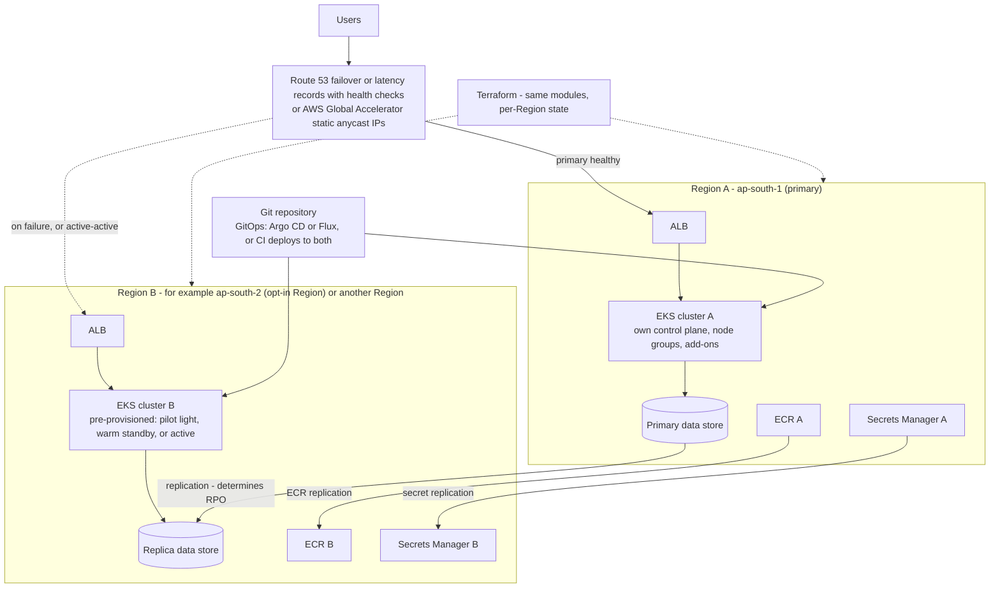

### 19.4 Building blocks

| Concern | Approach | Caveat |
|---|---|---|
| **Traffic management** | **Route 53** failover or latency/weighted records with health checks; or **AWS Global Accelerator** for static anycast IPs and faster failover than DNS caching allows | DNS failover depends on TTL and resolver behavior. Health checks must test something meaningful, not just "ALB responds" |
| **Application deployment** | Deploy the same manifests to both clusters through GitOps or CI; keep cluster-specific values (ARNs, hostnames) parameterized | Drift between clusters is the usual silent failure; detect it |
| **Independent failure domains** | Separate node groups, control planes, ideally separate VPCs/accounts for strong isolation | More cost and complexity |
| **Data** | **Shared** (one primary, with remote access) vs **replicated** (for example Aurora Global Database, DynamoDB global tables, S3 cross-Region replication) | Replication has lag (RPO > 0). Replication copies corruption. Decide write ownership and failover/failback procedures |
| **Container images** | Enable ECR cross-Region/cross-account replication | Image must exist in the standby Region *before* you need it |
| **Secrets and config** | Secrets Manager replica secrets; Parameter Store sync via IaC | Rotation and KMS keys per Region |
| **Infrastructure** | Terraform modules instantiated per Region with separate state | Test `plan` in the standby Region regularly |
| **Certificates** | ACM certificates are Regional: issue one per Region | Include in IaC |
| **Quotas** | Ensure the standby Region has quotas (vCPUs, EIPs, NAT gateways) to scale to production load | Quotas are per Region |

**RTO and RPO**

- **RTO (recovery time objective):** how long you can be down. Drives whether you need warm standby/active-active (minutes) or pilot light/backup-restore (hours).
- **RPO (recovery point objective):** how much data you can lose. Drives replication technology and mode.

Strategies, from cheapest/slowest to most expensive/fastest: **backup and restore → pilot light → warm standby → active-active**. See the [AWS Disaster Recovery whitepaper](https://docs.aws.amazon.com/whitepapers/latest/disaster-recovery-workloads-on-aws/disaster-recovery-workloads-on-aws.html).

> [!WARNING]
> ⚠️ Two clusters do **not** automatically give you seamless failover. You still need traffic management that detects failure correctly, replicated dependencies (data, secrets, images, DNS, certificates, identity), capacity in the standby, a data strategy that handles split-brain and failback, and a **tested** runbook. Untested DR is a hope, not a plan.

### 19.5 Decision matrix

| Question | A. Single cluster, multi-AZ | B. Two clusters, same Region | C. Multi-Region |
|---|---|---|---|
| Typical recovery from AZ failure | Automatic within the cluster | Automatic within each cluster | Automatic within each cluster |
| Recovery from a bad cluster change/upgrade | Rollback within the cluster; no spare cluster | Shift traffic to the other cluster | Shift traffic to the other cluster |
| Recovery from Region impairment | None | None | Yes, if dependencies are Regional-independent |
| Relative RTO for cluster-level failure | Long (rebuild or fix) | Short (traffic shift) | Short (traffic shift) |
| Relative RPO | Same as your data store | Same Region data, usually near-zero | Depends on cross-Region replication lag |
| Cost and complexity | Lowest | Roughly double compute plus traffic management | Highest (double compute, replication, data transfer, ops) |
| Choose when | Most workloads, with a tested rebuild path | You need safe cluster upgrades/blue-green and cluster-level isolation | Regulatory or business requirement to survive Region loss |

> [!TIP]
> ✅ **Production insight.** Start from the **business's RTO/RPO and the cost of downtime**, then pick the cheapest option that meets them. Many teams are better served by excellent single-cluster HA plus a *tested* infrastructure rebuild and data restore than by an untested second Region.

---

## 20. Production Readiness Checklist

> [!NOTE]
> 📘 A checklist cannot *guarantee* readiness. Real readiness depends on your application's requirements (latency, data durability, compliance, traffic shape) and on your team's ability to operate it at 3 a.m. Use this list to find gaps, not to declare victory.

### 20.1 Mandatory baseline (do not go live without these)

**Network design**
- [ ] CIDRs planned with the whole organization; no overlaps with peered/on-prem networks
- [ ] Subnets sized for peak pods, endpoints, and load balancers; free-IP alarms in place
- [ ] Public, private, and isolated tiers; database subnets have no default route
- [ ] NAT per AZ (or a documented single-NAT risk acceptance), private routes point to same-AZ NAT

**Availability Zone distribution**
- [ ] Nodes in three AZs; workloads spread across zones by topology constraints
- [ ] Capacity analysis for one-AZ loss (headroom or proven autoscaling)

**Identity and access**
- [ ] Cluster and node IAM roles reviewed; node role has only baseline permissions
- [ ] Kubernetes access via EKS access entries mapped to IAM roles; no shared admin; creator-admin removed or justified
- [ ] Workload access via Pod Identity/IRSA; one role per workload; no AWS access through the node role

**Private compute and API access**
- [ ] Worker nodes private (no public IPs)
- [ ] API endpoint restricted: private-only, or public with minimal CIDRs

**Capacity and scaling**
- [ ] Realistic resource requests; memory limits; node group min/max and quotas validated
- [ ] HPA configured and load-tested; node autoscaler (CA or Karpenter, not both on the same capacity) tested

**Workload resilience**
- [ ] ≥3 replicas for critical services; PDBs set; rolling updates with `maxUnavailable: 0` where appropriate
- [ ] Readiness, liveness, and startup probes correct; graceful termination and `preStop` configured

**Edge**
- [ ] ALB health checks tuned and consistent with readiness; deregistration delay aligned with termination grace
- [ ] TLS via ACM with a modern policy; HTTP→HTTPS redirect; DNS records and certificate renewal ownership clear

**Security**
- [ ] Secrets in Secrets Manager/SSM (or KMS-encrypted with strict RBAC), none in Git or images
- [ ] Images from private ECR, scanned, pinned by digest or immutable tags
- [ ] Pod Security `restricted` (or justified exceptions); non-root, read-only root FS, dropped capabilities

**Operations**
- [ ] Control-plane logs enabled with retention; metrics, logs, and alarms with owners
- [ ] SLOs defined; alerts routed to on-call; runbooks written (including the 5xx and node-loss runbooks)
- [ ] Backups for stateful data; restore tested
- [ ] Cost visibility: tags, budgets, alerts
- [ ] Terraform remote state encrypted, versioned, access-controlled, locked; plans reviewed in CI
- [ ] Upgrade strategy: Kubernetes version calendar owned; add-on and AMI update cadence defined
- [ ] Incident response process defined (roles, comms, postmortems)

### 20.2 Advanced hardening (add as risk and maturity require)

- [ ] Private-only API endpoint with VPN/Direct Connect/CI runners inside the VPC
- [ ] Interface VPC endpoints (and optionally no-NAT private cluster) with endpoint policies
- [ ] Default-deny NetworkPolicies everywhere; consider L7/FQDN policy tooling
- [ ] Admission policy (ValidatingAdmissionPolicy/Kyverno/Gatekeeper) enforcing registry, labels, resource rules
- [ ] Image signing and signature verification at admission; SBOMs; enhanced scanning
- [ ] AWS WAF on internet-facing ALBs; Shield Advanced where warranted
- [ ] GuardDuty EKS protection; centralized audit log analysis
- [ ] Service mesh or application-level mTLS where required
- [ ] Karpenter with tested disruption budgets and Spot interruption handling
- [ ] Multi-cluster or multi-Region DR, with **regularly executed** failover and failback tests
- [ ] Chaos/game-day practice using FIS and zonal shift
- [ ] Policy-as-code and drift detection for Terraform and cluster config

---

## 21. Teardown Procedure

> [!WARNING]
> ⚠️ **Destructive.** The steps below delete resources. Confirm `aws sts get-caller-identity` and the cluster context first. Order matters: **delete controller-created load balancers before destroying the VPC**, or `terraform destroy` fails because the ALB's network interfaces and security groups still depend on your subnets and VPC.

**1. Confirm you are in the right place**

```bash
aws sts get-caller-identity
kubectl config current-context
terraform workspace show 2>/dev/null; terraform state list | head -n 5
```

**2. Delete the Ingress and any `LoadBalancer` Services so the controller removes the AWS load balancers**

```bash
kubectl delete ingress --all -A
kubectl get svc -A | grep LoadBalancer      # delete any listed ones: kubectl delete svc <NAME> -n <NAMESPACE>

# Wait until the ALB (and NLB, if any) is gone. Re-run until the output is empty.
aws elbv2 describe-load-balancers --query "LoadBalancers[?contains(LoadBalancerName, 'k8s-')].[LoadBalancerName,State.Code]" --output table
```

**3. Remove the DNS alias record** (the ALB is gone; avoid a dangling record)

```bash
sed 's/"UPSERT"/"DELETE"/' dns-change.json > dns-delete.json
aws route53 change-resource-record-sets --hosted-zone-id "$ZONE_ID" --change-batch file://dns-delete.json
```

**4. Delete workloads, PVCs, and CLI-created monitoring objects**

```bash
kubectl delete namespace demo scaling-lab --ignore-not-found
kubectl get pvc -A                                   # delete any left over; EBS volumes may persist otherwise
aws cloudwatch delete-alarms --alarm-names "${CLUSTER_NAME}-alb-unhealthy-targets"
```

**5. Uninstall Helm releases**

```bash
helm uninstall cluster-autoscaler -n kube-system
helm uninstall metrics-server -n kube-system
helm uninstall aws-load-balancer-controller -n kube-system
```

**6. Review the destroy plan, then destroy**

```bash
terraform plan -destroy -out=destroy.tfplan          # READ IT. Confirm only this lab's resources are listed.
terraform apply destroy.tfplan
```

If you enabled EKS `deletion_protection`, set it to `false` and apply before destroying.

**7. Check for leftovers (they cost money)**

```bash
# Anything still tagged with this project (default_tags applied Project=eks-reference)
aws resourcegroupstaggingapi get-resources --tag-filters Key=Project,Values=eks-reference \
  --query 'ResourceTagMappingList[].ResourceARN' --output text

aws ec2 describe-nat-gateways --filter Name=state,Values=available,pending --query 'NatGateways[].NatGatewayId'
aws ec2 describe-addresses --query 'Addresses[?AssociationId==null].[PublicIp,AllocationId]'     # unattached Elastic IPs
aws ec2 describe-volumes --filters Name=status,Values=available --query 'Volumes[].[VolumeId,Size]'
aws ec2 describe-vpc-endpoints --query 'VpcEndpoints[].[VpcEndpointId,ServiceName]' --output table
aws logs describe-log-groups --log-group-name-prefix /aws/eks/ --query 'logGroups[].logGroupName'
aws logs describe-log-groups --log-group-name-prefix /aws/containerinsights/ --query 'logGroups[].logGroupName'
aws elbv2 describe-load-balancers --query 'LoadBalancers[].LoadBalancerName'
```

Container Insights log groups are created by the agent, not Terraform, so delete them yourself if present: `aws logs delete-log-group --log-group-name <NAME>`. The module's KMS key is scheduled for deletion with a waiting period rather than removed instantly.

**8. Last: remove the Terraform state bucket (only when you are completely done)**

The bucket is versioned, so `aws s3 rb --force` is not enough. Use the S3 console's **Empty** action (it removes all versions and delete markers), then delete the bucket. Do this *after* a successful destroy, since the state is how Terraform knows what exists.

**Teardown checklist**

- [ ] Ingresses and `LoadBalancer` Services deleted; ALB/NLB gone
- [ ] DNS record removed; ACM certificate and validation records removed by Terraform
- [ ] Namespaces and PVCs deleted; no `available` EBS volumes
- [ ] Helm releases uninstalled
- [ ] `terraform destroy` completed with no errors
- [ ] No NAT gateways, unattached Elastic IPs, interface endpoints, EKS clusters, or EC2 nodes remain
- [ ] CloudWatch log groups and alarms removed (including Container Insights groups)
- [ ] State bucket emptied and deleted (optional, last)
- [ ] AWS Cost Explorer / Budgets checked the next day

---

## 22. Official References and Further Learning

Links point to official documentation. They were written from knowledge of these documentation sets as of October 2026 and were not machine-validated one by one in this session. AWS reorganizes its documentation periodically; if a link has moved, search the page title on the same site.

**Amazon EKS**
- [EKS User Guide](https://docs.aws.amazon.com/eks/latest/userguide/what-is-eks.html)
- [EKS Best Practices Guides](https://docs.aws.amazon.com/eks/latest/best-practices/introduction.html) (reliability, security, networking, cost)
- [Kubernetes versions and support calendar](https://docs.aws.amazon.com/eks/latest/userguide/kubernetes-versions.html)
- [Cluster VPC and subnet requirements](https://docs.aws.amazon.com/eks/latest/userguide/network-reqs.html)
- [Private cluster requirements](https://docs.aws.amazon.com/eks/latest/userguide/private-clusters.html)
- [Access entries](https://docs.aws.amazon.com/eks/latest/userguide/access-entries.html)
- [EKS Pod Identity](https://docs.aws.amazon.com/eks/latest/userguide/pod-identities.html) and [IAM roles for service accounts (IRSA)](https://docs.aws.amazon.com/eks/latest/userguide/iam-roles-for-service-accounts.html)
- [Amazon VPC CNI](https://docs.aws.amazon.com/eks/latest/userguide/managing-vpc-cni.html), [prefix delegation](https://docs.aws.amazon.com/eks/latest/userguide/cni-increase-ip-addresses.html), [custom networking](https://docs.aws.amazon.com/eks/latest/userguide/cni-custom-network.html), and the [CNI project](https://github.com/aws/amazon-vpc-cni-k8s)
- [Managed node groups](https://docs.aws.amazon.com/eks/latest/userguide/managed-node-groups.html) and [EKS optimized AMIs](https://docs.aws.amazon.com/eks/latest/userguide/eks-optimized-ami.html)
- [Secrets envelope encryption](https://docs.aws.amazon.com/eks/latest/userguide/envelope-encryption.html)
- [EKS pricing](https://aws.amazon.com/eks/pricing/) and [SLA](https://aws.amazon.com/eks/sla/)

**Load balancing**
- [AWS Load Balancer Controller on EKS](https://docs.aws.amazon.com/eks/latest/userguide/aws-load-balancer-controller.html)
- [Controller documentation and annotation reference](https://kubernetes-sigs.github.io/aws-load-balancer-controller/latest/) and [releases / IAM policy](https://github.com/kubernetes-sigs/aws-load-balancer-controller/releases)
- [Application Load Balancer guide](https://docs.aws.amazon.com/elasticloadbalancing/latest/application/introduction.html), [Network Load Balancer guide](https://docs.aws.amazon.com/elasticloadbalancing/latest/network/introduction.html)
- [AWS Certificate Manager](https://docs.aws.amazon.com/acm/latest/userguide/acm-overview.html)

**VPC, endpoints, ECR**
- [Amazon VPC User Guide](https://docs.aws.amazon.com/vpc/latest/userguide/what-is-amazon-vpc.html), [NAT gateways](https://docs.aws.amazon.com/vpc/latest/userguide/vpc-nat-gateway.html), [subnet CIDR reservations](https://docs.aws.amazon.com/vpc/latest/userguide/subnet-cidr-reservation.html)
- [AWS PrivateLink and VPC endpoints](https://docs.aws.amazon.com/vpc/latest/privatelink/what-is-privatelink.html), [PrivateLink pricing](https://aws.amazon.com/privatelink/pricing/)
- [Amazon ECR User Guide](https://docs.aws.amazon.com/AmazonECR/latest/userguide/what-is-ecr.html) and [ECR VPC endpoints](https://docs.aws.amazon.com/AmazonECR/latest/userguide/vpc-endpoints.html)

**Kubernetes**
- [Topology spread constraints](https://kubernetes.io/docs/concepts/scheduling-eviction/topology-spread-constraints/)
- [PodDisruptionBudgets](https://kubernetes.io/docs/tasks/run-application/configure-pdb/)
- [Horizontal Pod Autoscaler walkthrough](https://kubernetes.io/docs/tasks/run-application/horizontal-pod-autoscale-walkthrough/)
- [Pod Security Standards](https://kubernetes.io/docs/concepts/security/pod-security-standards/)
- [ValidatingAdmissionPolicy](https://kubernetes.io/docs/reference/access-authn-authz/validating-admission-policy/)
- [Network Policies](https://kubernetes.io/docs/concepts/services-networking/network-policies/)

**Autoscaling**
- [Cluster Autoscaler on AWS](https://github.com/kubernetes/autoscaler/tree/master/cluster-autoscaler/cloudprovider/aws)
- [Karpenter documentation](https://karpenter.sh/docs/) and [compatibility matrix](https://karpenter.sh/docs/upgrading/compatibility/)
- [Metrics Server](https://github.com/kubernetes-sigs/metrics-server)

**Terraform**
- [AWS provider](https://registry.terraform.io/providers/hashicorp/aws/latest)
- [terraform-aws-modules/eks](https://registry.terraform.io/modules/terraform-aws-modules/eks/aws/latest) and its [v21 upgrade guide](https://github.com/terraform-aws-modules/terraform-aws-eks/blob/master/docs/UPGRADE-21.0.md)
- [S3 backend (including native locking)](https://developer.hashicorp.com/terraform/language/backend/s3)

**Resilience, DR, cost**
- [AWS Disaster Recovery of Workloads whitepaper](https://docs.aws.amazon.com/whitepapers/latest/disaster-recovery-workloads-on-aws/disaster-recovery-workloads-on-aws.html)
- [AWS Fault Injection Service](https://docs.aws.amazon.com/fis/latest/userguide/what-is.html) and [Application Recovery Controller zonal shift](https://docs.aws.amazon.com/r53recovery/latest/dg/arc-zonal-shift.html)
- [AWS Pricing Calculator](https://calculator.aws/), [VPC pricing](https://aws.amazon.com/vpc/pricing/), [Elastic Load Balancing pricing](https://aws.amazon.com/elasticloadbalancing/pricing/)

### Known limitations of this guide

- Prices and service quotas are deliberately not quoted; use the AWS Pricing Calculator and Service Quotas for your Region and account.
- Fargate, EKS Auto Mode, service meshes, GitOps tooling, and stateful storage (EBS/EFS CSI drivers) are mentioned but not implemented.
