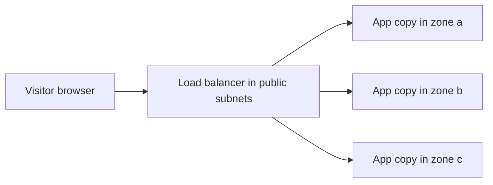
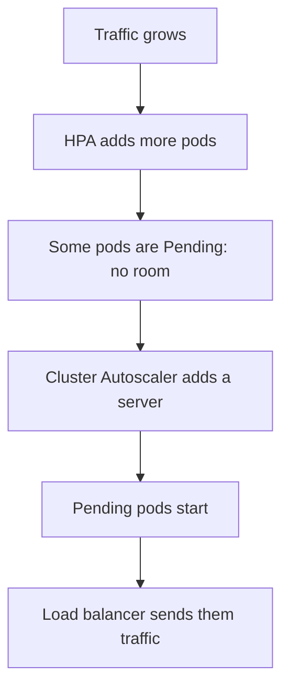

# Build a Production-Style Kubernetes Cluster on AWS (EKS): Beginner Guide

A step-by-step guide that takes you from an empty AWS account to a **working, load-balanced, auto-scaling web application** running on Amazon EKS (Kubernetes), built with Terraform.

You do not need to know Kubernetes already. Every step tells you **what** you are doing, **why**, the **exact commands**, and **how to check** that it worked.

| At a glance | |
|---|---|
| **Region** | `ap-south-1` (Mumbai) |
| **Time needed** | About 2 to 3 hours (creating the cluster alone takes 15 to 25 minutes) |
| **You will use** | AWS CLI, Terraform, kubectl, Helm, Docker |
| **Want the deep technical detail?** | See [ADVANCED.md](ADVANCED.md) after you finish |

> [!IMPORTANT]
> **This costs real money while it runs.** An EKS control plane, three servers, a NAT gateway and a load balancer are billed **by the hour** (roughly in the order of a dollar per hour or less for this setup; prices change, so check the [AWS Pricing Calculator](https://calculator.aws/)). **Do Part 9 (Clean up) the same day you finish.** Use a personal learning account, not a company production account.

> [!NOTE]
> **Honest status of this guide.** The configuration was checked against the official module and tool sources on 16 October 2026 (module inputs, controller IAM policy, versions). It has **not** been run end to end by the author in a live AWS account. Read every `terraform` plan before you say `yes`, and expect to fix small things.

---

## Table of contents

- [1. What you are building](#1-what-you-are-building)
- [Part 0: Before you start](#part-0-before-you-start)
- [Part 1: Create the network (VPC)](#part-1-create-the-network-vpc)
- [Part 2: Create the EKS cluster](#part-2-create-the-eks-cluster)
- [Part 3: Put an app on the cluster](#part-3-put-an-app-on-the-cluster)
- [Part 4: Install the AWS Load Balancer Controller](#part-4-install-the-aws-load-balancer-controller)
- [Part 5: Open the app to the internet (HTTP)](#part-5-open-the-app-to-the-internet-http)
- [Part 6 (optional): Add HTTPS with your own domain](#part-6-optional-add-https-with-your-own-domain)
- [Part 7: Autoscaling](#part-7-autoscaling)
- [Part 8: Break things on purpose](#part-8-break-things-on-purpose)
- [Part 9: Clean up (stop paying)](#part-9-clean-up-stop-paying)
- [Troubleshooting cheat sheet](#troubleshooting-cheat-sheet)
- [Glossary](#glossary)
- [Where to go next](#where-to-go-next)

---

## 1. What you are building

Plain English first. You will create:

1. **A private network** in AWS (called a *VPC*) spread across three data centers (called *Availability Zones*).
2. **A Kubernetes cluster** (EKS). AWS runs the "brain" of the cluster. Three servers (*nodes*) run your apps, one in each zone.
3. **A small web app** (a "hello" server) that Kubernetes runs as several copies (*pods*) spread across the zones.
4. **A public load balancer** that sends internet traffic to those copies.
5. **Autoscaling**: more copies of the app when busy, and more servers when the copies no longer fit.

### The big picture

```text
                           Internet
                              |
                     +--------v--------+
                     | Internet gateway|
                     +--------+--------+
  +---------------------------v-------------------------------------------+
  |  YOUR VPC  (private network)             Region: ap-south-1           |
  |                                                                       |
  |   Zone a              Zone b              Zone c                      |
  |  +-----------+      +-----------+      +-----------+                  |
  |  | PUBLIC    |      | PUBLIC    |      | PUBLIC    |  load balancer   |
  |  | subnet    |      | subnet    |      | subnet    |  + NAT gateway   |
  |  +-----------+      +-----------+      +-----------+                  |
  |  | PRIVATE   |      | PRIVATE   |      | PRIVATE   |  worker nodes    |
  |  | subnet    |      | subnet    |      | subnet    |  + app pods      |
  |  +-----------+      +-----------+      +-----------+                  |
  +-----------------------------------------------------------------------+
         |
         +--> EKS control plane (run by AWS, outside your network)
```

The servers that run your app sit in **private** subnets: nobody on the internet can reach them directly. Only the load balancer is public.

### How a visitor reaches your app



### The steps you will follow

| Part | What you do | Time |
|---|---|---|
| 0 | Install tools and log in to AWS | 20 min |
| 1 | Create the network with Terraform | 10 min |
| 2 | Create the EKS cluster with Terraform | 25 min |
| 3 | Put an app on the cluster | 15 min |
| 4 | Install the AWS Load Balancer Controller | 10 min |
| 5 | Open the app to the internet over HTTP | 10 min |
| 6 | *(Optional)* Add HTTPS with your own domain | 20 min |
| 7 | Autoscaling: more pods, then more servers | 30 min |
| 8 | Break things on purpose to see it recover | 15 min |
| 9 | **Clean up so you stop paying** | 15 min |

### Who builds what (this avoids a lot of confusion)

| Tool | It builds | Used in |
|---|---|---|
| **Terraform** | Network, cluster, nodes, permissions, image registry, certificate | Parts 1, 2, 4, 6 |
| **kubectl** | Your app inside the cluster | Parts 3, 5, 7 |
| **Helm** | Add-on software for the cluster (load balancer controller, autoscalers) | Parts 4, 7 |
| **The Load Balancer Controller** | The actual AWS load balancer, created for you when you apply an *Ingress* | Part 5 |

> You never create the load balancer by hand or in Terraform. You describe what you want in Kubernetes, and a controller creates it. That is how real EKS platforms work.

### Words you will meet

You do not need to memorize these. Come back to this table when a word is unfamiliar. A longer list is in the [Glossary](#glossary) at the end.

| Word | Plain-English meaning |
|---|---|
| **VPC** | Your own private network inside AWS |
| **Subnet** | A slice of the VPC inside one zone. *Public* can talk to the internet directly; *private* cannot be reached from it |
| **Availability Zone (AZ)** | One separate data center in a region. Using three means one failure does not take you down |
| **NAT gateway** | Lets private servers reach the internet (for downloads) without letting the internet reach them |
| **Node** | A server (EC2 instance) that runs your app containers |
| **Pod** | One running copy of your app |
| **Deployment** | "Keep N copies of this app running" |
| **Service** | A stable internal address for a group of pods |
| **Ingress** | "Please publish this Service to the internet": the request that leads to a load balancer |
| **Terraform state** | Terraform's notebook of what it has built. We keep it safely in S3 |

---

## Part 0: Before you start

### Step 0.1: Safety rules

1. Use a **personal sandbox AWS account**, not a company production account.
2. **Read the plan** Terraform shows you before typing `yes`.
3. **Destroy everything** (Part 9) when you finish.

### Step 0.2: Install the tools

You need a terminal with Bash: Linux, macOS, or **WSL 2 on Windows** (the commands will not work in plain Windows PowerShell).

| Tool | What it is for | Install guide | Check it works |
|---|---|---|---|
| AWS CLI v2 | Talk to AWS | [Install the AWS CLI](https://docs.aws.amazon.com/cli/latest/userguide/getting-started-install.html) | `aws --version` |
| Terraform 1.10 or newer | Build infrastructure from code | [Install Terraform](https://developer.hashicorp.com/terraform/install) | `terraform version` |
| kubectl | Talk to Kubernetes | [Install kubectl](https://kubernetes.io/docs/tasks/tools/) | `kubectl version --client` |
| Helm 3 | Install add-ons into Kubernetes | [Install Helm](https://helm.sh/docs/intro/install/) | `helm version` |
| Docker | Copy the sample image into your registry | [Get Docker](https://docs.docker.com/get-docker/) | `docker version` |
| jq and git | Small helpers used by some commands | Your package manager (`apt`, `brew`) | `jq --version` and `git --version` |

> **Why Terraform 1.10 or newer?** We store state in S3 with its built-in locking, which needs 1.10+.

### Step 0.3: Log in to AWS

Your AWS identity must be allowed to create VPCs, EKS clusters, IAM roles and load balancers. In a **personal sandbox account**, the simplest choice is a user or role with `AdministratorAccess`. For a shared or company account, use the least-privilege policy in [ADVANCED.md](ADVANCED.md#step-2-least-privilege-iam-for-provisioning) instead.

**Option A (recommended): IAM Identity Center (SSO).** Short-lived logins, no keys on disk.

```bash
aws configure sso --profile eks-lab
aws sso login --profile eks-lab
export AWS_PROFILE=eks-lab
```

**Option B (personal sandbox only): access keys.**

```bash
aws configure          # paste access key, secret key; region: ap-south-1; output: json
```

> [!WARNING]
> Never put access keys in a file you commit to Git. Delete the key when you finish the lab.

**Check it worked:**

```bash
aws sts get-caller-identity
```

You should see your 12-digit `Account` number. If you get an error, fix this before going on.

### Step 0.4: Set your shell variables

These variables are used by almost every command below, so you rarely have to type a value by hand.

```bash
export AWS_REGION=ap-south-1
export AWS_DEFAULT_REGION=ap-south-1
export CLUSTER_NAME=eks-ref
export AWS_ACCOUNT_ID=$(aws sts get-caller-identity --query Account --output text)
export ECR_REGISTRY="${AWS_ACCOUNT_ID}.dkr.ecr.${AWS_REGION}.amazonaws.com"
export TF_STATE_BUCKET="eks-ref-tfstate-${AWS_ACCOUNT_ID}-${AWS_REGION}"
echo "Account: $AWS_ACCOUNT_ID   Bucket: $TF_STATE_BUCKET"
```

> [!TIP]
> **If you open a new terminal window, run this block again.** Shell variables disappear when the terminal closes. (If you use SSO, also run `export AWS_PROFILE=eks-lab`.)

Check that Mumbai has the three zones we use:

```bash
aws ec2 describe-availability-zones --region "$AWS_REGION" \
  --query 'AvailabilityZones[].[ZoneName,State]' --output table
```

You should see `ap-south-1a`, `ap-south-1b` and `ap-south-1c`, all `available`.

---

## Part 1: Create the network (VPC)

**What:** Build the private network: 3 public subnets, 3 private subnets, an internet gateway, NAT gateways, route tables, and an image registry (ECR).

**Why first:** The cluster lives inside this network, and the servers need a working path to the internet (through NAT) before they can join the cluster. That is why we build in stages and not all at once.

### Step 1.1: How the network is divided

| Subnet type | CIDR block (address range) | Per zone | What lives there |
|---|---|---|---|
| Public | `10.0.0.0/24`, `10.0.1.0/24`, `10.0.2.0/24` | 1 | Load balancer, NAT gateway |
| Private | `10.0.16.0/20`, `10.0.32.0/20`, `10.0.48.0/20` | 1 | Worker nodes and pods (big ranges, so we never run out of IPs) |
| Database (reserved) | `10.0.64.0/24`, `10.0.65.0/24`, `10.0.66.0/24` | 1 | Empty for now. Created so you can add a database later |

You do not need to calculate anything. The code below already contains these numbers.

### Step 1.2: Create the project folder and the state bucket

```bash
mkdir -p eks-reference/k8s && cd eks-reference
```

Terraform keeps a notebook (the *state*) of what it created. We store it in a private, versioned S3 bucket so it is never lost:

```bash
aws s3api create-bucket --bucket "$TF_STATE_BUCKET" --region "$AWS_REGION" \
  --create-bucket-configuration LocationConstraint="$AWS_REGION"

aws s3api put-bucket-versioning --bucket "$TF_STATE_BUCKET" \
  --versioning-configuration Status=Enabled

aws s3api put-public-access-block --bucket "$TF_STATE_BUCKET" \
  --public-access-block-configuration BlockPublicAcls=true,IgnorePublicAcls=true,BlockPublicPolicy=true,RestrictPublicBuckets=true

aws s3api put-bucket-encryption --bucket "$TF_STATE_BUCKET" \
  --server-side-encryption-configuration '{"Rules":[{"ApplyServerSideEncryptionByDefault":{"SSEAlgorithm":"AES256"}}]}'
```

### Step 1.3: Create the Terraform files

Create each file below **inside the `eks-reference` folder** (use VS Code, `nano`, or any editor). Copy the content exactly. Click a file name to expand it.

<details>
<summary><b><code>versions.tf</code></b>: which Terraform and provider versions to use, and where state is stored</summary>

```hcl
terraform {
  required_version = ">= 1.10"

  required_providers {
    aws = {
      source  = "hashicorp/aws"
      version = "~> 6.0"
    }
    http = {
      source  = "hashicorp/http"
      version = "~> 3.4"
    }
  }

  backend "s3" {
    bucket       = "<TF_STATE_BUCKET>" # replace: the bucket created above
    key          = "eks-reference/ap-south-1/terraform.tfstate"
    region       = "ap-south-1"
    encrypt      = true
    use_lockfile = true # S3-native state locking (Terraform >= 1.10)
  }
}

provider "aws" {
  region = var.region

  default_tags {
    tags = {
      Project     = "eks-reference"
      Environment = var.environment
      ManagedBy   = "terraform"
    }
  }
}
```

</details>

Replace the bucket placeholder in that file with your real bucket name (this one command does it):

```bash
sed -i.bak "s/<TF_STATE_BUCKET>/${TF_STATE_BUCKET}/" versions.tf
grep bucket versions.tf       # you should see your bucket name, not <TF_STATE_BUCKET>
```

<details>
<summary><b><code>variables.tf</code></b>: the settings you can change (all have safe defaults except one)</summary>

```hcl
variable "region" {
  type    = string
  default = "ap-south-1"
}

variable "environment" {
  type    = string
  default = "lab"
}

variable "cluster_name" {
  type    = string
  default = "eks-ref"
}

variable "kubernetes_version" {
  description = "EKS Kubernetes version. Verify with: aws eks describe-cluster-versions"
  type        = string
  default     = "1.35"
}

variable "vpc_cidr" {
  type    = string
  default = "10.0.0.0/16"
}

variable "azs" {
  type    = list(string)
  default = ["ap-south-1a", "ap-south-1b", "ap-south-1c"]
}

variable "public_subnet_cidrs" {
  type    = list(string)
  default = ["10.0.0.0/24", "10.0.1.0/24", "10.0.2.0/24"]
}

variable "private_subnet_cidrs" {
  type    = list(string)
  default = ["10.0.16.0/20", "10.0.32.0/20", "10.0.48.0/20"]
}

variable "database_subnet_cidrs" {
  type    = list(string)
  default = ["10.0.64.0/24", "10.0.65.0/24", "10.0.66.0/24"]
}

variable "single_nat_gateway" {
  description = "true = one shared NAT (cheap lab, AZ dependency). false = one NAT per AZ (production)."
  type        = bool
  default     = false
}

variable "enable_vpc_endpoints" {
  description = "Create interface endpoints (hourly cost per endpoint per AZ). The S3 gateway endpoint is always created (free)."
  type        = bool
  default     = false
}

variable "api_allowed_cidrs" {
  description = "CIDRs allowed to reach the PUBLIC Kubernetes API endpoint. Never use 0.0.0.0/0."
  type        = list(string)

  validation {
    condition     = !contains(var.api_allowed_cidrs, "0.0.0.0/0") && length(var.api_allowed_cidrs) > 0
    error_message = "Provide specific CIDRs (for example your /32); 0.0.0.0/0 is not allowed."
  }
}

variable "node_instance_types" {
  type    = list(string)
  default = ["m6i.large"]
}

variable "node_min_size" {
  type    = number
  default = 1
}

variable "node_max_size" {
  type    = number
  default = 4
}

variable "node_desired_size" {
  description = "Initial desired nodes PER AZ node group. Autoscalers change this afterwards."
  type        = number
  default     = 1
}
```

</details>

Now create your own settings file. This command writes it for you, using your current public IP so that **only you** can reach the cluster API:

```bash
MY_IP=$(curl -s https://checkip.amazonaws.com | tr -d '[:space:]')
cat > terraform.tfvars <<EOF
api_allowed_cidrs  = ["${MY_IP}/32"]
single_nat_gateway = true
EOF
cat terraform.tfvars
```

> **What is `single_nat_gateway = true`?** One NAT gateway instead of three. It is cheaper and fine for learning. In real production you keep one per zone so that one zone failing cannot cut off the others' internet access. Remove the line to get three.

<details>
<summary><b><code>vpc.tf</code></b>: the VPC, subnets, internet gateway, NAT gateways and route tables</summary>

```hcl
locals {
  # { "ap-south-1a" = 0, "ap-south-1b" = 1, "ap-south-1c" = 2 }
  az_index = { for i, az in var.azs : az => i }

  # Which AZs get a NAT gateway
  nat_azs = var.single_nat_gateway ? [var.azs[0]] : var.azs
}

resource "aws_vpc" "main" {
  cidr_block           = var.vpc_cidr
  enable_dns_support   = true # required for EKS and interface endpoints
  enable_dns_hostnames = true # required for EKS and endpoint private DNS

  tags = { Name = "${var.cluster_name}-vpc" }
}

resource "aws_internet_gateway" "main" {
  vpc_id = aws_vpc.main.id
  tags   = { Name = "${var.cluster_name}-igw" }
}

# ---------- Subnets ----------

resource "aws_subnet" "public" {
  for_each = local.az_index

  vpc_id                  = aws_vpc.main.id
  availability_zone       = each.key
  cidr_block              = var.public_subnet_cidrs[each.value]
  map_public_ip_on_launch = false # internet-facing ALB nodes and NAT EIPs get public addresses regardless

  tags = {
    Name                                        = "${var.cluster_name}-public-${each.key}"
    Tier                                        = "public"
    "kubernetes.io/role/elb"                    = "1"      # LBC discovers these for internet-facing LBs
    "kubernetes.io/cluster/${var.cluster_name}" = "shared" # optional with modern LBC; harmless and explicit
  }
}

resource "aws_subnet" "private" {
  for_each = local.az_index

  vpc_id                  = aws_vpc.main.id
  availability_zone       = each.key
  cidr_block              = var.private_subnet_cidrs[each.value]
  map_public_ip_on_launch = false

  tags = {
    Name                                        = "${var.cluster_name}-private-${each.key}"
    Tier                                        = "private"
    "kubernetes.io/role/internal-elb"           = "1" # LBC discovers these for internal LBs
    "kubernetes.io/cluster/${var.cluster_name}" = "shared"
    "karpenter.sh/discovery"                    = var.cluster_name # only used if you adopt Karpenter
  }
}

resource "aws_subnet" "database" {
  for_each = local.az_index

  vpc_id                  = aws_vpc.main.id
  availability_zone       = each.key
  cidr_block              = var.database_subnet_cidrs[each.value]
  map_public_ip_on_launch = false

  tags = {
    Name = "${var.cluster_name}-db-${each.key}"
    Tier = "isolated-database"
  }
}

# ---------- NAT gateways (EIP per NAT) ----------

resource "aws_eip" "nat" {
  for_each = toset(local.nat_azs)

  domain = "vpc"
  tags   = { Name = "${var.cluster_name}-nat-eip-${each.key}" }

  depends_on = [aws_internet_gateway.main]
}

resource "aws_nat_gateway" "main" {
  for_each = toset(local.nat_azs)

  allocation_id = aws_eip.nat[each.key].id
  subnet_id     = aws_subnet.public[each.key].id # NAT lives in a PUBLIC subnet
  tags          = { Name = "${var.cluster_name}-nat-${each.key}" }

  depends_on = [aws_internet_gateway.main]
}

# ---------- Route tables ----------

# Public: one shared table. Local route is implicit; add the default route to the IGW.
resource "aws_route_table" "public" {
  vpc_id = aws_vpc.main.id
  tags   = { Name = "${var.cluster_name}-rt-public" }
}

resource "aws_route" "public_internet" {
  route_table_id         = aws_route_table.public.id
  destination_cidr_block = "0.0.0.0/0"
  gateway_id             = aws_internet_gateway.main.id
}

resource "aws_route_table_association" "public" {
  for_each       = aws_subnet.public
  subnet_id      = each.value.id
  route_table_id = aws_route_table.public.id
}

# Private: one table PER AZ so each AZ routes to the NAT in the SAME AZ
resource "aws_route_table" "private" {
  for_each = local.az_index

  vpc_id = aws_vpc.main.id
  tags   = { Name = "${var.cluster_name}-rt-private-${each.key}" }
}

resource "aws_route" "private_nat" {
  for_each = local.az_index

  route_table_id         = aws_route_table.private[each.key].id
  destination_cidr_block = "0.0.0.0/0"
  nat_gateway_id         = aws_nat_gateway.main[var.single_nat_gateway ? var.azs[0] : each.key].id
}

resource "aws_route_table_association" "private" {
  for_each       = aws_subnet.private
  subnet_id      = each.value.id
  route_table_id = aws_route_table.private[each.key].id
}

# Database: local route only. NO default route, NO NAT, NO IGW.
resource "aws_route_table" "database" {
  vpc_id = aws_vpc.main.id
  tags   = { Name = "${var.cluster_name}-rt-database" }
}

resource "aws_route_table_association" "database" {
  for_each       = aws_subnet.database
  subnet_id      = each.value.id
  route_table_id = aws_route_table.database.id
}
```

</details>

<details>
<summary><b><code>endpoints.tf</code></b>: private shortcuts to AWS services (only the free S3 one is on by default)</summary>

```hcl
locals {
  interface_endpoint_services = [
    "ecr.api",   # ECR control API (auth token, metadata)
    "ecr.dkr",   # Docker registry API (manifests)
    "sts",       # STS (IRSA/clients that call STS)
    "logs",      # CloudWatch Logs
    "ec2",       # EC2 API (VPC CNI, autoscalers)
    "eks-auth",  # EKS Pod Identity credential retrieval
  ]
}

# Gateway endpoint for S3: free, and keeps ECR layer downloads off the NAT gateway.
resource "aws_vpc_endpoint" "s3" {
  vpc_id            = aws_vpc.main.id
  service_name      = "com.amazonaws.${var.region}.s3"
  vpc_endpoint_type = "Gateway"
  route_table_ids   = [for rt in aws_route_table.private : rt.id]

  tags = { Name = "${var.cluster_name}-vpce-s3" }
}

resource "aws_security_group" "vpce" {
  count = var.enable_vpc_endpoints ? 1 : 0

  name_prefix = "${var.cluster_name}-vpce-"
  description = "Allow HTTPS from the VPC to interface endpoints"
  vpc_id      = aws_vpc.main.id

  ingress {
    description = "HTTPS from VPC"
    from_port   = 443
    to_port     = 443
    protocol    = "tcp"
    cidr_blocks = [var.vpc_cidr]
  }

  tags = { Name = "${var.cluster_name}-vpce-sg" }

  lifecycle {
    create_before_destroy = true
  }
}

resource "aws_vpc_endpoint" "interface" {
  for_each = var.enable_vpc_endpoints ? toset(local.interface_endpoint_services) : toset([])

  vpc_id              = aws_vpc.main.id
  service_name        = "com.amazonaws.${var.region}.${each.key}"
  vpc_endpoint_type   = "Interface"
  subnet_ids          = [for s in aws_subnet.private : s.id] # one ENI per AZ
  security_group_ids  = [aws_security_group.vpce[0].id]
  private_dns_enabled = true

  tags = { Name = "${var.cluster_name}-vpce-${each.key}" }
}
```

</details>

<details>
<summary><b><code>ecr.tf</code></b>: a private registry to store your app image</summary>

```hcl
resource "aws_ecr_repository" "http_echo" {
  name                 = "demo/http-echo"
  image_tag_mutability = "IMMUTABLE" # tags cannot be overwritten: safer rollouts and provenance
  force_delete         = true        # LAB ONLY: lets terraform destroy remove a non-empty repo

  image_scanning_configuration {
    scan_on_push = true # basic scanning; consider enhanced scanning (Amazon Inspector) in production
  }

  encryption_configuration {
    encryption_type = "AES256" # use KMS with a customer-managed key if your policy requires it
  }
}

resource "aws_ecr_lifecycle_policy" "http_echo" {
  repository = aws_ecr_repository.http_echo.name
  policy = jsonencode({
    rules = [{
      rulePriority = 1
      description  = "Keep the last 20 images"
      selection    = { tagStatus = "any", countType = "imageCountMoreThan", countNumber = 20 }
      action       = { type = "expire" }
    }]
  })
}
```

</details>

<details>
<summary><b><code>outputs.tf</code></b>: values we read later</summary>

```hcl
output "vpc_id" {
  value = aws_vpc.main.id
}

output "public_subnet_ids" {
  value = { for az, s in aws_subnet.public : az => s.id }
}

output "private_subnet_ids" {
  value = { for az, s in aws_subnet.private : az => s.id }
}

output "database_subnet_ids" {
  value = { for az, s in aws_subnet.database : az => s.id }
}

output "ecr_repository_url" {
  value = aws_ecr_repository.http_echo.repository_url
}
```

</details>

### Step 1.4: Build it

```bash
terraform init
terraform validate
terraform apply
```

`terraform apply` first prints a **plan**: a list of everything it will create. Skim it. When it asks `Enter a value:`, type `yes`.

**Check it worked:**

```bash
VPC_ID=$(terraform output -raw vpc_id)

aws ec2 describe-subnets --filters Name=vpc-id,Values="$VPC_ID" \
  --query 'Subnets[].{Name:Tags[?Key==`Name`]|[0].Value,AZ:AvailabilityZone,CIDR:CidrBlock}' --output table

aws ec2 describe-nat-gateways --filter Name=vpc-id,Values="$VPC_ID" \
  --query 'NatGateways[].[NatGatewayId,State,SubnetId]' --output table
```

You should see 9 subnets and the NAT gateway in state `available`.

> **If it fails:** an `AddressLimitExceeded` error means your account has no free Elastic IPs. Release unused ones, or request a quota increase, and run `terraform apply` again.

---

## Part 2: Create the EKS cluster

**What:** Create the Kubernetes cluster and three worker servers (one per zone) plus the essential add-ons.

**Why:** AWS runs the control plane (the "brain") for you. You own the worker nodes. Our nodes sit in private subnets, and the cluster API is reachable only from your IP.

### Step 2.1: Create `eks.tf`

<details>
<summary><b><code>eks.tf</code></b>: the cluster, node groups, add-ons, and three outputs</summary>

```hcl
locals {
  # One managed node group per AZ: ng-a, ng-b, ng-c
  node_groups = {
    for az, i in local.az_index :
    "ng-${substr(az, -1, 1)}" => { subnet_id = aws_subnet.private[az].id, az = az }
  }
}

module "eks" {
  source  = "terraform-aws-modules/eks/aws"
  version = "~> 21.0"

  name               = var.cluster_name
  kubernetes_version = var.kubernetes_version

  # --- Networking: control-plane ENIs and nodes live in the PRIVATE subnets ---
  vpc_id                   = aws_vpc.main.id
  subnet_ids               = [for s in aws_subnet.private : s.id]
  control_plane_subnet_ids = [for s in aws_subnet.private : s.id]

  # --- API endpoint access (separate decision from node placement) ---
  endpoint_private_access      = true                     # nodes and in-VPC clients reach the API privately
  endpoint_public_access       = true                     # lab convenience: kubectl/helm from your laptop
  endpoint_public_access_cidrs = var.api_allowed_cidrs    # never 0.0.0.0/0

  # --- Access: EKS access entries (no aws-auth ConfigMap) ---
  authentication_mode                      = "API"
  enable_cluster_creator_admin_permissions = true # grants the identity running Terraform cluster-admin via an access entry

  # --- Control-plane logging to CloudWatch (additional cost) ---
  enabled_log_types                      = ["api", "audit", "authenticator", "controllerManager", "scheduler"]
  cloudwatch_log_group_retention_in_days = 30

  deletion_protection = false # LAB: set to true in production

  # --- Core add-ons (managed by EKS) ---
  addons = {
    eks-pod-identity-agent = {
      before_compute = true
    }
    vpc-cni = {
      before_compute = true
      configuration_values = jsonencode({
        enableNetworkPolicy = "true" # native NetworkPolicy support (ADVANCED.md Section 15)
      })
    }
    kube-proxy = {}
    coredns = {
      configuration_values = jsonencode({
        replicaCount = 3 # one per AZ at minimum for DNS availability
      })
    }
  }

  # --- Managed node groups: private subnets, one per AZ ---
  eks_managed_node_groups = {
    for name, ng in local.node_groups : name => {
      ami_type       = "AL2023_x86_64_STANDARD"
      instance_types = var.node_instance_types
      capacity_type  = "ON_DEMAND"

      min_size     = var.node_min_size
      max_size     = var.node_max_size
      desired_size = var.node_desired_size

      subnet_ids = [ng.subnet_id] # nodes in exactly one AZ per group

      labels = { workload = "general" }

      update_config = { max_unavailable = 1 }

      block_device_mappings = {
        xvda = {
          device_name = "/dev/xvda"
          ebs = {
            volume_size           = 50
            volume_type           = "gp3"
            encrypted             = true
            delete_on_termination = true
          }
        }
      }
    }
  }

  tags = { Cluster = var.cluster_name }
}

output "cluster_name" {
  value = module.eks.cluster_name
}

output "cluster_endpoint" {
  value = module.eks.cluster_endpoint
}

output "node_security_group_id" {
  value = module.eks.node_security_group_id
}
```

</details>

Things worth knowing about this file (you do not have to change anything):

- **`ng-a`, `ng-b`, `ng-c`:** one node group per zone, each starting with 1 server. This makes autoscaling predictable.
- **Add-ons:** `vpc-cni` (pod networking), `coredns` (internal DNS), `kube-proxy`, and `eks-pod-identity-agent` (lets pods use AWS permissions safely).
- **`enable_cluster_creator_admin_permissions`:** whoever runs Terraform becomes cluster admin. Keep using the same AWS identity for `kubectl`.

### Step 2.2: Build it (15 to 25 minutes)

```bash
terraform init          # downloads the EKS module
terraform apply
```

Skim the plan, type `yes`, and wait. This is the slowest step. Get a coffee.

### Step 2.3: Connect `kubectl` to the cluster

```bash
aws eks update-kubeconfig --region "$AWS_REGION" --name "$CLUSTER_NAME"
kubectl get nodes -L topology.kubernetes.io/zone
```

**Check it worked.** You should see **3 nodes** with status `Ready`, one in each of `ap-south-1a`, `ap-south-1b`, `ap-south-1c`. Two more checks:

```bash
kubectl get nodes -o wide            # EXTERNAL-IP should be <none>: nodes are private
kubectl get pods -n kube-system      # everything should be Running
```

> **If it fails:**
> - `Unable to connect` or a timeout: your public IP changed. Re-run the `MY_IP` / `cat > terraform.tfvars` commands from Step 1.3, then `terraform apply`.
> - `Unauthorized`: you are using a different AWS identity than the one that ran Terraform. Run `aws sts get-caller-identity` and compare.

---

## Part 3: Put an app on the cluster

**What:** Copy a tiny web server image into your private registry (ECR), then run it as two apps called `frontend` and `api`, three copies each.

**Why:** This is what Kubernetes is for: running several copies of your software, spread across zones, replacing any that fail.

### Step 3.1: Copy the image into ECR

```bash
ECR_REPO_URL=$(terraform output -raw ecr_repository_url)
IMAGE_TAG=1.0.0

aws ecr get-login-password --region "$AWS_REGION" \
  | docker login --username AWS --password-stdin "$ECR_REGISTRY"

# The nodes are x86 (linux/amd64). Pull that version even if your laptop is ARM.
docker pull --platform linux/amd64 hashicorp/http-echo:${IMAGE_TAG}
docker tag  hashicorp/http-echo:${IMAGE_TAG} "${ECR_REPO_URL}:${IMAGE_TAG}"
docker push "${ECR_REPO_URL}:${IMAGE_TAG}"
```

**Check it worked:**

```bash
aws ecr describe-images --repository-name demo/http-echo \
  --query 'imageDetails[].[imageTags,imagePushedAt]' --output table
```

### Step 3.2: Create the Kubernetes files

<details>
<summary><b><code>k8s/00-namespace.yaml</code></b>: a separate "room" for the app, with security rules</summary>

```yaml
# 00-namespace.yaml
apiVersion: v1
kind: Namespace
metadata:
  name: demo
  labels:
    # Pod Security Standards: reject pods that violate the "restricted" profile
    pod-security.kubernetes.io/enforce: restricted
    pod-security.kubernetes.io/enforce-version: latest
    pod-security.kubernetes.io/warn: restricted
    # Make the AWS Load Balancer Controller inject a readiness gate so pods
    # are not considered Ready until their ALB targets are healthy (IP target mode)
    elbv2.k8s.aws/pod-readiness-gate-inject: enabled
```

</details>

<details>
<summary><b><code>k8s/10-app.yaml</code></b>: two apps, their Services, and a safety budget for upgrades</summary>

```yaml
# 10-app.yaml
apiVersion: apps/v1
kind: Deployment
metadata:
  name: frontend
  namespace: demo
  labels: { app: frontend }
spec:
  replicas: 3
  revisionHistoryLimit: 5
  selector:
    matchLabels: { app: frontend }
  strategy:
    type: RollingUpdate
    rollingUpdate:
      maxSurge: 1
      maxUnavailable: 0           # never drop below desired capacity during a rollout
  template:
    metadata:
      labels: { app: frontend }
    spec:
      terminationGracePeriodSeconds: 45
      automountServiceAccountToken: false   # this app never calls the Kubernetes API
      securityContext:
        runAsNonRoot: true
        runAsUser: 65532
        runAsGroup: 65532
        fsGroup: 65532
        seccompProfile: { type: RuntimeDefault }
      topologySpreadConstraints:
        - maxSkew: 1                           # spread evenly across AZs
          topologyKey: topology.kubernetes.io/zone
          whenUnsatisfiable: DoNotSchedule
          nodeTaintsPolicy: Honor              # ignore tainted/unavailable nodes when computing skew (see ADVANCED.md Section 10)
          labelSelector:
            matchLabels: { app: frontend }
        - maxSkew: 1                           # and across nodes, as a softer preference
          topologyKey: kubernetes.io/hostname
          whenUnsatisfiable: ScheduleAnyway
          labelSelector:
            matchLabels: { app: frontend }
      tolerations:                             # react to a dead node faster than the 300s default
        - key: node.kubernetes.io/unreachable
          operator: Exists
          effect: NoExecute
          tolerationSeconds: 60
        - key: node.kubernetes.io/not-ready
          operator: Exists
          effect: NoExecute
          tolerationSeconds: 60
      containers:
        - name: app
          image: <AWS_ACCOUNT_ID>.dkr.ecr.ap-south-1.amazonaws.com/demo/http-echo:1.0.0
          args: ["-listen=:5678", "-text=frontend ok"]
          ports:
            - name: http
              containerPort: 5678
          securityContext:
            allowPrivilegeEscalation: false
            readOnlyRootFilesystem: true
            capabilities: { drop: ["ALL"] }
          resources:
            requests: { cpu: 50m, memory: 32Mi }
            limits: { memory: 64Mi }           # memory limit protects the node; no CPU limit to avoid throttling
          startupProbe:                        # gives slow starters time before liveness applies
            httpGet: { path: /, port: http }
            periodSeconds: 2
            failureThreshold: 15
          readinessProbe:                      # controls whether the pod receives traffic
            httpGet: { path: /, port: http }
            periodSeconds: 5
            failureThreshold: 2
          livenessProbe:                       # restarts a wedged container
            httpGet: { path: /, port: http }
            periodSeconds: 10
            failureThreshold: 3
          lifecycle:
            preStop:
              sleep: { seconds: 15 }           # keep serving while the ALB deregisters this target
---
apiVersion: v1
kind: Service
metadata:
  name: frontend
  namespace: demo
spec:
  type: ClusterIP                              # enough for ALB IP target mode (see ADVANCED.md Section 11)
  selector: { app: frontend }
  ports:
    - name: http
      port: 80
      targetPort: http
---
apiVersion: policy/v1
kind: PodDisruptionBudget
metadata:
  name: frontend
  namespace: demo
spec:
  maxUnavailable: 1                            # voluntary disruptions (drains) may take at most one pod
  selector:
    matchLabels: { app: frontend }
---
apiVersion: apps/v1
kind: Deployment
metadata:
  name: api
  namespace: demo
  labels: { app: api }
spec:
  replicas: 3
  revisionHistoryLimit: 5
  selector:
    matchLabels: { app: api }
  strategy:
    type: RollingUpdate
    rollingUpdate:
      maxSurge: 1
      maxUnavailable: 0
  template:
    metadata:
      labels: { app: api }
    spec:
      terminationGracePeriodSeconds: 45
      automountServiceAccountToken: false
      securityContext:
        runAsNonRoot: true
        runAsUser: 65532
        runAsGroup: 65532
        fsGroup: 65532
        seccompProfile: { type: RuntimeDefault }
      topologySpreadConstraints:
        - maxSkew: 1
          topologyKey: topology.kubernetes.io/zone
          whenUnsatisfiable: DoNotSchedule
          nodeTaintsPolicy: Honor
          labelSelector:
            matchLabels: { app: api }
        - maxSkew: 1
          topologyKey: kubernetes.io/hostname
          whenUnsatisfiable: ScheduleAnyway
          labelSelector:
            matchLabels: { app: api }
      tolerations:
        - key: node.kubernetes.io/unreachable
          operator: Exists
          effect: NoExecute
          tolerationSeconds: 60
        - key: node.kubernetes.io/not-ready
          operator: Exists
          effect: NoExecute
          tolerationSeconds: 60
      containers:
        - name: app
          image: <AWS_ACCOUNT_ID>.dkr.ecr.ap-south-1.amazonaws.com/demo/http-echo:1.0.0
          args: ["-listen=:5678", "-text=api ok"]
          ports:
            - name: http
              containerPort: 5678
          securityContext:
            allowPrivilegeEscalation: false
            readOnlyRootFilesystem: true
            capabilities: { drop: ["ALL"] }
          resources:
            requests: { cpu: 50m, memory: 32Mi }
            limits: { memory: 64Mi }
          startupProbe:
            httpGet: { path: /, port: http }
            periodSeconds: 2
            failureThreshold: 15
          readinessProbe:
            httpGet: { path: /, port: http }
            periodSeconds: 5
            failureThreshold: 2
          livenessProbe:
            httpGet: { path: /, port: http }
            periodSeconds: 10
            failureThreshold: 3
          lifecycle:
            preStop:
              sleep: { seconds: 15 }
---
apiVersion: v1
kind: Service
metadata:
  name: api
  namespace: demo
spec:
  type: ClusterIP
  selector: { app: api }
  ports:
    - name: http
      port: 80
      targetPort: http
---
apiVersion: policy/v1
kind: PodDisruptionBudget
metadata:
  name: api
  namespace: demo
spec:
  maxUnavailable: 1
  selector:
    matchLabels: { app: api }
```

</details>

Put your AWS account number into the image address:

```bash
sed -i.bak "s/<AWS_ACCOUNT_ID>/${AWS_ACCOUNT_ID}/g" k8s/10-app.yaml
grep "image:" k8s/10-app.yaml        # the image line should show your 12-digit account number
```

### Step 3.3: Deploy

```bash
kubectl apply -f k8s/00-namespace.yaml
kubectl apply -f k8s/10-app.yaml
kubectl -n demo rollout status deploy/frontend
kubectl -n demo rollout status deploy/api
```

**Check it worked:**

```bash
kubectl -n demo get pods -o wide
```

You should see **6 pods** (3 `frontend`, 3 `api`), all `Running` and `1/1` ready, spread over different nodes. Now call the app from your own computer through a temporary tunnel:

```bash
kubectl -n demo port-forward svc/frontend 8080:80 >/dev/null 2>&1 &
PF_PID=$!
sleep 3
curl -s http://127.0.0.1:8080/
kill $PF_PID
```

You should see `frontend ok`. The app works inside the cluster. Next we make it reachable from the internet.

> **If a pod is stuck:** run `kubectl -n demo describe pod <pod-name>` and read the **Events** at the bottom. `ImagePullBackOff` usually means the image was not pushed or the account number in the file is wrong.

---

## Part 4: Install the AWS Load Balancer Controller

**What:** Install a helper program inside the cluster that watches for *Ingress* requests and builds real AWS load balancers for them.

**Why:** Kubernetes cannot create AWS load balancers on its own. This controller does it, and it needs AWS permissions. We give it those through **EKS Pod Identity**, which gives permissions to one specific program only, without storing any keys.

### Step 4.1: Pick the controller version

The controller's chart version and the IAM permissions file must come from the **same release**. This finds the newest one for you:

```bash
helm repo add eks https://aws.github.io/eks-charts
helm repo update

LBC_JSON=$(helm search repo eks/aws-load-balancer-controller --versions -o json | jq '.[0]')
export LBC_CHART_VERSION=$(echo "$LBC_JSON" | jq -r '.version')
export LBC_APP_VERSION=$(echo "$LBC_JSON" | jq -r '.app_version')
case "$LBC_APP_VERSION" in v*) ;; *) LBC_APP_VERSION="v${LBC_APP_VERSION}" ;; esac
echo "chart=${LBC_CHART_VERSION}  app=${LBC_APP_VERSION}"
```

You should see something like `chart=3.6.0  app=v3.6.0`. Save the app version for Terraform:

```bash
echo "lbc_app_version = \"${LBC_APP_VERSION}\"" >> terraform.tfvars
cat terraform.tfvars
```

### Step 4.2: Create `iam.tf`

This file creates the permissions for the load balancer controller **and** for the Cluster Autoscaler that we use in Part 7 (so we only apply once).

<details>
<summary><b><code>iam.tf</code></b>: IAM policies, roles and Pod Identity links</summary>

```hcl
variable "lbc_app_version" {
  description = "AWS Load Balancer Controller release tag (for example vX.Y.Z) whose IAM policy to fetch. Must match the Helm chart's APP VERSION (ADVANCED.md Section 12)."
  type        = string
}

data "aws_iam_policy_document" "pod_identity_trust" {
  statement {
    effect  = "Allow"
    actions = ["sts:AssumeRole", "sts:TagSession"]

    principals {
      type        = "Service"
      identifiers = ["pods.eks.amazonaws.com"]
    }
  }
}

# ---------- AWS Load Balancer Controller ----------

# Official AWS-maintained policy for exactly the controller release you install
data "http" "lbc_policy" {
  url = "https://raw.githubusercontent.com/kubernetes-sigs/aws-load-balancer-controller/${var.lbc_app_version}/docs/install/iam_policy.json"

  lifecycle {
    postcondition {
      condition     = self.status_code == 200
      error_message = "Could not download the controller IAM policy for ${var.lbc_app_version}. Check the tag exists."
    }
  }
}

resource "aws_iam_policy" "lbc" {
  name   = "${var.cluster_name}-aws-load-balancer-controller"
  policy = data.http.lbc_policy.response_body
}

resource "aws_iam_role" "lbc" {
  name               = "${var.cluster_name}-aws-load-balancer-controller"
  assume_role_policy = data.aws_iam_policy_document.pod_identity_trust.json
}

resource "aws_iam_role_policy_attachment" "lbc" {
  role       = aws_iam_role.lbc.name
  policy_arn = aws_iam_policy.lbc.arn
}

resource "aws_eks_pod_identity_association" "lbc" {
  cluster_name    = module.eks.cluster_name
  namespace       = "kube-system"
  service_account = "aws-load-balancer-controller"
  role_arn        = aws_iam_role.lbc.arn
}

# ---------- Cluster Autoscaler (used in ADVANCED.md Section 14) ----------

data "aws_iam_policy_document" "cluster_autoscaler" {
  statement {
    sid    = "Read"
    effect = "Allow"
    actions = [
      "autoscaling:DescribeAutoScalingGroups",
      "autoscaling:DescribeAutoScalingInstances",
      "autoscaling:DescribeLaunchConfigurations",
      "autoscaling:DescribeScalingActivities",
      "autoscaling:DescribeTags",
      "ec2:DescribeImages",
      "ec2:DescribeInstanceTypes",
      "ec2:DescribeLaunchTemplateVersions",
      "ec2:GetInstanceTypesFromInstanceRequirements",
      "eks:DescribeNodegroup",
    ]
    resources = ["*"]
  }

  statement {
    sid       = "ScaleOnlyThisClustersGroups"
    effect    = "Allow"
    actions   = ["autoscaling:SetDesiredCapacity", "autoscaling:TerminateInstanceInAutoScalingGroup"]
    resources = ["*"]

    condition {
      test     = "StringEquals"
      variable = "aws:ResourceTag/k8s.io/cluster-autoscaler/${module.eks.cluster_name}"
      values   = ["owned"]
    }
  }
}

resource "aws_iam_policy" "cluster_autoscaler" {
  name   = "${var.cluster_name}-cluster-autoscaler"
  policy = data.aws_iam_policy_document.cluster_autoscaler.json
}

resource "aws_iam_role" "cluster_autoscaler" {
  name               = "${var.cluster_name}-cluster-autoscaler"
  assume_role_policy = data.aws_iam_policy_document.pod_identity_trust.json
}

resource "aws_iam_role_policy_attachment" "cluster_autoscaler" {
  role       = aws_iam_role.cluster_autoscaler.name
  policy_arn = aws_iam_policy.cluster_autoscaler.arn
}

resource "aws_eks_pod_identity_association" "cluster_autoscaler" {
  cluster_name    = module.eks.cluster_name
  namespace       = "kube-system"
  service_account = "cluster-autoscaler"
  role_arn        = aws_iam_role.cluster_autoscaler.arn
}
```

</details>

```bash
terraform apply
```

Skim the plan. It creates IAM policies, roles, and Pod Identity associations. Type `yes`.

### Step 4.3: Install the controller

```bash
VPC_ID=$(terraform output -raw vpc_id)

helm upgrade --install aws-load-balancer-controller eks/aws-load-balancer-controller \
  --namespace kube-system \
  --version "$LBC_CHART_VERSION" \
  --set clusterName="$CLUSTER_NAME" \
  --set region="$AWS_REGION" \
  --set vpcId="$VPC_ID" \
  --set serviceAccount.create=true \
  --set serviceAccount.name=aws-load-balancer-controller \
  --set replicaCount=2

kubectl -n kube-system rollout status deploy/aws-load-balancer-controller
```

**Check it worked:**

```bash
kubectl -n kube-system get deploy aws-load-balancer-controller     # READY should be 2/2
kubectl get ingressclass                                           # you should see: alb
kubectl -n kube-system logs deploy/aws-load-balancer-controller --tail=20
```

The log should show no repeating `AccessDenied` errors.

---

## Part 5: Open the app to the internet (HTTP)

**What:** Create an *Ingress*. It tells the controller: "make a public load balancer and send `/app` to `frontend` and `/api` to `api`."

**Why HTTP first:** HTTPS needs a domain name. Plain HTTP lets you see everything working right now. You can add HTTPS in the optional Part 6.

### Step 5.1: Create `k8s/20-ingress-http.yaml`

```yaml
apiVersion: networking.k8s.io/v1
kind: Ingress
metadata:
  name: web
  namespace: demo
  annotations:
    # --- Where and how the load balancer is built ---
    alb.ingress.kubernetes.io/scheme: internet-facing       # public subnets
    alb.ingress.kubernetes.io/target-type: ip               # send traffic straight to pod IPs
    alb.ingress.kubernetes.io/ip-address-type: ipv4
    alb.ingress.kubernetes.io/listen-ports: '[{"HTTP":80}]'

    # --- Load balancer health checks ---
    alb.ingress.kubernetes.io/healthcheck-protocol: HTTP
    alb.ingress.kubernetes.io/healthcheck-path: /
    alb.ingress.kubernetes.io/healthcheck-interval-seconds: "15"
    alb.ingress.kubernetes.io/healthcheck-timeout-seconds: "5"
    alb.ingress.kubernetes.io/healthy-threshold-count: "2"
    alb.ingress.kubernetes.io/unhealthy-threshold-count: "2"
    alb.ingress.kubernetes.io/success-codes: "200"

    # --- Graceful draining and hygiene ---
    alb.ingress.kubernetes.io/target-group-attributes: deregistration_delay.timeout_seconds=30
    alb.ingress.kubernetes.io/load-balancer-attributes: routing.http.drop_invalid_header_fields.enabled=true,idle_timeout.timeout_seconds=60
    alb.ingress.kubernetes.io/tags: Environment=lab,Project=eks-reference

    # --- Who may connect (open to everyone for this demo) ---
    alb.ingress.kubernetes.io/inbound-cidrs: 0.0.0.0/0
spec:
  ingressClassName: alb
  rules:
    - http:
        paths:
          - path: /api
            pathType: Prefix
            backend:
              service:
                name: api
                port: { number: 80 }
          - path: /app
            pathType: Prefix
            backend:
              service:
                name: frontend
                port: { number: 80 }
```

> Want it private to you only? Change `inbound-cidrs` to `<your IP>/32`.

### Step 5.2: Apply and wait for the load balancer

```bash
kubectl apply -f k8s/20-ingress-http.yaml

# Wait until AWS gives the load balancer an address (usually 2 to 3 minutes)
until [ -n "$(kubectl -n demo get ingress web -o jsonpath='{.status.loadBalancer.ingress[0].hostname}')" ]; do
  echo "waiting for the load balancer..."; sleep 10
done

ALB_DNS=$(kubectl -n demo get ingress web -o jsonpath='{.status.loadBalancer.ingress[0].hostname}')
echo "$ALB_DNS"
```

### Step 5.3: Test it

The address exists before it is fully ready, so retry until it answers (press `Ctrl+C` to stop if it keeps failing for 10 minutes):

```bash
until curl -fsS "http://${ALB_DNS}/app"; do echo "not ready yet, retrying in 15s"; sleep 15; done
curl -s "http://${ALB_DNS}/api"
```

You should see `frontend ok` and then `api ok`.

> Visiting just `http://${ALB_DNS}/` returns **404**. That is normal: we only defined `/app` and `/api`.

**Check that every pod is healthy behind the load balancer:**

```bash
LB_ARN=$(aws elbv2 describe-load-balancers \
  --query "LoadBalancers[?DNSName=='${ALB_DNS}'].LoadBalancerArn" --output text)

for TG in $(aws elbv2 describe-target-groups --load-balancer-arn "$LB_ARN" \
    --query 'TargetGroups[].TargetGroupArn' --output text); do
  aws elbv2 describe-target-health --target-group-arn "$TG" \
    --query 'TargetHealthDescriptions[].[Target.Id,TargetHealth.State]' --output table
done
```

All targets should say `healthy` (3 for each app).

> **If the `ADDRESS` never appears:** run `kubectl -n demo describe ingress web` and `kubectl -n kube-system logs deploy/aws-load-balancer-controller --tail=50`. See the [Troubleshooting](#troubleshooting-cheat-sheet) table.

**You now have a working EKS application on the internet.** Parts 6 to 8 are about making it better. Part 9 is about not paying for it.

---

## Part 6 (optional): Add HTTPS with your own domain

**Skip this part** if you do not own a domain managed in Amazon Route 53. You need a **public hosted zone** in Route 53 for a domain you own.

**What:** Get a free TLS certificate from AWS Certificate Manager (ACM), validated through DNS, and attach it to the load balancer.

### Step 6.1: Set your domain

```bash
export ROUTE53_ZONE_NAME=example.com        # your hosted zone (change this)
export DOMAIN_NAME=app.example.com          # the address people will visit (change this)
```

### Step 6.2: Create `acm.tf`

<details>
<summary><b><code>acm.tf</code></b>: the certificate and its DNS validation records</summary>

```hcl
variable "domain_name" {
  description = "Public hostname for the application, e.g. app.example.com"
  type        = string
}

variable "route53_zone_name" {
  description = "Existing public Route 53 hosted zone, e.g. example.com"
  type        = string
}

data "aws_route53_zone" "this" {
  name         = var.route53_zone_name
  private_zone = false
}

resource "aws_acm_certificate" "app" {
  domain_name       = var.domain_name
  validation_method = "DNS"

  lifecycle {
    create_before_destroy = true
  }
}

resource "aws_route53_record" "acm_validation" {
  for_each = {
    for dvo in aws_acm_certificate.app.domain_validation_options : dvo.domain_name => {
      name   = dvo.resource_record_name
      record = dvo.resource_record_value
      type   = dvo.resource_record_type
    }
  }

  allow_overwrite = true
  zone_id         = data.aws_route53_zone.this.zone_id
  name            = each.value.name
  type            = each.value.type
  ttl             = 60
  records         = [each.value.record]
}

resource "aws_acm_certificate_validation" "app" {
  certificate_arn         = aws_acm_certificate.app.arn
  validation_record_fqdns = [for r in aws_route53_record.acm_validation : r.fqdn]
}

output "acm_certificate_arn" {
  value = aws_acm_certificate_validation.app.certificate_arn
}
```

</details>

```bash
cat >> terraform.tfvars <<EOF
domain_name       = "${DOMAIN_NAME}"
route53_zone_name = "${ROUTE53_ZONE_NAME}"
EOF

terraform apply
export ACM_CERTIFICATE_ARN=$(terraform output -raw acm_certificate_arn)
aws acm describe-certificate --certificate-arn "$ACM_CERTIFICATE_ARN" --query 'Certificate.Status'
```

The last command should print `"ISSUED"`.

### Step 6.3: Switch the Ingress to HTTPS

Create `k8s/21-ingress-https.yaml` with the content below. It is the same Ingress as Part 5 with an HTTPS listener, a redirect from HTTP, and your domain as the host.

<details>
<summary><b><code>k8s/21-ingress-https.yaml</code></b></summary>

```yaml
apiVersion: networking.k8s.io/v1
kind: Ingress
metadata:
  name: web
  namespace: demo
  annotations:
    # --- Placement and target mode ---
    alb.ingress.kubernetes.io/scheme: internet-facing       # public subnets (role/elb tag)
    alb.ingress.kubernetes.io/target-type: ip               # register pod IPs directly
    alb.ingress.kubernetes.io/ip-address-type: ipv4

    # --- HTTPS listener (remove these 4 lines for an HTTP-only lab) ---
    alb.ingress.kubernetes.io/listen-ports: '[{"HTTP":80},{"HTTPS":443}]'
    alb.ingress.kubernetes.io/ssl-redirect: "443"           # 80 redirects to 443
    alb.ingress.kubernetes.io/certificate-arn: <ACM_CERTIFICATE_ARN>   # REPLACE
    alb.ingress.kubernetes.io/ssl-policy: ELBSecurityPolicy-TLS13-1-2-2021-06

    # --- Target group health checks (ALB health checks, NOT Kubernetes probes) ---
    alb.ingress.kubernetes.io/healthcheck-protocol: HTTP
    alb.ingress.kubernetes.io/healthcheck-path: /
    alb.ingress.kubernetes.io/healthcheck-interval-seconds: "15"
    alb.ingress.kubernetes.io/healthcheck-timeout-seconds: "5"
    alb.ingress.kubernetes.io/healthy-threshold-count: "2"
    alb.ingress.kubernetes.io/unhealthy-threshold-count: "2"
    alb.ingress.kubernetes.io/success-codes: "200"

    # --- Draining and hygiene ---
    alb.ingress.kubernetes.io/target-group-attributes: deregistration_delay.timeout_seconds=30
    alb.ingress.kubernetes.io/load-balancer-attributes: routing.http.drop_invalid_header_fields.enabled=true,idle_timeout.timeout_seconds=60
    alb.ingress.kubernetes.io/tags: Environment=lab,Project=eks-reference

    # --- Source restriction (explicit; tighten for non-public apps) ---
    alb.ingress.kubernetes.io/inbound-cidrs: 0.0.0.0/0

    # --- Optional: AWS WAF (additional cost) ---
    # alb.ingress.kubernetes.io/wafv2-acl-arn: <WAF_WEB_ACL_ARN>
spec:
  ingressClassName: alb
  rules:
    - host: <DOMAIN_NAME>                                   # REPLACE (host-based routing)
      http:
        paths:
          - path: /api                                      # path-based routing
            pathType: Prefix
            backend:
              service:
                name: api
                port: { number: 80 }
          - path: /app
            pathType: Prefix
            backend:
              service:
                name: frontend
                port: { number: 80 }
```

</details>

```bash
sed -i.bak "s|<ACM_CERTIFICATE_ARN>|${ACM_CERTIFICATE_ARN}|; s|<DOMAIN_NAME>|${DOMAIN_NAME}|" k8s/21-ingress-https.yaml
kubectl apply -f k8s/21-ingress-https.yaml
```

### Step 6.4: Point your domain at the load balancer

```bash
ALB_DNS=$(kubectl -n demo get ingress web -o jsonpath='{.status.loadBalancer.ingress[0].hostname}')
ALB_ZONE_ID=$(aws elbv2 describe-load-balancers \
  --query "LoadBalancers[?DNSName=='${ALB_DNS}'].CanonicalHostedZoneId" --output text)
ZONE_ID=$(aws route53 list-hosted-zones-by-name --dns-name "$ROUTE53_ZONE_NAME" \
  --query 'HostedZones[0].Id' --output text | sed 's|/hostedzone/||')

cat > dns-change.json <<JSON
{
  "Changes": [{
    "Action": "UPSERT",
    "ResourceRecordSet": {
      "Name": "${DOMAIN_NAME}",
      "Type": "A",
      "AliasTarget": {
        "HostedZoneId": "${ALB_ZONE_ID}",
        "DNSName": "${ALB_DNS}",
        "EvaluateTargetHealth": true
      }
    }
  }]
}
JSON

aws route53 change-resource-record-sets --hosted-zone-id "$ZONE_ID" --change-batch file://dns-change.json
```

Wait a minute or two, then test:

```bash
curl -i "https://${DOMAIN_NAME}/app"
curl -I "http://${DOMAIN_NAME}/app"      # should redirect (301) to https
```

---

## Part 7: Autoscaling

Two things scale, and they need each other:

- **HPA (Horizontal Pod Autoscaler)** adds or removes **pods** when they get busy.
- **Cluster Autoscaler** adds or removes **servers** when pods have nowhere to run.



> [!NOTE]
> This lab can add several extra servers for 15 to 30 minutes. That costs a little. Delete the load generator promptly (Step 7.4).

### Step 7.1: Metrics Server (HPA needs it to read CPU usage)

```bash
helm repo add metrics-server https://kubernetes-sigs.github.io/metrics-server/
helm repo update
helm upgrade --install metrics-server metrics-server/metrics-server --namespace kube-system
kubectl -n kube-system rollout status deploy/metrics-server

kubectl top nodes                                 # may take a minute to show numbers
kubectl get apiservice v1beta1.metrics.k8s.io     # AVAILABLE should be True
```

### Step 7.2: A pod autoscaling demo

<details>
<summary><b><code>k8s/30-hpa-lab.yaml</code></b>: a CPU-hungry demo app plus its autoscaler (3 to 20 pods)</summary>

```yaml
# 30-hpa-lab.yaml
apiVersion: v1
kind: Namespace
metadata:
  name: scaling-lab
  labels:
    pod-security.kubernetes.io/enforce: baseline
---
apiVersion: apps/v1
kind: Deployment
metadata:
  name: php-apache
  namespace: scaling-lab
spec:
  replicas: 3
  selector:
    matchLabels: { app: php-apache }
  template:
    metadata:
      labels: { app: php-apache }
    spec:
      topologySpreadConstraints:
        - maxSkew: 1
          topologyKey: topology.kubernetes.io/zone
          whenUnsatisfiable: ScheduleAnyway
          labelSelector:
            matchLabels: { app: php-apache }
      containers:
        - name: php-apache
          image: registry.k8s.io/hpa-example
          ports:
            - containerPort: 80
          resources:
            requests: { cpu: 500m, memory: 64Mi }
            limits: { memory: 128Mi }
---
apiVersion: v1
kind: Service
metadata:
  name: php-apache
  namespace: scaling-lab
spec:
  selector: { app: php-apache }
  ports:
    - port: 80
      targetPort: 80
---
apiVersion: autoscaling/v2
kind: HorizontalPodAutoscaler
metadata:
  name: php-apache
  namespace: scaling-lab
spec:
  scaleTargetRef:
    apiVersion: apps/v1
    kind: Deployment
    name: php-apache
  minReplicas: 3
  maxReplicas: 20
  metrics:
    - type: Resource
      resource:
        name: cpu
        target:
          type: Utilization
          averageUtilization: 50           # 50% of the 500m request = 250m per pod
  behavior:
    scaleUp:
      stabilizationWindowSeconds: 0
      policies:
        - { type: Percent, value: 100, periodSeconds: 30 }
        - { type: Pods, value: 4, periodSeconds: 30 }
      selectPolicy: Max
    scaleDown:
      stabilizationWindowSeconds: 300      # avoid flapping
      policies:
        - { type: Percent, value: 50, periodSeconds: 60 }
```

</details>

```bash
kubectl apply -f k8s/30-hpa-lab.yaml
kubectl -n scaling-lab get hpa php-apache
```

`TARGETS` should show a percentage like `0%/50%`. If it shows `<unknown>`, wait a minute and check again.

### Step 7.3: Add the Cluster Autoscaler

```bash
helm repo add autoscaler https://kubernetes.github.io/autoscaler
helm repo update

# Find the newest autoscaler image whose version matches your Kubernetes version
K8S_VERSION=$(aws eks describe-cluster --name "$CLUSTER_NAME" --query cluster.version --output text)
CA_TAG=$(git ls-remote --tags --refs https://github.com/kubernetes/autoscaler.git "cluster-autoscaler-${K8S_VERSION}.*" \
  | awk -F/ '{print $NF}' | sed 's/^cluster-autoscaler-/v/' | sort -V | tail -n 1)
echo "Kubernetes ${K8S_VERSION} -> autoscaler image ${CA_TAG}"
```

You should see a tag such as `v1.35.2`. If it is empty, check your internet connection and `K8S_VERSION`.

```bash
helm upgrade --install cluster-autoscaler autoscaler/cluster-autoscaler \
  --namespace kube-system \
  --set autoDiscovery.clusterName="$CLUSTER_NAME" \
  --set awsRegion="$AWS_REGION" \
  --set rbac.serviceAccount.create=true \
  --set rbac.serviceAccount.name=cluster-autoscaler \
  --set image.tag="$CA_TAG" \
  --set extraArgs.balance-similar-node-groups=true \
  --set extraArgs.skip-nodes-with-system-pods=false \
  --set extraArgs.expander=least-waste

kubectl -n kube-system rollout status deploy/cluster-autoscaler-aws-cluster-autoscaler
kubectl -n kube-system logs deploy/cluster-autoscaler-aws-cluster-autoscaler --tail=20
```

> The service account name **must** stay `cluster-autoscaler`: it is what Terraform linked to the permissions in Part 4.

### Step 7.4: Create load and watch it scale

Open **three terminals** (run the variables block from Step 0.4 in each).

```bash
# Terminal 1: watch the pod autoscaler
kubectl -n scaling-lab get hpa php-apache -w

# Terminal 2: watch the servers
kubectl get nodes -L topology.kubernetes.io/zone -w

# Terminal 3: start the load
kubectl -n scaling-lab create deployment load --image=busybox:1.36 --replicas=5 -- \
  /bin/sh -c 'while true; do wget -q -O- http://php-apache > /dev/null; done'
```

**What you should see over the next 5 to 15 minutes:** `TARGETS` rises above 50%, replicas climb toward 20, some pods go `Pending`, then new nodes appear in Terminal 2 and the pods start.

**Stop the load as soon as you have seen it:**

```bash
kubectl -n scaling-lab delete deployment load
```

Scale-down is slow on purpose (5 minutes for pods, around 10 for servers). You do not have to wait for it; Part 9 removes everything.

---

## Part 8: Break things on purpose

The point of three zones and several copies is that failures do not hurt. Prove it. In one terminal, keep hitting the app:

```bash
while true; do curl -s -o /dev/null -w "%{http_code}\n" "http://${ALB_DNS}/app"; sleep 1; done
```

(If you did Part 6, use `https://${DOMAIN_NAME}/app` with `-L`.) You should see a steady stream of `200`. In a second terminal, try these one at a time:

**Test 1: Kill a pod.** Kubernetes replaces it right away.

```bash
POD=$(kubectl -n demo get pods -l app=frontend -o name | head -n 1)
kubectl -n demo delete "$POD"
kubectl -n demo get pods -l app=frontend      # a new pod is already starting
```

**Test 2: Empty a server (as if it were being maintained).**

```bash
NODE=$(kubectl get nodes -o jsonpath='{.items[0].metadata.name}')
kubectl drain "$NODE" --ignore-daemonsets --delete-emptydir-data
kubectl get pods -n demo -o wide        # pods have moved to the other nodes
kubectl uncordon "$NODE"                # put the server back to work
```

The drain respects the app's *PodDisruptionBudget*, so it never removes too many copies at once. Your `200` stream should not break.

**Test 3: Look at the spread.**

```bash
kubectl -n demo get pods -o wide
```

The pods of each app should sit on different nodes in different zones.

Want harder tests (losing a whole zone's capacity, a bad deployment)? See [ADVANCED.md, Section 17: Failure Testing](ADVANCED.md#17-failure-testing).

---

## Part 9: Clean up (stop paying)

> [!WARNING]
> **Order matters.** If you run `terraform destroy` while the load balancer still exists, it can fail or leave costly resources behind. Follow these steps in order.

**1. Delete the load balancer first** (it is created by Kubernetes, not Terraform):

```bash
kubectl delete ingress --all -A
# wait until it is really gone (the list should be empty):
aws elbv2 describe-load-balancers --query 'LoadBalancers[].LoadBalancerName' --output text
```

**2. Only if you did Part 6: remove the DNS record.**

```bash
sed 's/"UPSERT"/"DELETE"/' dns-change.json > dns-delete.json
aws route53 change-resource-record-sets --hosted-zone-id "$ZONE_ID" --change-batch file://dns-delete.json
```

**3. Delete the apps and add-ons:**

```bash
kubectl delete namespace demo scaling-lab --ignore-not-found
helm uninstall cluster-autoscaler metrics-server aws-load-balancer-controller -n kube-system
```

**4. Destroy everything Terraform built** (about 10 to 15 minutes):

```bash
terraform destroy
```

Read the plan, type `yes`.

**5. Delete the state bucket** (it has versioning, so it must be emptied properly). The easiest way is the AWS Console: S3, select the bucket, **Empty**, then **Delete**.

**6. Look for leftovers.** These should all be empty:

```bash
aws eks list-clusters --query 'clusters' --output text
aws elbv2 describe-load-balancers --query 'LoadBalancers[].LoadBalancerArn' --output text
aws ec2 describe-nat-gateways --filter Name=state,Values=available,pending \
  --query 'NatGateways[].NatGatewayId' --output text
aws ec2 describe-addresses --query 'Addresses[].[PublicIp,AssociationId]' --output text
```

If `terraform destroy` fails with `DependencyViolation`, a load balancer, network interface or security group is still attached to the VPC. Re-check steps 1 and 3, wait a few minutes, and run `terraform destroy` again.

---

## Troubleshooting cheat sheet

**Three commands solve most problems.** Run them first. (Replace anything in `<angle brackets>` with the real name from `kubectl get pods`.)

```bash
kubectl -n <namespace> describe pod <pod-name>        # read the Events at the bottom
kubectl -n <namespace> logs <pod-name>                # what the app printed
kubectl get events -A --sort-by=.lastTimestamp | tail -n 20
```

| What you see | Most likely cause | What to do |
|---|---|---|
| `kubectl` hangs, `i/o timeout` | Your public IP changed | Re-run the `MY_IP` + `terraform.tfvars` commands (Step 1.3), then `terraform apply` |
| `You must be logged in to the server (Unauthorized)` | Different AWS identity than the one that created the cluster | `aws sts get-caller-identity`; log in as the original identity |
| `Error acquiring the state lock` | An earlier Terraform run was interrupted | Make sure no other `terraform` is running, then `terraform force-unlock <ID shown in the error>` |
| `AddressLimitExceeded` | No free Elastic IPs | Release unused ones or ask AWS for a higher quota |
| Node group `NodeCreationFailure` | Nodes cannot reach the internet or the API | Check the NAT gateway is `available` and private routes exist (Part 1 check) |
| Pod `Pending` | No room, or a rule cannot be satisfied | `kubectl describe pod`: read `FailedScheduling`; wait for the Cluster Autoscaler or add nodes |
| `ImagePullBackOff` | Image not pushed, wrong tag, or wrong account number | Redo Step 3.1; check `grep image: k8s/10-app.yaml` |
| `violates PodSecurity "restricted"` | A manifest is missing required security settings | The error lists the missing fields; compare with the provided file |
| Ingress has no `ADDRESS` after 5 minutes | Controller problem | `kubectl -n demo describe ingress web` and the controller logs (Part 5 check) |
| `failed calling webhook ...elbv2.k8s.aws` | Controller was not ready yet when you applied | Wait for `rollout status` in Step 4.3, then apply again |
| ALB returns **404** at `/` | Normal: only `/app` and `/api` exist | Use `/app` or `/api` |
| ALB returns **503** | No healthy targets | Check pods are Ready and run the target-health loop in Step 5.3 |
| ALB returns **504** | Traffic cannot reach pods | Check target health; see [ADVANCED.md, Section 13.7](ADVANCED.md#137-troubleshooting-502-503-and-504) |
| HPA `TARGETS` shows `<unknown>` | Metrics Server not ready | `kubectl get apiservice v1beta1.metrics.k8s.io` must be `True` |
| `terraform destroy` fails with `DependencyViolation` | A load balancer or network interface is still attached | Redo Part 9 steps 1 and 3, wait, retry |

More failure scenarios, with causes and fixes, are in the [troubleshooting handbook in ADVANCED.md](ADVANCED.md#163-troubleshooting-handbook).

---

## Glossary

| Term | Meaning |
|---|---|
| **ACM** | AWS Certificate Manager. Issues free TLS (HTTPS) certificates |
| **ALB** | Application Load Balancer. Spreads web traffic over your pods |
| **Availability Zone (AZ)** | One separate data center inside an AWS Region |
| **CIDR** | A way to write an IP address range, such as `10.0.0.0/16` |
| **Cluster Autoscaler** | Adds or removes servers (nodes) when pods do not fit |
| **Control plane** | The "brain" of Kubernetes. On EKS, AWS runs it for you |
| **Deployment** | "Keep N copies of this app running and replace broken ones" |
| **ECR** | Elastic Container Registry. A private place to store container images |
| **EKS** | Elastic Kubernetes Service. Kubernetes run by AWS |
| **HPA** | Horizontal Pod Autoscaler. Adds or removes pods based on CPU |
| **Helm** | A package manager for Kubernetes add-ons |
| **IAM role** | A set of AWS permissions that a person or program can use |
| **Ingress** | A Kubernetes request to publish a Service to the internet |
| **Internet gateway** | The door between your VPC and the internet |
| **Namespace** | A separate "room" inside a cluster to keep things organized |
| **NAT gateway** | Lets private servers make outbound connections only |
| **Node** | A worker server that runs pods |
| **Pod** | One running copy of your app (one or more containers) |
| **Pod Identity** | The way a single pod gets AWS permissions without access keys |
| **PodDisruptionBudget** | A rule that limits how many pods may be down during maintenance |
| **Service** | A stable internal address that load balances over a set of pods |
| **Subnet** | A slice of a VPC inside one AZ (public or private) |
| **Terraform** | Tool that builds cloud infrastructure from code |
| **VPC** | Virtual Private Cloud: your own private network in AWS |

---

## Where to go next

You now have a working, highly available EKS application. When you are ready for more depth, open **[ADVANCED.md](ADVANCED.md)**. It covers, among other things:

- Why the network is designed the way it is, and private access to AWS services (VPC endpoints)
- How high availability really works, and capacity planning for losing a zone
- Security hardening: network policies, secrets, least privilege, admission policies
- Observability (logs, metrics, alarms), cost optimization, and Karpenter
- Disaster recovery and multi-cluster designs
- A long troubleshooting playbook

Good luck, and remember to **run Part 9 when you are done**.
